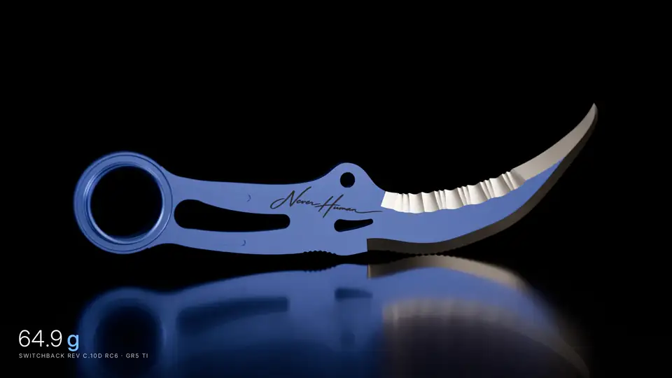
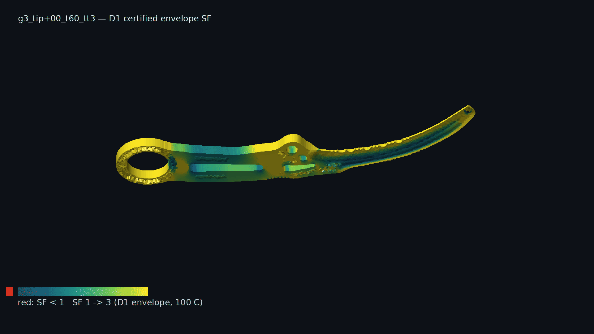
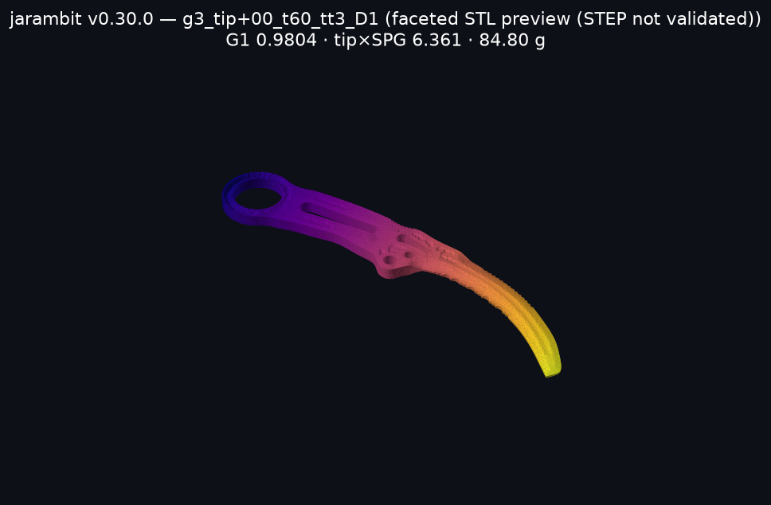
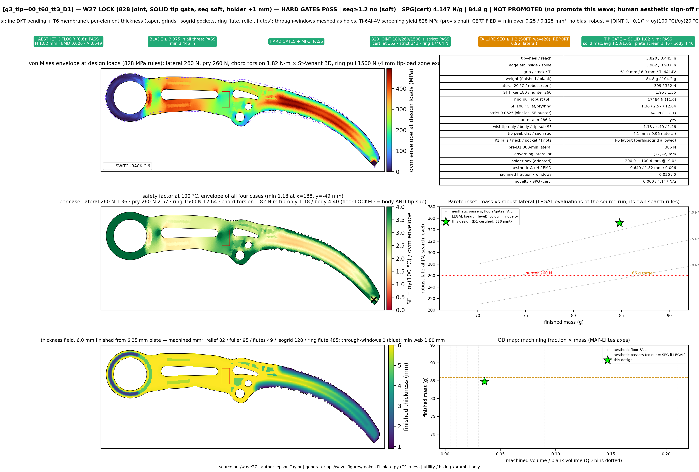
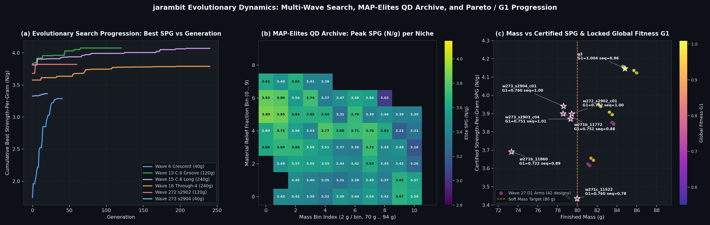
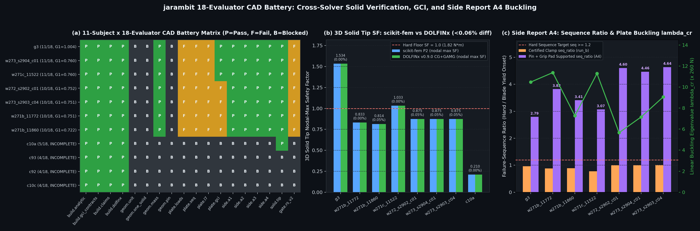
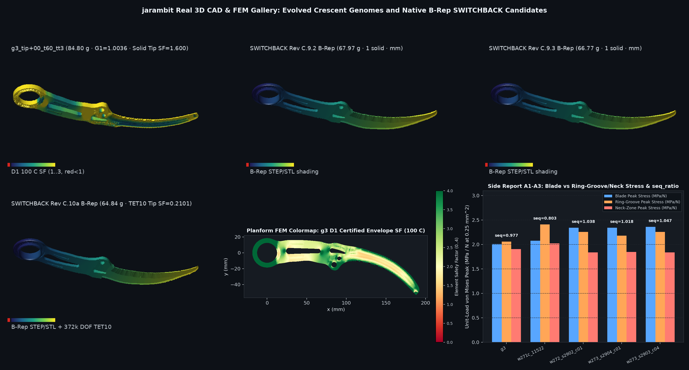
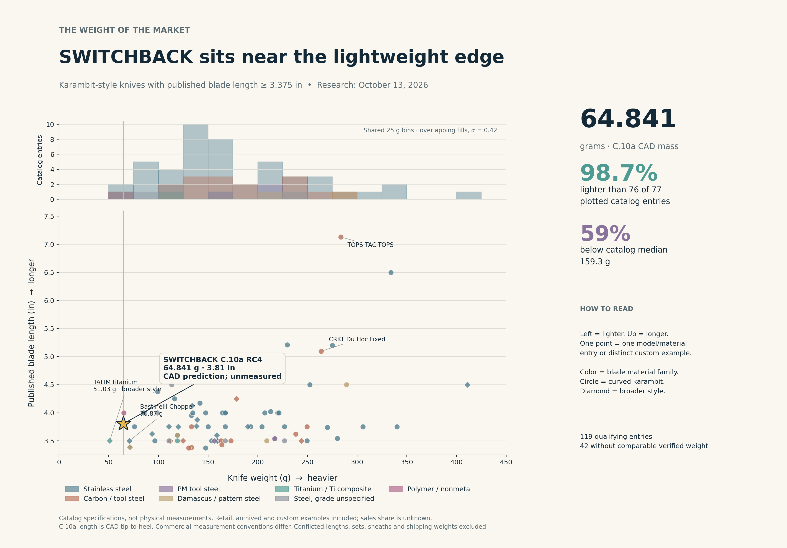

<div align="center">

<a href="https://github.com/neverhuman/jarambit/releases/download/film-c10d-rc6-v1/switchback_C10d_rc6_chat_h264.mp4"></a>

<sub>SWITCHBACK Rev C.10d rc6 · 64.9 g Gr5 Ti — <a href="https://github.com/neverhuman/jarambit/releases/download/film-c10d-rc6-v1/switchback_C10d_rc6_chat_h264.mp4">full film (1080p MP4)</a> · rendered by <code>ops/render/pro/jr_film.py</code></sub>


# 🗡️ jarambit

### Intelligence-designed titanium utility karambits — evolved, FEM-verified, Monte-Carlo-robust

<!-- GEN:HEAD:BEGIN -->
[](https://github.com/neverhuman/jarambit/releases/tag/v0.32.3)
[](docs/GLOBAL_METRIC.md)
[](docs/PROVISIONAL.md)
[](docs/WHITEPAPER.md)
[](docs/PROVISIONAL.md)

**Provisional `g3_tip+00_t60_tt3` — G1 0.9804 · 84.80 g · tip SF 1.534 × SPG 4.147 = 6.361 · ring bore 25.46 mm · Ti-6Al-4V 6.0 mm**
<!-- GEN:HEAD:END -->

<!-- RS:BEGIN docs/wave27_diversity/plates/wave27_D1_index.json g3_tip+00_t60_tt3_D1 -->
RS-karambit-v1: screen PASS · promotion FAIL (seq 0.959 < 1.2) · soft: mass 84.80 g over 80 g target (G penalty) · human aesthetic sign-off pending · not promoted
<!-- RS:END -->

Verdicts are scoped to a requirement set (`requirements/RS-karambit-v1.toml`): *screen* = geometry + aesthetic floor + 828 MPa joint floors + twist + solid tip; *promotion* adds strict hunter lateral and seq ≥ 1.2. Mass is **soft** (Jepson, 2026-10-12): a strong penalty in G and a search target (< 80 g first, then < 70 g), never a promotion gate.

<!-- GEN:FIGS:BEGIN -->
📄 [White paper](docs/WHITEPAPER.md) · 📐 [Engineering gates & evolution paper](docs/ENGINEERING_GATES_AND_EVOLUTION.md) · ⚖️ [Patent draft (not filed)](docs/PATENT_DRAFT.md) · 📦 [Release v0.32.3](https://github.com/neverhuman/jarambit/releases/tag/v0.32.3) · 🗺️ [Technology map](TECHNOLOGY_MAP.md)



*360° turntable (`ops/render/turntable.py`, manifest `docs/media/g3_tip+00_t60_tt3_turntable.gif.manifest.json`): faceted STL, colour = D1 certified envelope SF at 100 °C (red < 1).*





*Top: faceted STL preview, not a validated STEP. The wave27 STEP imports as an unsewable shell, so the whole-part solid mesh uses the STL twin (84.86 g vs 84.80 g). Colour = position along the blade. Bottom: **historical** wave27 D1 plate (RS-karambit-v1 W27 screen scope; it labels seq SOFT, which RS-karambit-v2 makes HARD). Solid-tip SF 1.534 at the production mesh.*







*Engineering gates & evolutionary verification gallery (`ops/render/engineering_gates_paper_figs.py`, [full paper](docs/ENGINEERING_GATES_AND_EVOLUTION.md)): (1) multi-wave evolutionary progression across W27 → W271b/c → W272 → W273 → W274 → W275 → W276 and C9.2–C10c B-rep studies; (2) 18-evaluator CAD battery status matrix, 3-level P2 tetrahedral Roache GCI convergence, and independent `dolfinx` vs `skfem` cross-solver verification; (3) real CAD thickness fields $t(x,y)$ and certified DKT+CST von Mises stress fields across evolved genomes and B-rep candidates.*
<!-- GEN:FIGS:END -->

> **SWITCHBACK Rev C.9.3 (rc3, current RC)** — [`designs/switchback/C9.3/`](designs/switchback/C9.3/README.md): B-rep STEP, drawings and FEM plates from the hiking-karambit study; all C.9-study gates V1–V8 pass with ≥ 5 % margin (governor V3 spine SF 1.597, 66.773 g). C.9.3 is a release candidate, not the design of record: the gates are the C.9 study set, not an RS-karambit-v2 verdict from this repo, and nothing is machined or tested.
>
> SWITCHBACK Rev C.9.2 (rc2, previous RC) — [`designs/switchback/C9.2/`](designs/switchback/C9.2/README.md): release candidate, not the design of record; superseded by C.9.3 (its V6 lateral-pry margin was 1.9 %, below the 5 % promotion rule).

</div>

<!-- MARKET:CENSUS:BEGIN -->
## Market weight comparison

The source-audited [October 13, 2026 census](docs/market/2026-10-13/README.md) consolidates eight supplied CSVs plus an additional qualifying polymer model. **119 identifiable entries meet the published 3.375 in blade minimum; 77 have comparable verified published knife weights.** Color-only duplicates are consolidated; genuine material variants and distinct custom examples remain separate. Missing weights and unresolved candidates stay visible in the evidence tables.



**SWITCHBACK C.10a RC4: 64.841 g, CAD prediction.** Nominally lighter than 76 of 77 plotted entries (98.7%); 59.3% below their 159.32 g median. TALIM titanium lists 51.03 g, so this does not support a lightest-overall claim. C.10a is a release candidate, unmanufactured and untested; `g3_tip+00_t60_tt3` remains the historical 84.80 g design of record. Listed commercial lengths use different measurement conventions, and material/weight comparisons establish no performance equivalence.

[Transparent material histogram](docs/market/2026-10-13/figures/weight_histogram.png) · [Every weight by exact grade](docs/market/2026-10-13/figures/weight_by_grade.png) · [Catalog by material](docs/market/2026-10-13/qualified_by_material.csv) · [Missing/conditional candidate queue](docs/market/2026-10-13/review_queue.csv)
<!-- MARKET:CENSUS:END -->

<!-- GEN:RELEASE:BEGIN -->
## Release v0.32.3 — what is measured, and under which requirement set

Generated by `ops/ci/gen_readme.py` from committed evidence; CI fails if this section is stale. Release notes: [docs/RELEASES.md](docs/RELEASES.md) · [v0.32.3](https://github.com/neverhuman/jarambit/releases/tag/v0.32.3).

### Hard floors and design-engine objective (crescent, `crates/crescent/src/qd.rs`)

- **Hard (feasibility):** aesthetic floor, geometric gates, robust lateral ≥ 260 N (hunter) and ≥ 180 N (hiker), ring pull ≥ 1500 N, failure sequence seq ≥ 1.2 (**HARD**, `RS-karambit-v2`), chord twist 1.82 N·m with body AND 4–15 mm tip SF ≥ 1.
- **Search fitness (feasible designs):** F = 1 + ln(84.8 g / m) (slope × 0.25 below 70 g) − 0.4·(1 − exp(−30·((m − 80)/80)²)) above 80 g + 0.03·margin bonus + 0.02·aesthetic + 0.02·novelty. Infeasible designs score < 0 (graded).
- **Mass is SOFT:** 80 g target, 70 g stretch — a strong G penalty, never a cap or gate.
- **G1** (`docs/GLOBAL_METRIC.md`) is the locked cross-wave *reporting* metric for design snapshots; it is not the search fitness.

### 3D CAD breakdown — `g3_tip+00_t60_tt3` (grind law `evidence/wave27/g3_tip+00_t60_tt3_grind_law.json`, analytic grind law (D1 item 4); NOT a B-rep)

| feature | value | source |
|---|---|---|
| material / stock | Ti-6Al-4V, 6.0 mm | grind law |
| distal taper | 6.0 → 3.096 mm from x = 134.6 to 192.1 mm | grind law |
| inner edge grind | half-angle 21.94°, edge thickness 0.90 mm | grind law |
| spine edge grind | half-angle 22.00°, edge thickness 0.90 mm | grind law |
| blade | tip-to-heel 97.02 mm, reach 87.49 mm, arcs 101.14 / 101.26 mm | D1 record |
| ring | nominal ID 25.466 mm (genome; measured bore 25.46 mm), wall 5.74 mm, neck fillet 17.76 mm | genome |
| grip / relief | grip 61.0 mm, relief fraction 0.0409, min web 1.8 mm, perforations 1 | D1 record |
| mass | 84.80 g (blank 104.16 g); STL solid mesh 84.86 g | D1 record, verify_0.30.2 |
| CAD artifacts | faceted STL (watertight); STEP is an unsewable shell — **not validated** | verify_0.30.2 |

Ring handling (RS-karambit-v2, 40-design cohort, `docs/calibration/t1_t2.md`): finger-bearing width (bore length along the finger axis) 4.5–5.3 mm vs ≥ 10 mm required (0/40); bore edge radius ≥ 1.5 mm is an export specification. A ring flare / 3D ring lip is not expressible by the current genotype (roadmap PR-0.33.4).

### FEM results

Provisional `g3_tip+00_t60_tt3` (plate mesh: certified min(0.25, 0.125) mm² element area, 828 MPa joint thin+hot; RS-karambit-v1 scope):

| quantity | value |
|---|---|
| robust lateral / hunter SF / hiker SF | 351.7 N / 1.353 / 1.954 |
| robust ring pull / SF | 17464 N / 11.64 |
| chord twist SF tip / body / tip zone (certification mesh) | 1.176 / 4.40 / 1.385 |
| strict D1 mesh (0.0625 mm²): hunter capacity / SF | 340.8 N / 1.311 |
| strict D1 mesh (0.0625 mm²): 4–15 mm tip-submodel twist SF | 1.458 |
| failure sequence seq | 0.959 (HARD ≥ 1.2: **not met**, governs `lateral`) |
| SPG | 4.147 N/g |
| solid tip SF (dolfinx P2, 1.82 N·m) production / fine | 1.534 (422955 dofs) / 1.600 [1.572, 1.630] (3169395 dofs), GCI_fine 1.80 % |
| solver verification | St-Venant torsion 0.25 %, Kirsch 3D 0.73 %, dolfinx vs skfem 6.5e-05 |

RS-karambit-v2 structural cases — first-yield safety factors (L7: fatigue/endurance SF, Marin + modified Goodman) on the 40-design `bench/fixed_1k` cohort (cohort results, not a re-assessment of `g3_tip+00_t60_tt3`; RS-v2 is evaluated but does not yet gate search):

| case (RS-karambit-v2) | SF min / median / max | meets SF ≥ 1 |
|---|---|---|
| twist 16.2 N·m | 0.044 / 0.060 / 0.075 | 0 / 40 |
| tip in-plane 1000 N | 0.421 / 0.586 / 0.694 | 0 / 40 |
| spine 3427 N | 0.295 / 0.449 / 0.502 | 0 / 40 |
| L6 ring-back 3000 N (static equivalent, **PROVISIONAL**) | 1.492 / 2.009 / 2.122 | 40 / 40 |
| L7 fatigue, lateral 0..180 N, Marin + Goodman | 0.612 / 0.724 / 0.807 | 0 / 40 |
| all human_max cases | — | **0 / 40** |

### RS-karambit-v2 hard-gate verdicts — named designs (`evidence/rs_v2/*.json`, `jarambit rs-v2-eval`: certification + strict 0.0625 mm² + solid tip evidence)

| design | mass g | screen (v1: gates, 828 floors, twist body + strict tip-sub, solid tip) | strict hunter lateral | seq ≥ 1.2 | human_max | L7 fatigue | all hard gates | governing shortfalls / unverified |
|---|---|---|---|---|---|---|---|---|
| `g3_tip+00_t60_tt3` | 84.80 | **no** | yes | **no** | **no** | **no** | **no** | gate: Holder envelope: best oriented box 200.9 x 100.4 > 200 x 100, seq 0.959, hm twist 0.132, hm tip 0.565, hm spine 0.419, fatigue 0.982, bearing 5.9 mm |
| `w271b_11772` | 78.55 | **no** | yes | **no** | **no** | **no** | **no** | strict tip-sub twist SF 0.668, solid tip SF 0.834, seq 0.882, hm twist 0.076, hm tip 0.597, hm spine 0.418, fatigue 0.856, bearing 5.1 mm |
| `w271b_11860` | 73.33 | **no** | yes | **no** | **no** | **no** | **no** | strict tip-sub twist SF 0.716, seq 0.892, hm twist 0.075, hm tip 0.528, hm spine 0.384, fatigue 0.756, bearing 4.7 mm, unverified: solid_tip_sf |
| `w271c_11522` | 79.96 | **no** | yes | **no** | **no** | **no** | **no** | strict tip-sub twist SF 0.842, seq 0.778, hm twist 0.097, hm tip 0.574, hm spine 0.419, fatigue 0.767, bearing 4.8 mm, unverified: solid_tip_sf |

**0 of 4 named designs pass every RS-karambit-v2 hard gate.** An unverified gate (no evidence) never counts as met. No design is promoted.

### 14-Subject × 18-Evaluator CAD Battery & Multi-Wave Progression (`evidence/cad_battery/*.json`, `docs/ENGINEERING_GATES_AND_EVOLUTION.md`)

Every candidate in the 14-subject CAD battery is evaluated against all 18 standardized evaluators (`build.analytic`, `build.gci_contracts`, `build.claims`, `build.dolfinx`, `geom.unit`, `geom.one_solid`, `geom.mass`, `geom.pin`, `plate.loads`, `plate.seq`, `plate.l7`, `plate.gci`, `side.a1`–`side.a4`, `solid.tip`, `solid.whole_part`), and the `crescent-evolve` loop enforces an opt-in live CAD battery gate via `JARAMBIT_CAD_BATTERY=1` (`ops/ci/evaluate_cad_candidate.py`). Full methodology and derivations: [docs/ENGINEERING_GATES_AND_EVOLUTION.md](docs/ENGINEERING_GATES_AND_EVOLUTION.md).

| subject | role | mass (g) | hunter lat (N) / SPG (N/g) | cert `seq_ratio` | Winkler+bore `seq` (`side.a4`) | buckling $P_{\text{cr}}$ (N) | P2 solid tip SF (`dolfinx` / `skfem`, $\Delta$) | 18-case tally (`pass` / `fail` / `blocked`) |
|---|---|---|---|---|---|---|---|---|
| `g3` | `genome` | 84.80 | 351.7 / 4.147 | 0.959 | 2.790 | 2723 | 1.534 / 1.534 (0.00 %) | `11 / 4 / 3` |
| `w276_s2913_c01` | `genome` | 79.99 | 274.8 / 3.435 | 1.213 | 4.096 | 2343 | 1.339 / 1.339 (0.02 %) | `11 / 4 / 3` |
| `w275_s2909_c01` | `genome` | 81.77 | 274.4 / 3.356 | 1.206 | 3.373 | 3412 | 1.297 / 1.297 (0.02 %) | `11 / 4 / 3` |
| `w274_s2905_c01` | `genome` | 84.98 | 267.7 / 3.150 | 1.273 | 2.721 | 2693 | 1.304 / 1.304 (0.00 %) | `11 / 4 / 3` |
| `w273_s2904_c01` | `genome` | 78.59 | 309.7 / 3.940 | 1.001 | 4.465 | 1861 | 0.875 / 0.875 (0.05 %) | `11 / 4 / 3` |
| `w271c_11522` | `genome` | 79.96 | 274.7 / 3.435 | 0.778 | 3.067 | 2934 | 1.033 / 1.033 (0.00 %) | `11 / 4 / 3` |
| `w272_s2902_c01` | `genome` | 79.43 | 309.7 / 3.899 | 1.000 | 4.604 | 1473 | 0.875 / 0.875 (0.05 %) | `10 / 5 / 3` |
| `w273_s2903_c04` | `genome` | 79.30 | 307.0 / 3.871 | 1.009 | 4.637 | 2356 | 0.875 / 0.875 (0.05 %) | `10 / 5 / 3` |
| `w271b_11772` | `genome` | 78.55 | 306.3 / 3.900 | 0.882 | 3.820 | 2958 | 0.833 / 0.833 (0.00 %) | `10 / 5 / 3` |
| `w271b_11860` | `genome` | 73.33 | 270.6 / 3.691 | 0.892 | 3.406 | 1892 | 0.814 / 0.814 (0.05 %) | `10 / 5 / 3` |
| `c10a` | `native_cad` | 64.84 | *blocked (B-rep)* | *blocked* | *blocked* | *blocked* | *blocked* | `9 / 0 / 9` |
| `c93` | `native_cad` | 66.77 | *blocked (B-rep)* | *blocked* | *blocked* | *blocked* | *blocked* | `8 / 0 / 10` |
| `c92` | `native_cad` | 66.76 | *blocked (B-rep)* | *blocked* | *blocked* | *blocked* | *blocked* | `8 / 0 / 10` |
| `c10c` | `archived_not_on_main` | 67.09 | *blocked (B-rep)* | *blocked* | *blocked* | *blocked* | *blocked* | `7 / 1 / 10` |

**Battery total across 14 subjects × 18 evaluators (252 cells):** `138 pass`, `45 fail`, `69 blocked`. Every genome subject (`10/10`) clears the `side.a4` Winkler grip-foundation + radial/tangential bore-pin sequence check and linear buckling ($P_{\text{cr}} \gg 260\text{ N}$), and agrees within $\le 0.45\%$ between independent `dolfinx` and `skfem` 3D P2 solid-tip solves; `w276_s2913_c01` (`80.00 g` / `79.995 g`, `G1 = 0.8323`, `W_CAD = +1.6381`), `w275_s2909_c01` (`81.77 g`, `G1 = 0.8015`, `W_CAD = +1.5589`), and `w274_s2905_c01` (`84.98 g`, `G1 = 0.7701`, `W_CAD = +1.4634`) clear both certified `seq_ratio >= 1.20` and 3D P2 solid-tip `SF >= 1.0`.

### 178-Group (356-Control) Scientific Assurance Catalog (`T00`–`T19`, `docs/v1/science/tests/TEST_CASE_CATALOG.json`)

All scientific evaluators, mesh-convergence gates, CAD hygiene checks, and reporting claims are guarded by **178 paired positive/negative control groups (356 controls)** across 20 topic families (`T00`–`T19`), verified in one command via `python3 -B ops/ci/science_suite.py`:

- **`T00`–`T04` (Governance, Authority & Evidence Binding):** `T00` metric & gate governance (`T00-01`..`10`), `T01` claim & authority admission (`T01-01`..`10`), `T02` artifact & provenance integrity (`T02-01`..`10`), `T03` CAD B-rep & mesh hygiene (`T03-01`..`10`), `T04` mass, density & volume accounting (`T04-01`..`10`).
- **`T05`–`T11` (Continuum Mechanics, 3D Solid FEM & Solver Verification):** `T05` boundary conditions & load application (`T05-01`..`10`), `T06` constitutive & thermal knockdown (`T06-01`..`10`), `T07` DKT+CST plate element formulation (`T07-01`..`10`), `T08` 3D P2 tetrahedral solid FEM (`T08-01`..`10`), `T09` Roache GCI & Richardson extrapolation (`T09-01`..`10`), `T10` T1→T2 calibration & bias factors (`T10-01`..`10`), `T11` linear solver & cross-solver reproducibility (`T11-01`..`08`).
- **`T12`–`T19` (Failure Sequence, Fatigue, Monte Carlo, QD Search & Release Integrity):** `T12` failure sequence & Winkler/bore support physics (`T12-01`..`09`), `T13` Marin + Goodman high-cycle fatigue (`T13-01`..`08`), `T14` ergonomics, ring bore & sheath retention (`T14-01`..`09`), `T15` Monte Carlo tolerance & thermal cloud (`T15-01`..`08`), `T16` evolutionary QD search & archive invariants (`T16-01`..`09`), `T17` market census & comparative claims (`T17-01`..`08`), `T18` figure, turntable & media provenance (`T18-01`..`09`), `T19` end-to-end release & battery coherence (`T19-01`..`10`).

### Calibration and solver speed

| T1 → T2 case | factor | residual σ | σ ≤ 7 % |
|---|---|---|---|
| lat_rob | 0.947 | 6.5 % | yes |
| ring_rob | 1.059 | 5.5 % | yes |
| twist_joint | 0.865 | 10.8 % | **no** (gated on T2 only) |
| pry20 | 0.924 | 3.3 % | yes |

`bench/fixed_1k` on xbabe3 (core-s per design, median of 3 reps): T1 search 2.146 (skyline) / 2.028 (faer); T1c cert 26.31 (skyline) / 6.74 (faer). The default solver is **skyline**: faer drifts 2.6e-08 per design (sum 8.7e-09) vs skyline, above the 1e-09 bar (issue #32); faer is opt-in with `JARAMBIT_SOLVER=faer`.
<!-- GEN:RELEASE:END -->

---

| | |
|---|---|
| 🧬 **Genotype** | 40 outline control points + ~100 feature genes (stock/tip law, rails, ring channels), red-team validators reject; during search, infeasible designs are ranked below feasible ones with graded negative scores (never eligible for promotion) |
| 🧊 **Phenotype** | outline + thickness field → watertight STL + faceted STEP (export not yet validated as a sewn solid) |
| 🔥 **FEM** | DKT + CST plate screen (828 MPa joint, thin+hot) + P2 solid tip submodel (dolfinx, mesh-converged; see Release) |
| 🧪 **CAD Battery** | 18 standardized evaluators per subject (`build.*`, `geom.*`, `plate.*`, `side.a1`–`a4`, `solid.*`) + 178-group (356-control) scientific assurance suite (`T00`–`T19`) |
| 🎲 **Monte Carlo** | tolerances × −10…100 °C, p05 strength-per-gram (legacy NSGA-II lane) |
| 🧭 **Evolution** | two engines: legacy NSGA-II islands (`crates/evolve`) and the crescent island GA + novelty + MAP-Elites archive (`crates/crescent/src/qd.rs`, used for all recent waves); one locked GLOBAL metric **G1** across waves |

> No design is promoted to manufacturing. 828 MPa is a provisional screening yield; seq ≥ 1.2 is HARD (RS-karambit-v2); mass is soft; human aesthetic sign-off pending.

## Install

### Prerequisites
- **Rust toolchain** (`rustup` stable, `cargo` 1.75+): builds the `jarambit` CLI and all 11 workspace crates (`crates/*`).
- **Python 3.11+**: runs the scientific assurance suite (`ops/ci/science_suite.py`), the 18-case CAD battery (`ops/ci/cad_battery.py`), live candidate evaluation (`ops/ci/evaluate_cad_candidate.py`), and deterministic documentation/figure generators (`numpy`, `scipy`, `matplotlib`, `Pillow`, `gmsh`, `scikit-fem` optional for local 3D solid cross-checks).
- **Docker** *(optional)*: required only when re-running the containerized FEniCSx `dolfinx` v0.9.0 3D P2 solid-tip cross-check (`fem_solid/cross_check.py`).

### Build from source
```bash
git clone https://github.com/neverhuman/jarambit.git
cd jarambit
cargo build --release
cargo test --release
```

## Quick start

```bash
# 1. Re-screen a committed crescent genome (certification + strict 0.0625 mm² DKT+CST plate + 18-case CAD battery + G1)
./target/release/jarambit crescent-d1 \
  --genomes w276_s2913_c01=evidence/rs_v2/w276_ultrarunner/w276_s2913_c01_genome.csv \
  --threads 4 --out /tmp/jarambit_quickstart_d1
python3 -B ops/ci/cad_battery.py \
  --evaluate-genome w276_s2913_c01=evidence/rs_v2/w276_ultrarunner/w276_s2913_c01_genome.csv \
  --analytic pass --gci pass --claims pass --dolfinx pass \
  --out-dir /tmp/jarambit_quickstart_battery

# 2. Run a crescent MAP-Elites + island GA evolutionary search with the live CAD battery gate enabled
JARAMBIT_CAD_BATTERY=1 ./target/release/jarambit crescent-evolve \
  --gens 2 --pop 12 --islands 2 --threads 8 --seed 2913 \
  --seeds evidence/rs_v2/w276_ultrarunner/w276_s2913_c01_genome.csv \
  --out /tmp/jarambit_quickstart_evolve

# 3. Verify the committed 14-subject × 18-evaluator CAD battery and the 178-group (356-control) scientific assurance suite
python3 -B -m unittest ops.ci.tests.test_cad_battery -v
python3 -B ops/ci/science_suite.py inventory
python3 -B -m unittest discover -s research/science_v1 -p "test_*.py" -v

# 4. Verify deterministic engineering-gates figures and public documentation blocks
python3 -B ops/ci/verify_figures.py
python3 -B ops/ci/gen_readme.py --check
python3 -B ops/ci/gen_whitepaper.py --check
python3 -B ops/ci/gen_status.py --check
```

## Engine

Rust workspace for intelligence-designed + Monte Carlo evolution of **SWITCHBACK-class titanium hiking/utility karambits**.

Invariants (red-team enforced, see [docs/WHITEPAPER.md](docs/WHITEPAPER.md) §III-A and [docs/ENGINEERING_GATES_AND_EVOLUTION.md](docs/ENGINEERING_GATES_AND_EVOLUTION.md)): blade **≥ 3.375 in (85.725 mm, +0.5 mm guard) on tip-to-heel AND horizontal reach AND sharpened-edge arc; sharpened edge ≤ 4.0 in** · grip ≥ 60 mm (60–80) · finger ring 25.4 mm ID · curved blade · double-edged, both edges serrated · single connected solid · flat brand pad · 0.1 mm thickness precision · titanium only · sheath/holder pop-in interface ([docs/HOLDER_ENVELOPE.md](docs/HOLDER_ENVELOPE.md)).

**Design-engine objective:** the crescent lane uses hard feasibility floors plus a log mass reward and a strong soft over-80 g penalty (see *Release* above). The legacy NSGA-II lane (`crates/evolve`) optimises MC-p05 strength-per-gram subject to the same strength floors.

**Version:** see `docs/VERSION`. **Engineering gates & evolution paper:** `docs/ENGINEERING_GATES_AND_EVOLUTION.md`. **Whitepaper:** `docs/WHITEPAPER.md`. **Map:** `TECHNOLOGY_MAP.md`. **Global metric:** `docs/GLOBAL_METRIC.md`. **Status:** `STATUS.md`.

## Crates
| crate | role |
|---|---|
| `genotype` | legacy 20-gene vector (the crescent lane uses 128 genes, `crates/crescent/src/genome.rs`) + titanium grade, bounds, mutate/crossover, deterministic RNG |
| `phenotype` | outline and ring → watertight STL and faceted `MANIFOLD_SOLID_BREP` STEP |
| `physics` | beam surrogate for Monte Carlo; Kirchhoff plate (DKT + membrane) as a separate check |
| `monte_carlo` | exact-n tolerance cloud, thread-stable seeds, cut-media mix, p05 |
| `evolve` | NSGA-II with islands, migration, checkpoint/resume; primary objective is p05 strength-per-gram |
| `redteam` | hooked planform, double serrations, connected solid, holder insertion/draw, blade limits |
| `holder` | kinematic insertion/retention envelope and sheath detent geometry checks (`docs/HOLDER_ENVELOPE.md`) |
| `evidence` | schema-validated evidence manifests, SHA-256 provenance binding, and artifact verification helpers |
| `docs` | report tables for `docs/WHITEPAPER.md` |
| `crescent` | **current design lane**: 128-gene crescent genotype (`genome.rs`), phenotype + thickness field, gates, aesthetic floor (C.6), DKT+CST plate FEM certification, D1 gates, island GA + MAP-Elites (`qd.rs`), serde-typed records (`record.rs`) |
| `cli` | `jarambit` binary (`crescent`, `rs-v2-eval`, `t1-t2-cal`, and legacy NSGA-II modes) |

## Run
```bash
cargo build --release
./target/release/jarambit --gens 20 --pop 16 --islands 4 --mc 10000 --threads 16 --seed 42 --out out/nsga20
cargo test --release
```
`--threads` is capped by `JARAMBIT_MAX_THREADS` (default 48). `--pop` is per island. `--resume` continues from `{out}/checkpoint.txt`.

Outputs: `history.csv`, `pareto.csv/svg`, `diversity.svg`, `fitness.svg`, `quarantine.csv`, `best.stl/step/svg`, `best_report.md`, `results.md`, `checkpoint.txt`. The report's strength is the beam surrogate; `plate FEM` is one 20 °C solve of the winner. By default the search uses the uncalibrated beam surrogate; set `JARAMBIT_FEM=1` to search with that plate level (`--fine` / `JARAMBIT_FINE=1` selects the fine plate). The sample loop stays the beam model and only supplies the knockdown. Do not `--resume` a surrogate checkpoint with plate fitness, or the reverse.

A 60-generation multi-host search (`mh1`, 20 island pairs, 10k or 50k samples) was started on 2026-10-11. See `briefs/MULTIHOST_2026-10-11.md` and `COORD.md` before launching another large run on the same hosts.

Coordination: see `COORD.md` and `COMMS.md`. Papers: `docs/WHITEPAPER.md` and `docs/ENGINEERING_GATES_AND_EVOLUTION.md`.
