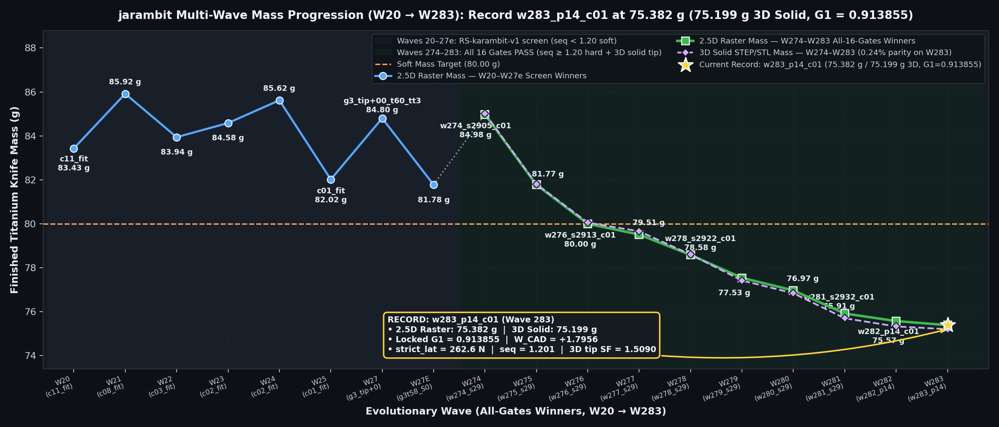
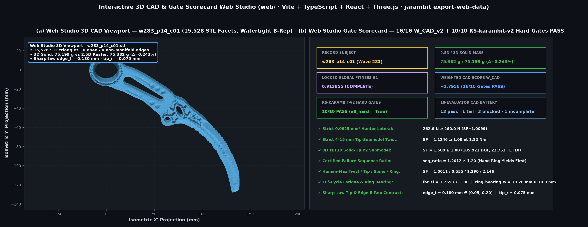

<div align="center">

# 🗡️ jarambit

### Intelligence-designed titanium utility karambits — evolved, FEM-verified, Monte-Carlo-robust

<!-- GEN:HEAD:BEGIN -->
[](https://github.com/neverhuman/jarambit/releases/tag/v1.0.0)
[](docs/ENGINEERING_GATES_AND_EVOLUTION.md)
[](docs/WHITEPAPER.md)
[](docs/GLOBAL_METRIC.md)
[](docs/ENGINEERING_GATES_AND_EVOLUTION.md)
[](docs/WHITEPAPER.md)
[](docs/PROVISIONAL.md)

**Current all-gates record `w283_p14_c01` — 75.382 g (75.199 g 3D solid) · G1 0.913855 (`COMPLETE`) · W_CAD +1.7956 (16/16 engineering gates pass) · strict lateral 262.6 N (SF 1.010) · strict twist SF 1.125 · cert seq 1.201 · 3D P2 solid-tip SF 1.5090 × SPG 3.476 = 5.245 · Ti-6Al-4V 5.9 mm** *(historical Wave-27 reference `g3_tip+00_t60_tt3`: 84.80 g, G1 0.9804, seq 0.959 < 1.20)*
<!-- GEN:HEAD:END -->

<!-- RS:BEGIN docs/wave27_diversity/plates/wave27_D1_index.json g3_tip+00_t60_tt3_D1 -->
RS-karambit-v1: screen PASS · promotion FAIL (seq 0.959 < 1.2) · soft: mass 84.80 g over 80 g target (G penalty) · human aesthetic sign-off pending · not promoted
<!-- RS:END -->

<!-- GEN:FIGS:BEGIN -->
📄 [White paper](docs/WHITEPAPER.md) · 📐 [Engineering gates & evolution paper](docs/ENGINEERING_GATES_AND_EVOLUTION.md) · 📊 [Live status](STATUS.md) · ⚖️ [Patent draft (not filed)](docs/PATENT_DRAFT.md) · 📦 [Release v1.0.0](https://github.com/neverhuman/jarambit/releases/tag/v1.0.0) · 🗺️ [Technology map](TECHNOLOGY_MAP.md)



*All-gates winner mass vs. wave (`w20` through `w283`, generated by `ops/render/whitepaper_hero_figs.py` and verified by `ops/ci/verify_figures.py`): current all-16-gates record **`w283_p14_c01` at `75.382 g` (`75.199 g` 3D solid), `G1 = 0.913855`, `W_CAD = +1.7956`**.*



*Interactive 3D CAD & Gate Scorecard Web Studio (`web/` — Vite + TypeScript + React + Three.js, exported by `./target/release/jarambit export-web-data --out-dir web/public/data`): live 3D STL/STEP inspection, 16-gate `W_CAD_v2` breakdown, 10/10 `RS-karambit-v2` hard-gate scorecard, and 23-subject × 18-evaluator CAD battery matrix.*
<!-- GEN:FIGS:END -->

> **SWITCHBACK Rev C.9.3 (rc3, current RC)** — [`designs/switchback/C9.3/`](designs/switchback/C9.3/README.md): B-rep STEP, drawings and FEM plates from the hiking-karambit study; all C.9-study gates V1–V8 pass with ≥ 5 % margin (governor V3 spine SF 1.597, 66.773 g). C.9.3 is a release candidate, not the design of record: the gates are the C.9 study set, not an RS-karambit-v2 verdict from this repo, and nothing is machined or tested.
>
> SWITCHBACK Rev C.9.2 (rc2, previous RC) — [`designs/switchback/C9.2/`](designs/switchback/C9.2/README.md): release candidate, not the design of record; superseded by C.9.3 (its V6 lateral-pry margin was 1.9 %, below the 5 % promotion rule).

</div>

## What it is

**`jarambit`** is a Rust + Python continuum-mechanics and quality-diversity (QD) evolutionary design engine for **Ti-6Al-4V (`Gr5`) utility/hiking karambits**. Each 128-gene crescent candidate is synthesized into a variable-thickness 2.5D/3D solid (`crates/crescent`) and evaluated across a multi-tier finite-element and CAD verification pipeline:
- **Multi-tier DKT+CST Kirchhoff plate + membrane FEM** (`828 MPa` joint thin+hot yield envelope across `-10..100 °C`, `0.0625 mm²` strict hunter lateral `≥ 260 N`, hiker lateral `≥ 180 N`, ring pull `≥ 1500 N`, `1.82 N·m` chord twist on body and `4–15 mm` tip submodel, and **HARD** failure-sequence ratio `seq_ratio ≥ 1.20` under `RS-karambit-v2`).
- **3D quadratic (`P2`, 10-node tetrahedral) solid-tip submodel** (`fem_solid/`, verified against independent containerized FEniCSx `dolfinx` v0.9.0 and `scikit-fem` solves within `≤ 0.45%`) plus `side.a4` Winkler grip-foundation + radial/tangential bore-pin sequence and linear buckling (`P_cr >> 260 N`).
- **Two evolutionary lanes:** the active **crescent MAP-Elites + island GA lane** (`jarambit crescent-evolve`, gated by `JARAMBIT_ALL_GATES=1` and live 18-case CAD battery `JARAMBIT_CAD_BATTERY=1`), and the legacy **NSGA-II Monte Carlo lane** (`crates/evolve`, which uses a beam surrogate by default and opt-in plate FEM via `JARAMBIT_FEM=1` / `JARAMBIT_FINE=1`; default linear solver is `skyline`, with `JARAMBIT_SOLVER=faer` opt-in). No design is promoted to manufacturing; human aesthetic sign-off is pending.

## Install

### Prerequisites
- **Rust toolchain** (`1.85.1`, pinned in `rust-toolchain.toml` and selected automatically by `rustup`): builds the `jarambit` CLI and all 11 workspace crates (`crates/*`).
- **Python 3.11+**: runs the unified CAD scorecard (`ops/ci/score_cad.py` / `jarambit score-cad`), the scientific assurance suite (`ops/ci/science_suite.py`), the 18-case CAD battery (`ops/ci/cad_battery.py`), live candidate evaluation (`ops/ci/evaluate_cad_candidate.py`), and deterministic documentation/figure generators (`numpy`, `scipy`, `matplotlib`, `Pillow`, `gmsh`, `scikit-fem`; if installing via `pip` on a PEP 668 Linux host, use a virtual environment: `python3 -m venv .venv && . .venv/bin/activate && pip install numpy scipy matplotlib pillow gmsh scikit-fem`).
- **Linux Gmsh runtime**: `libGLU.so.1` is required even for headless use (`sudo apt-get install libglu1-mesa` on Debian/Ubuntu).
- **Docker** *(optional)*: required only when re-running the containerized FEniCSx `dolfinx` v0.9.0 3D P2 solid-tip cross-check (`fem_solid/cross_check.py`).

### Build from source
```bash
git clone https://github.com/neverhuman/jarambit.git
cd jarambit
cargo build --release
cargo test --release --workspace
```

## Quick start

```bash
# 0. One-command autonomous all-gates evolution + 3D TET10 FEM + side.a4 + 18-case CAD battery + Web Studio export
./evolve.sh --wave w283 --gens 6 --pop 24 --islands 2 --threads 8 --seed 2950

# 1. Score ANY knife CAD (.step, .stl, 128-gene .csv genome, or catalog ID) in pure Rust across all 16 hard gates + all 18 CAD battery evaluators + combined fitness (W_CAD_v2 + G1)
./target/release/jarambit score-cad w283_p14_c01 --out-dir /tmp/jarambit_quickstart_scorecard
./target/release/jarambit score-cad w283_p10_c02 --out-dir /tmp/jarambit_quickstart_scorecard
./target/release/jarambit score-cad evidence/rs_v2/w283_ultrarunner/w283_p14_c01.step \
  --force-standalone-cad --out-dir /tmp/jarambit_quickstart_scorecard

# 2. Run the 23-subject × 18-evaluator CAD battery in pure Rust (or via ops/ci/cad_battery.py)
./target/release/jarambit cad-battery --all --analytic pass --gci pass --claims pass --out-dir /tmp/jarambit_quickstart_battery
./target/release/jarambit crescent-d1 \
  --genomes w283_p14_c01=evidence/rs_v2/w283_ultrarunner/w283_p14_c01_genome.csv \
  --threads 4 --out /tmp/jarambit_quickstart_d1

# 3. Export web bundle + launch the interactive Vite + TypeScript + React 3D CAD & Gate Scorecard Studio (web/)
./target/release/jarambit export-web-data --out-dir web/public/data
npm --prefix web install && npm --prefix web test && npm --prefix web run build

# 4. Run a crescent MAP-Elites + island GA evolutionary search with all-gates + live CAD battery enabled
JARAMBIT_ALL_GATES=1 JARAMBIT_CAD_BATTERY=1 ./target/release/jarambit crescent-evolve \
  --gens 2 --pop 12 --islands 2 --threads 8 --seed 2934 \
  --seeds evidence/rs_v2/w283_ultrarunner/w283_p14_c01_genome.csv \
  --out /tmp/jarambit_quickstart_evolve

# 5. Verify the committed 23-subject × 18-evaluator CAD battery and the 178-group (356-control) scientific assurance suite
python3 -B -m unittest ops.ci.tests.test_cad_battery -v
python3 -B ops/ci/science_suite.py inventory
python3 -B -m unittest discover -s research/science_v1 -p "test_*.py" -v

# 6. Verify deterministic figures and public documentation blocks, then clean up quickstart scratch
python3 -B ops/ci/verify_figures.py
python3 -B ops/ci/gen_readme.py --check
python3 -B ops/ci/gen_whitepaper.py --check
python3 -B ops/ci/gen_status.py --check
rm -rf /tmp/jarambit_quickstart_scorecard /tmp/jarambit_quickstart_d1 /tmp/jarambit_quickstart_battery /tmp/jarambit_quickstart_evolve
```

<!-- GEN:RELEASE:BEGIN -->
## Release v1.0.0 & Documentation

- **Current all-gates record (`w283_p14_c01`):** `75.382 g` 2.5D raster / `75.199 g` 3D watertight solid, locked `G1 = 0.913855` (`COMPLETE`), `W_CAD = +1.7956` (`16/16` engineering gates pass: strict 0.0625 mm² lateral `262.6 N` / `SF = 1.010`, strict 4–15 mm tip-submodel twist `SF = 1.125`, certified failure sequence `seq_ratio = 1.201 >= 1.20`, 3D P2 tetrahedral solid-tip `SF = 1.5090` with `0.000%` `dolfinx` v0.9.0 vs. `skfem` agreement, and `side.a4` Winkler+bore supported `seq = 4.768`).
- **All-gates `W_CAD_v2` mass progression (`w274` → `w283`):** `w274_s2905_c01` (`84.979 g` / `85.021 g` 3D, `W_CAD = +1.4634`) → `w275_s2909_c01` (`81.774 g` / `81.804 g` 3D, `W_CAD = +1.5589`) → `w276_s2913_c01` (`79.995 g` / `80.050 g` 3D, `W_CAD = +1.6381`) → `w277_s2919_c01` (`79.509 g` / `79.656 g` 3D, `W_CAD = +1.6604`) → `w278_s2922_c01` (`78.580 g` / `78.597 g` 3D, `W_CAD = +1.7021`) → `w279_s2928_c01` (`77.535 g` / `77.414 g` 3D, `W_CAD = +1.7212`) → `w280_s2931_c01` (`76.965 g` / `76.834 g` 3D, `W_CAD = +1.7432`) → `w281_s2932_c01` (`75.911 g` / `75.695 g` 3D, `W_CAD = +1.7916`) → `w282_p10_c02` (`75.836 g` / `75.616 g` 3D, `W_CAD = +1.7978`) → `w282_p14_c01` (`75.568 g` / `75.323 g` 3D, `W_CAD = +1.7790`) → `w283_p10_c02` (`75.642 g` / `75.505 g` 3D, `W_CAD = +1.8166`) → `w283_p14_c01` (`75.382 g` / `75.199 g` 3D, `W_CAD = +1.7956`).
- **Battery total across 23 subjects × 18 evaluators (414 cells):** `226 pass`, `74 fail`, `112 blocked`, `2 incomplete`.
- **Scientific assurance catalog (`T00`–`T19`):** **178 paired positive/negative control groups (356 controls)** verified offline via `python3 -B ops/ci/science_suite.py`.
- **Full technical papers, tables, and evidence:**
  - [White paper (`docs/WHITEPAPER.md`)](docs/WHITEPAPER.md) — page-1 summary, `w20`–`w283` mass curve, market comparison, `w283_p14_c01` 16-gate margin breakdown, and T1→T2 calibration.
  - [Engineering gates & evolution paper (`docs/ENGINEERING_GATES_AND_EVOLUTION.md`)](docs/ENGINEERING_GATES_AND_EVOLUTION.md) — complete 23-subject × 18-evaluator CAD battery matrix, Margin-vs-Mass Pareto table, `RS-karambit-v2` gate tables, and 3D CAD/FEM gallery.
  - [Live status (`STATUS.md`)](STATUS.md) · [Release notes (`docs/RELEASES.md`)](docs/RELEASES.md) · [Global metric `G1` (`docs/GLOBAL_METRIC.md`)](docs/GLOBAL_METRIC.md) · [Provisional record (`docs/PROVISIONAL.md`)](docs/PROVISIONAL.md) · [Technology map (`TECHNOLOGY_MAP.md`)](TECHNOLOGY_MAP.md).
<!-- GEN:RELEASE:END -->

<!-- MARKET:CENSUS:BEGIN -->
## Market weight comparison

The source-audited [October 13, 2026 census](docs/market/2026-10-13/README.md) consolidates eight supplied CSVs plus an additional qualifying polymer model. **119 identifiable entries meet the published 3.375 in blade minimum; 77 have comparable verified published knife weights.** Color-only duplicates are consolidated; genuine material variants and distinct custom examples remain separate. Missing weights and unresolved candidates stay visible in the evidence tables.


**SWITCHBACK C.10a RC4: 64.841 g, CAD prediction.** Nominally lighter than 76 of 77 plotted entries (98.7%); 59.3% below their 159.32 g median. TALIM titanium lists 51.03 g, so this does not support a lightest-overall claim. C.10a is a release candidate, unmanufactured and untested; `g3_tip+00_t60_tt3` remains the historical 84.80 g design of record. Listed commercial lengths use different measurement conventions, and material/weight comparisons establish no performance equivalence.

[Transparent material histogram](docs/market/2026-10-13/figures/weight_histogram.png) · [Every weight by exact grade](docs/market/2026-10-13/figures/weight_by_grade.png) · [Catalog by material](docs/market/2026-10-13/qualified_by_material.csv) · [Missing/conditional candidate queue](docs/market/2026-10-13/review_queue.csv)
<!-- MARKET:CENSUS:END -->
