# Engineering Gates, Multi-Fidelity Physics, and Evolutionary Dynamics in `jarambit`

**Authors:** Jepson Taylor & the `jarambit` Engineering/Assurance Pipeline  
**Document Version:** `0.32.9` — `2026-10-16` (synchronized with [`docs/VERSION`](VERSION) and [`docs/WHITEPAPER.md`](WHITEPAPER.md))
**Canonical Evidence Schemas:** `jarambit.cad_battery.v1` · `RS-karambit-v1` · `RS-karambit-v2` · `GLOBAL_METRIC = G1`

---

## Abstract

`jarambit` is a deterministic, Rust-native evolutionary CAD and multi-fidelity structural verification pipeline for fixed-blade titanium hiking/utility karambits (`SWITCHBACK` class, Ti-6Al-4V Grade 5 / Grade 23 ELI / Ti-6Al-2Sn-4Zr-6Mo). Unlike conventional generative design workflows that blend geometric legality, manufacturability, and structural safety into soft penalty weights, `jarambit` enforces a strict **two-tier gate hierarchy**:

1. **Hard Engineering & Manufacturability Gates (Rejections, Never Penalties):** Every candidate genotype or native B-rep CAD model is subjected to deterministic geometric, red-team, sheath/holder snap-fit, aesthetic (`C.4`/`C.5`/`C.6`), multi-mesh CST+DKT plate FEM, 3D quadratic-tetrahedron (`TET10`) tip submodel, Roache 3-mesh Grid Convergence Index (`GCI`), and `RS-karambit-v2` human-maximum / Goodman fatigue / sharpness gates. Any hard-gate violation immediately rejects the design from promotion eligibility.
2. **Locked Cross-Wave Global Fitness Metric (`G1`) & Quality-Diversity (`QD`) Search:** Across 28+ evolutionary waves (`w1` $\rightarrow$ `w27` $\rightarrow$ `w271` $\rightarrow$ `w272` $\rightarrow$ `w273` $\rightarrow$ `w274` $\rightarrow$ `w275` $\rightarrow$ `w276` $\rightarrow$ `w277` $\rightarrow$ `w278` $\rightarrow$ `w279` $\rightarrow$ `w280` $\rightarrow$ `w281` $\rightarrow$ `w282`), feasible and near-feasible designs are explored via an island genetic algorithm coupled to a 12-dimensional $k$-NN novelty archive and a 2D MAP-Elites Quality-Diversity (`QD`) grid, and ranked across waves by a single locked global metric $G_1$ ([`metrics/global_metric.py`](../metrics/global_metric.py)) guarded by a **178-group (`356`-control) scientific assurance suite** (`T00`–`T19`).

> [!IMPORTANT]
> **Honest Qualification Verdict (`RS-karambit-v1` vs `RS-karambit-v2`)**
> - Under **`RS-karambit-v1` (Screen) & `W_CAD_v2` All-Gates Calibration**, `g3_tip+00_t60_tt3` (`84.80 g`, `G1 = 1.0036` fine / `0.9804` prod, 3D solid tip $\text{SF} = 1.6003$) and `w271c_11522` (`79.96 g`, `G1 = 0.7597`, 3D solid tip $\text{SF} = 1.0330$) satisfy the 3D solid tip submodel floor ($\text{SF}_{\text{tip}} \ge 1.0$ at $1.82\text{ N}\cdot\text{m}$), `w272_s2902_c01` (`79.43 g`, $\text{seq\_ratio} = 1.0000$) and `w273_s2904_c01` (`78.59 g`, $\text{SPG} = 3.940\text{ N/g}$, $\text{seq\_ratio} = 1.0012$, `G1 = 0.7603`) push failure-sequence ratio to unity below $80\text{ g}$, and the all-gates calibrated waves `w274_s2905_c01` (`84.98 g`, $\text{seq\_ratio} = 1.273$, 3D solid tip $\text{SF} = 1.3040$, `W_CAD = +1.4634`, `G1 = 0.7701`), `w275_s2909_c01` (`81.77 g`, $\text{seq\_ratio} = 1.206$, 3D solid tip $\text{SF} = 1.2967$, `W_CAD = +1.5589`, `G1 = 0.8015`), sub-$80\text{ g}$ `w276_s2913_c01` (`79.995 g` raster / `80.050 g` 3D solid, $\text{seq\_ratio} = 1.213$, 3D solid tip $\text{SF} = 1.3393$, `W_CAD = +1.6381`, `G1 = 0.8323`), `w277_s2919_c01` (`79.509 g` raster / `79.656 g` 3D solid, $\text{seq\_ratio} = 1.218$, 3D solid tip $\text{SF} = 1.3393$, `W_CAD = +1.6604`, `G1 = 0.8348`), `w278_s2922_c01` (`78.580 g` raster / `78.597 g` 3D solid, strict lateral $273.2\text{ N}$ / $+5.1\%$ reserve, $\text{seq\_ratio} = 1.223$, $\text{twist\_tip} = 1.098$, $\text{twist\_strict} = 1.098$, 3D solid tip $\text{SF} = 1.3819$, `W_CAD = +1.7021`, `G1 = 0.8618`), `w279_s2928_c01` (`77.535 g` raster / `77.414 g` 3D solid, strict lateral $274.4\text{ N}$ / $+5.5\%$ reserve, $\text{seq\_ratio} = 1.202$, $\text{twist\_tip} = 1.123$, $\text{twist\_strict} = 1.107$, 3D solid tip $\text{SF} = 1.3866$, `W_CAD = +1.7212`, `G1 = 0.8738`), `w280_s2931_c01` (`76.965 g` raster / `76.834 g` 3D solid, strict lateral $273.4\text{ N}$ / $+5.2\%$ reserve, $\text{seq\_ratio} = 1.202$, $\text{twist\_tip} = 1.123$, $\text{twist\_strict} = 1.107$, 3D solid tip $\text{SF} = 1.3866$, `W_CAD = +1.7432`, `G1 = 0.8776`), `w281_s2932_c01` (`75.911 g` raster / `75.695 g` 3D solid, strict lateral $267.4\text{ N}$ / $+2.85\%$ reserve, $\text{seq\_ratio} = 1.212$, 3D solid tip $\text{SF} = 1.4094$, `W_CAD = +1.7916`, `G1 = 0.8808`), `w282_p10_c02` (`75.836 g` raster / `75.616 g` 3D solid, strict lateral $267.4\text{ N}$ / $+2.85\%$ reserve, $\text{seq\_ratio} = 1.215$, 3D solid tip $\text{SF} = 1.4094$, `W_CAD = +1.7978`, `G1 = 0.8811`), and lightest all-gates record `w282_p14_c01` (`75.568 g` raster / `75.323 g` 3D solid, strict lateral $262.6\text{ N}$ / $+1.00\%$ reserve, $\text{seq\_ratio} = 1.201$, 3D solid tip $\text{SF} = 1.4093$, `W_CAD = +1.7790`, `G1 = 0.8782`) simultaneously clear certified $\text{seq\_ratio} \ge 1.20$, strict hunter lateral $\ge 260\text{ N}$, strict tip-submodel twist $\text{SF} \ge 1.0$, and 3D P2 solid-tip $\text{SF} \ge 1.0$.
> - Under **`RS-karambit-v2` (v1 Promotion & Human-Maximum Gate Set)**, **0 of 21 evaluated CAD subjects** pass every hard gate (`hm_twist_sf >= 1.0` at $16.2\text{ N}\cdot\text{m}$, `hm_spine_sf >= 1.0` at $3427\text{ N}$, and `ring_bearing_w_mm >= 10.0\text{ mm}`). Consequently, **0 designs are promoted to `v1.0.0`**, and all public claims are machine-checked by [`ops/ci/check_claims.py`](../ops/ci/check_claims.py) and [`ops/ci/claim_admission.py`](../ops/ci/claim_admission.py).

---

**Wave w282 / v0.32.9 record.** **`w282_p14_c01`** (`75.568 g` raster / `75.323 g` 3D solid, `G1 = 0.878210` COMPLETE, `W_CAD = +1.7790`, `16/16` search gates pass): strict lateral `262.6 N` / `SF = 1.010` (`+1.00%` reserve), certified `seq_ratio = 1.201`, strict tip twist `SF = 1.125`, tip-only twist `SF = 1.141`, 3D P2 solid-tip `SF = 1.4093` (`0.0213%` cross-solver difference), `SPG = 3.4671 N/g`, and `side.a4 seq = 4.042` / `P_cr = 1521.57 N`; companion Pareto elite **`w282_p10_c02`** (`75.836 g` raster / `75.616 g` 3D solid, `G1 = 0.881101` COMPLETE, `W_CAD = +1.7978`, `16/16` search gates pass) achieves the highest combined `W_CAD` and `G1` among all `W_CAD_v2` waves while trimming `0.075 g` raster / `0.079 g` 3D solid off `w281_s2932_c01`. Full RS-karambit-v2 still fails human-maximum loads, L7 fatigue (`fat_sf = 0.7319` / `0.7414`), ring-bearing width (`5.26 mm < 10 mm`), and the sharp-law gate; the tip-point B-rep gate is unverified. No design is promoted.

## I. End-to-End Architecture & The 18-Evaluator CAD-to-`G1` Pipeline

Every candidate in `jarambit`—whether synthesized from the 20-gene legacy genotype ([`crates/genotype/src/lib.rs`](../crates/genotype/src/lib.rs)), the 128-gene `C.4`/`C.5`/`C.6` spline + 3D thickness/relief/lattice genotype ([`crates/crescent/src/genotype.rs`](../crates/crescent/src/genotype.rs)), or imported as a native B-rep `STEP`/`STL` solid ([`designs/switchback/`](../designs/switchback/))—passes through an 18-evaluator CAD battery ([`ops/ci/cad_battery.py`](../ops/ci/cad_battery.py)) that feeds the locked global fitness score $G_1$.

```mermaid
flowchart TD
    subgraph Genotypes["1. Genotypes & CAD Representations"]
        G20["20-Gene + TiGrade Genotype\n(crates/genotype/src/lib.rs)"]
        G128["128-Gene Crescent Spline + 3D Relief\n+ Through-Lattice + Grind Law\n(crates/crescent/src/genotype.rs)"]
        BREP["Native B-Rep STEP / Watertight STL\nSWITCHBACK C9.2 / C9.3 / C10a / C10c\n(designs/switchback/)"]
    end

    subgraph HardGates["2. Pre-FEM Geometric, Red-Team & Aesthetic Gates"]
        RT["Red-Team & Manufacturability Gates\n- 3 Blade Length Measures >= 86.225 mm, Edge <= 101.6 mm\n- Ring ID 25.4 +- 0.5 mm, Wall >= 4.5 mm, Fillet >= 8 mm\n- Ligaments >= 3.0 mm (or RAIL_W), Genus-1 Watertight\n- Double Serrated (>= 3 teeth, >= 0.05 mm ripple)\n- Stock 5.3..6.0 mm (0.1 mm quantum), Edge >= 14 deg\n- Holder Pop-In (F_ins 3..80 N, F_draw 1.5..45 N, 200x100x9 mm)\n- Brand Pad on Clear Flat"]
        AES["Automated Aesthetic Floor (C.4 / C.5 / C.6)\n- Hausdorff <= 6.0 mm, Curvature EMD <= 0.06\n- Straight Run <= C.4 + 8 mm, Blend R >= 2.0 mm\n- Spine Convex & Hawkbill Concave Continuity\n- Thumb Seat >= 0.4 mm, Guard Lobe >= 5.0 mm, Hook >= 25 mm\n- C.5 Jimping (0.45 mm +-20%) & C.6 Ring Groove (>= 2.0 mm)"]
    end

    subgraph Evaluators["3. Multi-Fidelity Structural Physics & 18-Evaluator CAD Battery"]
        PLATE["Plate CST + Batoz DKT FEM (crates/crescent/src/fem.rs)\n- 828 MPa Joint Thin (-0.1 mm) + Hot (100 C) Knockdown\n- Search (2.0 mm2, bias 1.11/1.08) -> Cert min(0.25, 0.125 mm2) -> Strict (0.0625 mm2)\n- Hiker >= 180 N, Hunter >= 260 N, Ring Pull >= 1500 N\n- Chord Torsion 1.82 N*m (Body & 4-15 mm Tip-Zone SF >= 1.0, St-Venant 3D k_c)\n- Failure Sequence Ratio seq = F_hand / F_blade >= 1.2"]
        PGCI["3-Mesh Plate GCI (plate_gci_probe + fem_solid/gci.py)\n- Areas {4.0, 1.0, 0.25} mm2 (r = 2.0), Roache GCI_fine <= 5%"]
        SOLID["3D Quadratic TET10 Solid Tip Submodel & Whole-Part\n- scikit-fem P2 (fem_solid/tip_solid.py, step_solid.py)\n- DOLFINx v0.9.0 CG+GAMG Cross-Check (rel_err < 0.06%)\n- 3-Level Solid GCI up to 3.19M DOFs"]
        SIDE["Side Reports A1-A4 (g3_side_report + ops/ci/side_a4.py)\n- A1-A3: Hand/Blade/Ring/Neck Peaks, Governor (x,y), Mesh Stability\n- A4: Radial Pin Bearing + Winkler Grip Foundation + Linear Buckling lambda_cr"]
        RSV2["RS-karambit-v2 Hard Gates & Sharpness Gate S\n- Human-Max: Twist 16.2 N*m, Spine 3427 N, Ring-Back 3000 N (DAF 2), Tip 1000 N\n- Ring Bearing Width >= 10 mm, Edge Radius >= 1.5 mm\n- L7 Fatigue: Marin + Modified Goodman (0..180 N, 1e7 cycles, SF >= 1.0)\n- Gate S: Apex <= 0.20 mm, Half-Angles <= 25 deg, Point Taper S2"]
    end

    subgraph Scoring["4. Evolutionary Search & Global Fitness G1"]
        EVO["Island GA + 12-D Novelty + 2D MAP-Elites QD\n- Cap-Free Feasible Objective F(mass, margin, aes, nov)\n- Lossless Checkpoints & Append-Only Zstd .jevl Lineage"]
        G1["Locked Global Metric G1 (metrics/global_metric.py)\n- Complete 5-Input Contract (SF_tip, SPG, aes, mass_g, seq_ratio)\n- Deletion Monotonicity & Scoped Claim Verification (T00-T19)"]
    end

    Genotypes --> HardGates --> Evaluators --> Scoring
    Scoring -. "Parent Selection / Elites / Seeds (w6 -> w282)" .-> Genotypes
```



### I-A. The 18 Standardized CAD Battery Evaluators (`jarambit.cad_battery.v1`)

Every CAD subject in [`evidence/cad_battery/*.json`](../evidence/cad_battery/manifest.json) is evaluated against the same 18-case vector defined in [`ops/ci/cad_battery.py`](../ops/ci/cad_battery.py#L48-L67):

| # | Case ID | Category | Physical / Mathematical Observable | Pass Criterion (`jarambit.cad_battery.v1`) | Primary Implementation |
|---:|:---|:---|:---|:---|:---|
| 1 | `build.analytic` | Build Gate | Analytic & manufactured solutions (`crates/fem`, `crates/crescent`, `crates/physics`, `crates/evolve`) | All Rust unit & integration tests pass | [`crates/crescent/src/fem.rs`](../crates/crescent/src/fem.rs) |
| 2 | `build.gci_contracts` | Build Gate | Roache GCI & assurance contract suite (`fem_solid/tests`, `assurance/tests`, `metrics/tests`) | All Python unit tests pass | [`fem_solid/gci.py`](../fem_solid/gci.py) |
| 3 | `build.claims` | Build Gate | Public-document claim-scope & evidence custody admission (`check_claims.py`, `claim_admission.py`) | Zero unscoped `PASS` claims; valid checkout SHA | [`ops/ci/claim_admission.py`](../ops/ci/claim_admission.py) |
| 4 | `build.dolfinx` | Build Gate | Cross-solver `DOLFINx v0.9.0` vs `scikit-fem` field semantics & representation invariants (`63` tests + `7` genomes) | `all_within_2pct == true` (actual $\le 0.05\%$) | [`fem_solid/cross_check.py`](../fem_solid/cross_check.py) |
| 5 | `geom.unit` | Geometry | Native STEP header length unit verification (`SI_UNIT(.MILLI.,.METRE.)`) | `unit == "mm"` (blocked on CSV-only genomes) | [`ops/ci/cad_battery.py`](../ops/ci/cad_battery.py#L84-L108) |
| 6 | `geom.one_solid` | Geometry | Topological connected-component / single manifold B-rep solid check | `solids == 1` | [`ops/ci/cad_battery.py`](../ops/ci/cad_battery.py#L109-L148) |
| 7 | `geom.mass` | Geometry | Volume integral $\times \rho_{\text{Ti}} = 4.43\times 10^{-3}\text{ g/mm}^3$ vs reference mass | $|\Delta m| \le 0.5\text{ g}$ and finite mass in $[1, 1000]\text{ g}$ | [`crates/crescent/src/stl.rs`](../crates/crescent/src/stl.rs) |
| 8 | `geom.pin` | Geometry | Bore diameter $25.4 \pm 0.5\text{ mm}$ and bore-axis bearing width | Bore clean, pin-ready | [`crates/crescent/src/outline.rs`](../crates/crescent/src/outline.rs) |
| 9 | `plate.loads` | Plate FEM | Cert-mesh (`min(0.25, 0.125) mm²`) + strict (`0.0625 mm²`) load capacities & human-max plate loads | `floors_ok` **and** `hm_spine_sf >= 1` **and** `hm_ringback_sf >= 1` | [`crates/crescent/src/fem.rs`](../crates/crescent/src/fem.rs#L653-L799) |
| 10 | `plate.seq` | Plate FEM | Hand-zone vs blade-zone yield-onset ratio $\text{seq\_ratio} = F_{y,\text{hand}} / F_{y,\text{blade}}$ | $\text{seq\_ratio} \ge 1.20$ on unbiased $0.25\text{ mm}^2$ mesh | [`crates/crescent/src/fem.rs`](../crates/crescent/src/fem.rs#L748-L770) |
| 11 | `plate.l7` | Plate FEM | `L7` Marin-corrected modified Goodman high-cycle fatigue ($0 \leftrightarrow 180\text{ N}$, $10^7$ cycles) + `hm_twist` | `l7_goodman_sf >= 1.0` **and** `hm_twist_sf >= 1.0` | [`crates/crescent/src/rs_v2.rs`](../crates/crescent/src/rs_v2.rs#L80-L120) |
| 12 | `plate.gci` | Plate GCI | 3-mesh Roache GCI across `max_area` $\in \{4.0, 1.0, 0.25\}\text{ mm}^2$ ($r = 2.0$) | Convergent / bounded `GCI_fine <= 5%` on `seq_ratio` & `sf_hunter` | [`plate_gci_probe.rs`](../crates/crescent/examples/plate_gci_probe.rs) |
| 13 | `side.a1` | Side Report | Zone stress decomposition (`blade`, `bore_rim`, `groove`, `neck`, `other`) + Weibull $A_{\text{eff}}$ ($m \in \{10,20,30\}$) | Complete zone peak & $A_{\text{eff}}$ report at $4\text{ mm}$ & $15\text{ mm}$ tip exclusions | [`g3_side_report.rs`](../crates/crescent/examples/g3_side_report.rs) |
| 14 | `side.a2` | Side Report | Governing element $(x,y)$ coordinates, radius from bore center, and distance to C.6 groove annulus | Complete governor localization across all load cases | [`g3_side_report.rs`](../crates/crescent/examples/g3_side_report.rs) |
| 15 | `side.a3` | Side Report | Unbiased mesh stability across $0.25$, $0.125$, and $0.0625\text{ mm}^2$ (`seq_ratio` and zone peaks) | Complete 3-tier mesh-stability table | [`g3_side_report.rs`](../crates/crescent/examples/g3_side_report.rs) |
| 16 | `side.a4` | Side Report | Radial pin bearing + Winkler grip pad foundation + linear plate buckling eigenvalue $\lambda_{\text{cr}}$ | `supported_seq_ratio > certified_seq_ratio` and $\lambda_{\text{cr}} > 1.0$ | [`ops/ci/side_a4.py`](../ops/ci/side_a4.py) |
| 17 | `solid.tip` | 3D Solid FEM | Quadratic `TET10` (`P2`) 3D tip submodel ($R_{\text{cut}} = 30\text{ mm}$, $1.82\text{ N}\cdot\text{m}$ chord torsion, $4\text{--}15\text{ mm}$ ROI) | Nodal-max $\text{SF}_{\text{tip}} > 0$ and `DOLFINx` vs `scikit-fem` diff $\le 2\%$ | [`fem_solid/tip_solid.py`](../fem_solid/tip_solid.py), [`step_solid.py`](../fem_solid/step_solid.py) |
| 18 | `gate.rs_v2` | Promotion Gate | Full `RS-karambit-v2` hard-gate conjunction (`w20_hard_pass`, `solid_tip_sf >= 1`, `seq >= 1.2`, `hm_* >= 1`, `l7 >= 1`, `bearing_w >= 10`) | `overall_pass == true` | [`crates/crescent/src/rs_v2.rs`](../crates/crescent/src/rs_v2.rs) |

### I-B. Unified Turnkey CAD $\rightarrow$ All-Gates + Combined Fitness Scoring (`jarambit score-cad`)

Both the 16-gate `W_CAD_v2` certification pipeline and the 18-evaluator CAD battery are wired into the standard Rust CLI ([`crates/cli/src/main.rs`](../crates/cli/src/main.rs), [`crates/cli/src/crescent.rs`](../crates/cli/src/crescent.rs)) and [`ops/ci/score_cad.py`](../ops/ci/score_cad.py) so that **any** knife CAD or genome can be scored end-to-end in a single command:

- **Turnkey CAD Scorecard (`jarambit score-cad <input>` / `python3 -B ops/ci/score_cad.py <input>`)**: Accepts any `.step`/`.stp`, `.stl`, 128-gene `.csv` genome, or catalog subject ID, evaluates **all 16 hard engineering/CAD/archetype gates** AND **all 18 CAD battery evaluators**, and emits a unified Master CAD Scorecard (`<subject>_scorecard.json` + `<subject>_scorecard.md`) containing both `W_CAD_v2_ultrarunner_karambit` (with 5-component weighted breakdown) and the locked cross-wave global fitness `G1` (with 5-term breakdown). Passing `--force-standalone-cad` evaluates any arbitrary 3D `.step` or `.stl` purely from its 3D surface geometry via exact barycentric triangle thickness rasterization, DKT+CST plate FEM, `side.a4` Winkler+bore buckling, and 3D P2 `TET10` solid-tip FEM (`--run-solid`).
- **Single-Candidate Full Evaluation (`--evaluate-genome <csv>`)**: Evaluates a 128-gene CSV through the multi-tier Rust plate FEM (`search`, `cert`, `strict`), writes `rs_v2` and `D1` JSONs, invokes [`ops/ci/cad_battery.py`](../ops/ci/cad_battery.py) (`--genome-csv`), and prints the complete 18-case table plus the locked $G_1$ breakdown (`<subject>_cad_battery.json`).
- **Evolutionary Loop Integration (`JARAMBIT_ALL_GATES=1 JARAMBIT_CAD_BATTERY=1`)**: During `jarambit crescent-evolve`, `qd::fitness` optimizes the exact `W_CAD_v2` combined fitness directly (`crates/crescent/src/qd.rs`), and `JARAMBIT_CAD_BATTERY=1` automatically runs the full 16-gate + 18-evaluator CAD battery on the top certified elites at the end of the evolutionary run.

---

## II. Geometric, Red-Team, Holder Pop-In, DFM & C.4/C.5/C.6 Aesthetic Gates

Before any finite-element solve is executed, `jarambit` applies deterministic geometric, manufacturability, and aesthetic filters. Any violation returns an immediate rejection reason in `rejects` (never a soft penalty).

### II-A. Hard Geometric & Red-Team Gates

Implemented in [`crates/genotype/src/lib.rs`](../crates/genotype/src/lib.rs#L211-L407) (legacy 20-gene) and [`crates/crescent/src/outline.rs`](../crates/crescent/src/outline.rs#L363-L526) (128-gene crescent):

1. **All-Three Blade Length Floors & Legal Ceiling (`red_team_all_three_blade_measures`):**
   To prevent evolutionary "cheating" where a curved spine or overhanging tang inflates one length measure while the usable blade shrinks, **all three** geometric length measures must simultaneously exceed the $3.375\text{ in}$ ($85.725\text{ mm}$) legal minimum plus a $+0.50\text{ mm}$ machining guard band ($86.225\text{ mm}$):
   $$\min\!\big(L_{\text{tip-to-heel}},\; x_{\text{tip}} - x_{\text{heel}},\; s_{\text{inner}}\big) \ge 86.225\text{ mm}, \qquad s_{\text{inner}} \le 101.60\text{ mm}\;(4.000\text{ in})$$
   where $L_{\text{tip-to-heel}} = \|\mathbf{p}_{\text{tip}} - \mathbf{p}_{\text{heel}}\|_2$ is the straight chord, $x_{\text{tip}} - x_{\text{heel}}$ is horizontal reach, and $s_{\text{inner}} = \int_{\text{heel}}^{\text{tip}} ds$ is the inner sharpened hawkbill arc length.
2. **Retention Ring Bore, Outer Wall & Neck Fillet:**
   - Inner diameter: $D_{\text{ID}} \in [24.90, 25.90]\text{ mm}$ ($25.4 \pm 0.5\text{ mm}$, $1.00\text{ in}$ standard index-finger bore).
   - Minimum ring wall radial thickness: $w_{\text{ring}}(\theta) = R_{\text{outer}}(\theta) - R_{\text{ID}} \ge 4.50\text{ mm}$ for all $\theta \in [0, 2\pi)$.
   - Ring-to-neck transition fillet radius: $r_{\text{fillet}} \ge 8.0\text{ mm}$ (20-gene) / smooth $C^1$ blend radius $r_{\text{blend}} \ge 2.0\text{ mm}$ (crescent).
3. **Ligament & Through-Window Topology (`single_connected_solid`, `genus == 1`):**
   - Every internal weight-relief pocket or through-lattice window must maintain a minimum ligament of $\ge 3.0\text{ mm}$ (20-gene) or $\ge w_{\text{rail}}$ (`3.5 mm` standard / `2.4 mm` P1) to the outer contour, ring bore, C.6 annular groove, and adjacent windows.
   - The 2D planform polygon must be simple (zero self-intersections), and the extruded 3D triangle mesh (`crates/crescent/src/stl.rs`) must be a **single connected, watertight manifold** (`boundary_edges == 0`, `non_manifold_edges == 0`, `components == 1`, `inverted_normals == 0`) with Euler characteristic $\chi = V - E + F = 2 - 2g$ matching the exact through-hole count $g = 1 + N_{\text{through}}$.
4. **Double Serrated Profile:**
   Both the inner hawkbill cutting edge and the outer spine carry machined serration scallops with tooth count $N_{\text{teeth}} \ge 3$ and peak-to-trough depth $\ge 0.05\text{ mm}$ (`non_serrated_inner` / `non_serrated_outer` rejected).
5. **Stock Quantum, Edge Inclusion Angle & Ti-Only Material Gate:**
   - Stock thickness $t_0 \in [5.3, 6.0]\text{ mm}$ quantized to $0.1\text{ mm}$ mill stock increments (`off_stock_quantum` rejected if $|10 t_0 - \text{round}(10 t_0)| > 10^{-6}$).
   - Edge bevel full inclusion angle $\theta_{\text{edge}} \ge 14.0^\circ$ (with $0.5^\circ$ guard band $\implies 14.5^\circ$ nominal).
   - Material restricted strictly to titanium alloys (`Ti6Al4V` Grade 5, `Ti6Al4V_ELI` Grade 23, `Ti6246`); any non-Ti material string is rejected at parse time (`T19-06`).
6. **Brand Pad on Clear Flat (`brand_pad_clear_flat`):**
   A rectangular laser-etch brand pad ($18\text{ mm} \times 3.5\text{ mm}$ in 20-gene; $12\text{ mm} \times 3\text{ mm}$ in crescent) must lie strictly inside the unground, un-pocketed flat web with $\ge 1.5\text{ mm}$ clearance to all pockets, bevels, and boundaries.
7. **Holder / Sheath Pop-In Retention & Envelope Gate (`crates/holder/src/lib.rs`, `docs/HOLDER_ENVELOPE.md`):**
   Every valid knife must admit a companion snap-fit polymer/composite holder (`PA12-CF`, $E = 3500\text{ MPa}$, $\sigma_y = 55\text{ MPa}$) modeled as twin cantilever detent arms engaging the retention ring:
   $$k_{\text{arm}} = \frac{3 E I}{L_{\text{arm}}^3}, \quad I = \frac{b h^3}{12}, \quad F_{\text{ins}} = 2 k_{\text{arm}} \delta \frac{\sin\alpha_{\text{lead}} + \mu\cos\alpha_{\text{lead}}}{\cos\alpha_{\text{lead}} - \mu\sin\alpha_{\text{lead}}}, \quad F_{\text{draw}} = 2 k_{\text{arm}} \delta \frac{\sin\alpha_{\text{exit}} + \mu\cos\alpha_{\text{exit}}}{\cos\alpha_{\text{exit}} - \mu\sin\alpha_{\text{exit}}}$$
   Hard constraints:
   $$F_{\text{ins}} \in [3.0, 80.0]\text{ N}, \quad F_{\text{draw}} \in [1.5, 45.0]\text{ N}, \quad \text{SF}_{\text{detent}} = \frac{\sigma_y}{\sigma_{\max}(10\text{ N side})} \ge 1.5, \quad \text{Box}(L, W, H) \le (200.0, 100.0, 9.0)\text{ mm}$$
   where the $9.0\text{ mm}$ thickness cap includes the $+1.0\text{ mm}$ bilateral sheath wall clearance around the blade stock.

### II-B. Automated Aesthetic Floor (`C.4` Outline + `C.5` Jimping + `C.6` Ring Groove)

Implemented in [`crates/crescent/src/aesthetic.rs`](../crates/crescent/src/aesthetic.rs#L1-L122), the aesthetic gate prevents evolutionary drift toward jagged or non-ergonomic silhouettes by anchoring the outline to the human-approved `SWITCHBACK Rev C.4/C.5/C.6` reference geometry (`REF_OUTLINE`):

| Aesthetic Sub-Gate | Mathematical Definition | Hard Threshold | Composite Score Weight |
|:---|:---|:---|:---|
| Symmetric Hausdorff Distance $d_H(P, R)$ | $\max\!\big(\sup_{p\in P}\inf_{r\in R}\|p-r\|_2,\; \sup_{r\in R}\inf_{p\in P}\|p-r\|_2\big)$ | $d_H \le 6.0\text{ mm}$ | $0.25\,\text{clamp}(1 - d_H/6, 0, 1)$ |
| Signed-Curvature 1-Wasserstein $\text{EMD}(\kappa_P, \kappa_R)$ | $\frac{1}{B}\sum_{b=1}^{B} \left|\text{CDF}_P(b) - \text{CDF}_R(b)\right|$ ($B=32$ bins on $[-0.15, 0.15]\text{ mm}^{-1}$) | $\text{EMD} \le 0.06$ | $0.20\,\text{clamp}(1 - \text{EMD}/0.06, 0, 1)$ |
| Maximum Straight Run $L_{\text{flat}}$ | Longest contiguous run with $\|\kappa(s)\| < 0.002\text{ mm}^{-1}$ | $L_{\text{flat}} \le L_{\text{flat,C.4}} + 8.0\text{ mm}$ | $0.10\,\text{clamp}(1 - \max(0, L_{\text{flat}} - L_{\text{C.4}})/8, 0, 1)$ |
| Minimum Blend Radius $r_{\min}$ | $\min_{s \notin \text{tip}} 1/\|\kappa(s)\|$ outside the $3\text{ mm}$ tip apex | $r_{\min} \ge 2.0\text{ mm}$ | $0.10\,\text{clamp}((r_{\min}-2)/8, 0, 1)$ |
| Spine Convex Fraction $f_{\text{spine}}$ | Fraction of spine arc ($x \in [35, 165]\text{ mm}$) with $\kappa \ge -0.004\text{ mm}^{-1}$ | $f_{\text{spine}} \ge f_{\text{C.4}} - 0.12$ | $0.10\,f_{\text{spine}}$ |
| Hawkbill Concave Fraction $f_{\text{belly}}$ | Fraction of inner belly ($x \in [105, 175]\text{ mm}$) with $\kappa \le +0.003\text{ mm}^{-1}$ | $f_{\text{belly}} \ge 0.85$ | $0.10\,f_{\text{belly}}$ |
| Thumb-Ramp Seat Depth $d_{\text{seat}}$ | Saddle depth below line joining ring top and spine hump | $d_{\text{seat}} \ge 0.40\text{ mm}$ | $0.05\,\text{clamp}(d_{\text{seat}}/5, 0, 1)$ |
| Finger-Choil Guard Lobe $p_{\text{guard}}$ | Guard protrusion below line from ring bottom to belly | $p_{\text{guard}} \ge 5.0\text{ mm}$ | $0.05\,\text{clamp}(p_{\text{guard}}/14, 0, 1)$ |
| Hawkbill Hook Drop $d_{\text{hook}}$ | Vertical drop $-y_{\text{tip}}$ below ring centerline | $d_{\text{hook}} \ge 25.0\text{ mm}$ | $0.05\,\text{clamp}((d_{\text{hook}}-25)/30, 0, 1)$ |
| `C.5` Jimping & `C.6` Ring Groove | Spine/neck jimping depth $0.45\text{ mm} \pm 20\%$; ring groove radial width $\ge 2.0\text{ mm}$, depth $\in [0.4, 0.30\,t_0]$ | All 4 sub-checks true | Hard gate (`c5_jimp_ok && c6_groove_ok`) |

---

## III. Multi-Fidelity Structural Physics: CST+DKT Plate FEM, St-Venant 3D Torsion, Solid TET10 Submodel, Roache GCI & Side Report A4 Buckling

### III-A. Multi-Tier CST + Batoz DKT Plate FEM (`crates/crescent/src/fem.rs`)

The primary structural screen and certification engine discretizes the 2D karambit planform via constrained Delaunay triangulation (`spade`) with adaptive boundary refinement and assembles a 5-DOF-per-node ($u, v, w, \theta_x, \theta_y$) shell element combining:
- **In-Plane Constant-Strain Triangle (`CST` Membrane, 2 DOFs/node):** Element thickness $t_e = t(x_c, y_c)$ evaluated from the 3D phenotype thickness law (incorporating the primary hollow/flat bevel, tip taper `dt_tip`, spine crown, C.6 annular ring groove, and bilateral pockets).
- **Out-of-Plane Discrete Kirchhoff Triangle (`DKT` Plate Bending, 3 DOFs/node, Batoz et al. 1980):** Flexural rigidity $D_e = \frac{E t_e^3}{12(1-\nu^2)}$, capturing out-of-plane lateral bend ($w$) and chord-axis torsion ($\theta_x, \theta_y$).

#### Joint Thin + Hot Material Knockdown (`828 MPa` Effective Allowable)
Under `RS-karambit-v1` / `D1`, all structural safety factors evaluate the worst-case combination of **minimum stock tolerance** ($-0.1\text{ mm}$) and **elevated operating temperature** ($T = 100\text{ }^\circ\text{C}$, where Ti-6Al-4V yield drops by $6\%$ from $880\text{ MPa}$ to $827.2\text{ MPa}$, rounded in the D1 spec to $828\text{ MPa}$):
$$k_{\text{joint}}(t_{\text{joint}}, p) = (1 - 0.06)\,\left(\frac{t_{\text{joint}} - 0.1\text{ mm}}{t_{\text{joint}}}\right)^p, \qquad p = \begin{cases} 1 & \text{in-plane membrane (pry, ring pull, spine)} \\ 2 & \text{out-of-plane bending/torsion (lateral, twist)} \end{cases}$$

#### Three-Tier Mesh Hierarchy & Search-to-Certification Calibration
To prevent coarse-mesh optimism during evolutionary search while keeping per-candidate evaluation fast, `jarambit` uses a calibrated 3-tier mesh hierarchy:
1. **Search Tier (`max_area = 2.0 mm²`, `run()`):** Used inside the inner GA loop. Applies conservative calibration dividers (`SEARCH_LATERAL_BIAS = 1.11`, `SEARCH_SEQ_BIAS = 1.08`) derived from the Wave 27 42-arm regression so a search-tier pass reliably predicts fine-mesh certification.
2. **Certification Tier (`min(0.25 mm², 0.125 mm²)`, `run_certified()`):** Evaluates every load case on both `0.25 mm²` and `0.125 mm²` meshes and takes the **worst-case minimum** capacity across both meshes (`lat20 = f4.lat20.min(f8.lat20)`).
3. **Strict D1 Verification Tier (`max_area = 0.0625 mm²`, `run_strict()`):** ~60,000–100,000 triangles; verifies that hunter lateral capacity remains $\ge 260\text{ N}$ and tip-zone torsion SF remains $\ge 1.0$ without unconverged stress spikes.

#### St-Venant 3D Rectangular Section Correction for Chord Torsion (`1.82 N·m`)
Thin-plate DKT bending overestimates the torsional shear stress of a narrow rectangular cross-section of chord width $b(x)$ and thickness $t_e$ near the blade tip. `jarambit` applies the exact St-Venant rectangular bar torsion factor $\alpha_{\text{rect}}(b/t)$:
$$\alpha_{\text{rect}}(\eta) = \frac{1}{3}\left(1 - \frac{192}{\pi^5 \eta}\sum_{n=1,3,5,7} \frac{1}{n^5}\tanh\frac{n\pi\eta}{2}\right), \quad \eta = \frac{\max(b, t_e)}{\min(b, t_e)}, \quad k_c = \text{clamp}\!\left(\frac{1/6}{\alpha_{\text{rect}}(\eta)}\frac{\max(b,t_e)}{\min(b,t_e)},\; 0.35,\; 1.0\right)$$
Element torsion stress is evaluated in two distinct regions:
- **Body Torsion SF (`twist_body_sf`):** Outside the $15\text{ mm}$ tip radius ($r_{\text{tip}} \ge 15\text{ mm}$).
- **Plate Tip-Submodel Screen (`twist_tipzone_sf`):** Within the $4\text{ mm} \le r_{\text{tip}} < 15\text{ mm}$ tip annulus (the $r_{\text{tip}} < 4\text{ mm}$ point-load singularity is handed off to the 3D quadratic `TET10` solid submodel).

#### Failure-Sequence Ratio (`seq_ratio`)
Under lateral overload, a safe utility tool must yield visibly in the **blade** ($x \ge x_{\text{heel}}$, away from the operator's fingers) before yielding in the **hand/ring/neck zone** ($x < x_{\text{heel}}$):
$$\text{seq\_ratio} = \frac{F_{y,\text{hand}}}{F_{y,\text{blade}}} = \frac{\max_{e \in \Omega_{\text{blade}}} \sigma_{\text{vM},e}}{\max_{e \in \Omega_{\text{hand}}} \sigma_{\text{vM},e}}, \qquad \text{Hard Promotion Target: } \text{seq\_ratio} \ge 1.20$$

### III-B. `RS-karambit-v2` Human-Maximum Loads, `L7` Goodman Fatigue & Sharpness Gate `S`

Introduced in `v0.31` ([`crates/crescent/src/rs_v2.rs`](../crates/crescent/src/rs_v2.rs), [`crates/physics/src/lib.rs`](../crates/physics/src/lib.rs#L172-L386)), `RS-karambit-v2` extends the `RS-karambit-v1` utility screen with biomechanically grounded human-maximum loads and cyclic endurance:

1. **Human-Maximum Static Loads (`joint_k` thin+hot knockdown applied):**
   - **`hm_twist` ($16.2\text{ N}\cdot\text{m}$):** 95th-percentile male isometric pronation/supination torque with a ring-locked grip ($\text{SF} \ge 1.0$ required).
   - **`hm_spine` ($3427\text{ N}$):** Distributed in-plane downward spine traction over $[x_{\text{heel}}, x_{\text{tip}} - 10\text{ mm}]$ toward the cutting edge with the retention ring held ($\text{SF} \ge 1.0$ required).
   - **`hm_ringback` ($3000\text{ N}$):** Dynamic amplification factor $\text{DAF} = 2.0 \times 1500\text{ N}$ static equivalent on the outer ring back with the grip band seated ($\text{SF} \ge 1.0$ required).
   - **`hm_tip_inplane` ($1000\text{ N}$):** In-plane upward tip load over the last $8\text{ mm}$ (recorded for diagnostic completeness; not a hard gate).
2. **`L7` High-Cycle Fatigue (Marin-Corrected Endurance Limit + Modified Goodman):**
   For $10^7$ zero-to-max hiker lateral cycles ($F \in [0, 180]\text{ N}$, $\sigma_a = \sigma_m = \frac{1}{2}\sigma_{\max}(180\text{ N})$ at $100\text{ }^\circ\text{C}$ and $t - 0.1\text{ mm}$):
   $$S_e = k_a k_b k_c k_d k_e \, (0.5\,\sigma_{\text{UTS}}), \qquad \frac{1}{\text{SF}_{\text{Goodman}}} = \frac{\sigma_a}{S_e} + \frac{\sigma_m}{\sigma_{\text{UTS}}(100\text{ }^\circ\text{C})} \le 1.0$$
   with machined Ti-6Al-4V Marin factors $k_a = 4.51\,\sigma_{\text{UTS}}^{-0.265}$, $k_b = (d_e / 7.62)^{-0.107}$ ($d_e = 0.808\sqrt{w_{\text{neck}} t}$), $k_c = 1.0$, $k_d = 0.94$, $k_e = 0.814$ ($99\%$ reliability), giving $S_e \approx 315.4\text{ MPa}$.
3. **Finger-Bearing Width & Grip Comfort:**
   Bore axial length $w_{\text{bearing}} = t_{\text{ring}} \ge 10.0\text{ mm}$ (`ring_bearing_w_mm`) and outer handle edge radius $r_{\text{edge}} \ge 1.5\text{ mm}$.
4. **Sharpness & Edge Retention Gate `S` (`S1`–`S3`, [`crates/physics/src/lib.rs`](../crates/physics/src/lib.rs#L279-L386)):**
   - **`S1` Primary Bevel Half-Angle & Apex Width:** $\theta_{1/2}(s) = \arctan\!\big(\frac{t(s) - w_{\text{apex}}(s)}{2 h_{\text{grind}}(s)}\big) \in [8^\circ, 25^\circ]$ and $w_{\text{apex}}(s) \le 0.20\text{ mm}$ at every station $s \in \{0.25, 0.50, 0.75\}$.
   - **`S2` Penetrator Point Taper:** Monotonic spine and belly convergence over the final $15\text{ mm}$ with tip half-angles $\le 25^\circ$ and tip thickness $t_{\text{tip}} \le 2.0\text{ mm}$.
   - **`S3` Edge Retention Index (`ERI`, CATRA TCC proxy):** $\text{ERI} = \frac{H_{\text{HRC}}}{60}\frac{1 + 0.12\,V_{\text{carbide}}}{(\theta_{\text{deg}}/30)^{0.65}\,(w_{\text{apex}}/0.25)^{0.40}}$.

### III-C. 3D Quadratic-Tetrahedron (`TET10`) Tip Submodel, Cross-Solver Verification & Roache 3-Mesh GCI

Because a 2D Kirchhoff plate cannot resolve the full 3D triaxial stress state inside the double-beveled, serrated hawkbill tip under chord torsion, `jarambit` extracts the 3D STL/STEP tip submodel within $R_{\text{cut}} = 30\text{ mm}$ of the tip apex, clamps the cut boundary $\Gamma_{\text{cut}}$, applies the $1.82\text{ N}\cdot\text{m}$ Saint-Venant torsional traction on the $r_{\text{tip}} \le 4\text{ mm}$ tip cap, and solves the 3D linear elasticity equations on a 10-node quadratic tetrahedron (`TET10` / $P_2$) mesh ([`fem_solid/tip_solid.py`](../fem_solid/tip_solid.py), [`fem_solid/step_solid.py`](../fem_solid/step_solid.py)):

1. **Cross-Solver Parity (`scikit-fem` vs `DOLFINx v0.9.0`):**
   Every genome in the CAD battery (`g3`, `w271b_11772`, `w271b_11860`, `w271c_11522`, `w272_s2902_c01`, `w273_s2904_c01`, `w273_s2903_c04`, `w274_s2905_c01`, `w275_s2909_c01`, `w276_s2913_c01`, `w277_s2919_c01`, `w278_s2922_c01`, `w279_s2928_c01`, `w280_s2931_c01`, `w281_s2932_c01`, `w282_p10_c02`, `w282_p14_c01`) plus the native B-rep `SWITCHBACK Rev C.10a` (`372,357` DOFs) is solved independently in `scikit-fem` (`ElementTetP2` + `pyamg` smoothed-aggregation CG) and inside the official `ghcr.io/fenics/dolfinx/dolfinx:v0.9.0` container (`PETSc` CG + `GAMG`, $\text{rtol} = 10^{-12}$) via [`fem_solid/cross_check.py`](../fem_solid/cross_check.py). Across the 17 genome subjects in `evidence/cad_battery/dolfinx_cross_check.json`, the nodal-maximum and nodal-average von Mises stresses agree to **within $0.00\%$–$0.05\%$** (vs the $2.0\%$ gate tolerance).
2. **Roache 3-Mesh Grid Convergence Index (`GCI`, [`fem_solid/gci.py`](../fem_solid/gci.py)):**
   For three nested meshes with characteristic lengths $h_1 > h_2 > h_3$ and constant refinement ratio $r = h_1/h_2 = h_2/h_3 > 1$, the observed order $p$, Richardson extrapolation $\phi_{\text{ext}}$, and fine-grid uncertainty $\text{GCI}_{\text{fine}}$ (with safety factor $F_s = 1.25$) are:
   $$p = \frac{\ln\!\big((\phi_1 - \phi_2)/(\phi_2 - \phi_3)\big)}{\ln r}, \qquad \phi_{\text{ext}} = \phi_3 + \frac{\phi_3 - \phi_2}{r^p - 1}, \qquad \text{GCI}_{\text{fine}} = \frac{F_s\,|\phi_3 - \phi_2|}{\max(|\phi_3|, \epsilon)\,(r^p - 1)}$$
   - **3D Solid Tip GCI (`evidence/fem_solid/gci/*.json`):** 3 refinement levels up to $3,192,243$ DOFs (`NL=4, NSUB=2`), yielding $\text{GCI}_{\text{fine}} \in [0.4\%, 1.8\%]$ ($p \in [2.00, 3.15]$).
   - **2D Plate GCI (`evidence/cad_battery/plate_gci/*.json`):** 3 refinement levels at $\text{max\_area} \in \{4.0, 1.0, 0.25\}\text{ mm}^2$ ($h \in \{2.0, 1.0, 0.5\}\text{ mm}$, $r = 2.0$), verifying mesh convergence on both `seq_ratio` and `sf_hunter`.

### III-D. Side Reports `A1`–`A4`: Stress Governance, Bore-Pin Contact & Linear Plate Buckling

To diagnose *why* early single-piece $5.8\text{--}6.0\text{ mm}$ flat-stock karambits (`g3`, `w271`–`w273`) exhibited a clamped-bore `seq_ratio` near $0.78\text{--}1.05$ (prior to the `W_CAD_v2` neck/groove calibration in `w274`–`w282` that raised clamped `seq_ratio` to $1.201\text{--}1.273$), `jarambit` runs four diagnostic side reports (`side.a1`–`side.a4`) that **never alter or override** the certified gates:

- **`side.a1` & `side.a2` (Zone Stress Decomposition, Weibull $A_{\text{eff}}$ & Spatial Governor):** Partitions the mesh into 5 disjoint anatomical zones (`bore_rim`, `groove`, `neck`, `blade`, `other`) and computes both the peak von Mises stress and the Weibull effective area $A_{\text{eff}}(m) = \sum_{e} A_e (\sigma_e / \sigma_{\max})^m$ ($m \in \{10, 20, 30\}$). Under lateral load, the hand-side peak occurs inside the **`C.6` ring groove annulus** at $r \approx 14.7\text{ mm}$ ($x \approx 14.6\text{ mm}, y \approx -1.5\text{ mm}$) due to the rigid 5-DOF bore clamp and groove thickness step.
- **`side.a3` (Mesh Stability Across $0.25, 0.125, 0.0625\text{ mm}^2$):** Confirms that the groove-governed hand peak is a smooth continuum feature (varying by $< 2.2\%$ from $0.25\text{ mm}^2$ to $0.0625\text{ mm}^2$), not a mesh artifact.
- **`side.a4` (Compliant Bore Pin + Winkler Grip Pad Support & Linear Buckling, [`ops/ci/side_a4.py`](../ops/ci/side_a4.py)):** Replaces the artificial 5-DOF rigid bore clamp with a realistic radial pin bearing + flange spring stiffness ($k_r = 50\text{ kN/mm}$, $k_t = 5\text{ kN/mm}$, $k_{\text{flange}} = 100\text{ kN/mm}$) plus a distributed Winkler palm/grip pad foundation ($k_f = 200\text{ N/mm}^3$) over $x \in [18, 95]\text{ mm}$, and solves the out-of-plane geometric stiffness eigenvalue problem:
  $$K_{\text{support}}\,\boldsymbol{\phi} = \lambda_{\text{cr}}\,(-K_G)\,\boldsymbol{\phi}$$
  Under realistic pin + palm support, **`supported_seq_ratio` jumps to $2.72\text{--}4.64$** across all 17 genomes (hand stress drops by $> 70\%$ once load transfers through the palm pad rather than cantilevering purely into the ring bore), and the critical linear buckling load factor is $\lambda_{\text{cr}} \in [5.67, 13.12] \times 260\text{ N}$ ($F_{\text{cr}} \in [1473, 3412]\text{ N}$).

---

## IV. The 178-Group (`356`-Control) Scientific Assurance Catalog (`T00`–`T19`)

Every evaluator, numerical solver, RNG stream, checkpoint serializer, and claim-admission gate in `jarambit` is backed by a machine-verified **178-group scientific assurance catalog** ([`assurance/testing/policy.json`](../assurance/testing/policy.json), orchestrated by [`ops/ci/science_suite.py`](../ops/ci/science_suite.py)). Each of the 178 groups requires **both** a `positive_control` (proving the invariant holds on valid data) and a `negative_control` (proving a synthetic perturbation, NaN injection, or contract violation is deterministically caught and refused), totaling **356 verified controls**:

| Family | Groups | Domain & Invariants Verified | Primary Test Modules & Binaries |
|:---|---:|:---|:---|
| `T00` | 6 | **Assurance Spine (`S01`):** Dual-control schema, source-bundle SHA-256 binding, execution receipts, mutation refusal | [`assurance/tests/test_spine.py`](../assurance/tests/test_spine.py) |
| `T01` | 18 | **Grid Convergence (`S02`):** Roache 3-mesh GCI math, non-uniform ratio rejection, oscillatory refusal, asymptotic range, plate & solid GCI | [`fem_solid/tests/test_gci.py`](../fem_solid/tests/test_gci.py) |
| `T02` | 8 | **Method of Manufactured Solutions (`MMS`):** Polynomial & trigonometric CST/DKT manufactured fields, $L_2$/$H^1$ convergence rates | [`crates/fem/src/lib.rs`](../crates/fem/src/lib.rs), [`crates/crescent/src/fem.rs`](../crates/crescent/src/fem.rs) |
| `T03` | 10 | **Deterministic RNG & Lossless Checkpoints (`S04`):** SplitMix64 stream isolation, IEEE-754 hex checkpoint framing (`jarambit-ckpt 2`), resume bit-identity, `.jevl` zstd framing | [`crates/evolve/src/lib.rs`](../crates/evolve/src/lib.rs), [`crates/crescent/src/checkpoint.rs`](../crates/crescent/src/checkpoint.rs) |
| `T04` | 14 | **Linear Solver & Conditioning Gates (`S06`):** Skyline vs `faer` $LL^T$ parity, zero/negative pivot refusal, rigid-body mode detection, residual gates | [`crates/crescent/src/solver_faer.rs`](../crates/crescent/src/solver_faer.rs), [`crates/fem/src/lib.rs`](../crates/fem/src/lib.rs) |
| `T05` | 12 | **Physical & Geometric Invariances:** $SE(2)$ rigid rotation/translation invariance, mirror symmetry, load linearity, thickness scaling ($t^1, t^2, t^3$) | [`crates/crescent/src/invariance.rs`](../crates/crescent/src/invariance.rs) |
| `T06` | 10 | **CAD Topology & Mass Conservation:** Watertight STL Euler characteristic, self-intersection refusal, divergence-theorem volume vs 2D prism integral | [`crates/crescent/src/stl.rs`](../crates/crescent/src/stl.rs), [`crates/crescent/src/outline.rs`](../crates/crescent/src/outline.rs) |
| `T07` | 12 | **Cross-Solver Field Semantics (`S07`):** `DOLFINx v0.9.0` vs `scikit-fem` `DG1` von Mises interpolation, ROI annulus filtering, mesh hash binding | [`fem_solid/tests/test_field_semantics.py`](../fem_solid/tests/test_field_semantics.py), [`test_representation_invariants.py`](../fem_solid/tests/test_representation_invariants.py) |
| `T08` | 8 | **Constitutive & Knockdown Contracts:** Ti alloy property tables, Arrhenius/thermal yield knockdown, Marin fatigue factors, Goodman envelope | [`research/science_v1/test_t08_t18_catalog.py`](../research/science_v1/test_t08_t18_catalog.py), [`crates/physics/src/lib.rs`](../crates/physics/src/lib.rs) |
| `T09` | 10 | **Boundary Condition & Load Equivalence:** Bore clamp vs compliant pin support, consistent nodal force integration, zero net-force drift | [`research/science_v1/test_t08_t18_catalog.py`](../research/science_v1/test_t08_t18_catalog.py) |
| `T10` | 8 | **Singularity & ROI Exclusion Contracts:** Point-load $1/r$ stress singularity isolation, $4\text{--}15\text{ mm}$ tip annulus ROI stability, Weibull $A_{\text{eff}}$ | [`research/science_v1/test_t08_t18_catalog.py`](../research/science_v1/test_t08_t18_catalog.py) |
| `T11` | 8 | **Aesthetic & Differential Geometry Contracts:** Hausdorff distance symmetry/triangle inequality, curvature histogram $\text{EMD}$, $C^1$ blend radius | [`crates/crescent/src/aesthetic.rs`](../crates/crescent/src/aesthetic.rs), [`research/science_v1/test_t08_t18_catalog.py`](../research/science_v1/test_t08_t18_catalog.py) |
| `T12` | 8 | **Multi-Objective & Global Metric `G1` Axioms (`S03`):** Strict monotonicity, completeness enforcement (`INCOMPLETE` on null/bool/NaN/out-of-range), deletion non-improvement | [`metrics/tests/test_global_metric.py`](../metrics/tests/test_global_metric.py) |
| `T13` | 8 | **Monte Carlo & Tolerance Robustness:** Latin-hypercube / deterministic seed perturbation over stock thickness, temperature, and load angle | [`crates/evolve/src/lib.rs`](../crates/evolve/src/lib.rs), [`research/science_v1/test_t08_t18_catalog.py`](../research/science_v1/test_t08_t18_catalog.py) |
| `T14` | 6 | **Quality-Diversity & Novelty Archive Contracts:** 12-D behavioral descriptor bounds, MAP-Elites niche replacement monotonicity, novelty $k$-NN invariance | [`crates/crescent/src/qd.rs`](../crates/crescent/src/qd.rs), [`research/science_v1/test_t08_t18_catalog.py`](../research/science_v1/test_t08_t18_catalog.py) |
| `T15` | 6 | **Sheath / Holder Snap-Fit Mechanics:** Cantilever beam deflection, lead/exit ramp friction equations, $200\times 100\times 9\text{ mm}$ envelope | [`crates/holder/src/lib.rs`](../crates/holder/src/lib.rs), [`research/science_v1/test_t08_t18_catalog.py`](../research/science_v1/test_t08_t18_catalog.py) |
| `T16` | 6 | **Sharpness & Edge Retention Gate `S`:** Primary/secondary bevel trigonometry, apex width cap, point taper monotonicity, `ERI` scaling | [`crates/physics/src/lib.rs`](../crates/physics/src/lib.rs), [`research/science_v1/test_t08_t18_catalog.py`](../research/science_v1/test_t08_t18_catalog.py) |
| `T17` | 6 | **Figure & Media Provenance Manifests:** Input/script/output SHA-256 verification, swapped-STL/PNG tamper refusal, colorbar norm checks | [`ops/ci/tests/test_figures.py`](../ops/ci/tests/test_figures.py), [`ops/ci/verify_figures.py`](../ops/ci/verify_figures.py) |
| `T18` | 4 | **Benchmarking & Hardware Telemetry Integrity:** Fixed-workload timing receipts, solver drift threshold enforcement | [`research/science_v1/test_t08_t18_catalog.py`](../research/science_v1/test_t08_t18_catalog.py) |
| `T19` | 10 | **Evidence Custody & Scoped Claim Admission (`S05`):** Canonical JSON hashing, `claim_report` binary verification, unscoped `PASS` refusal, `v1.0.0` promotion lock | [`ops/ci/tests/test_claim_admission.py`](../ops/ci/tests/test_claim_admission.py), [`crates/evidence/src/lib.rs`](../crates/evidence/src/lib.rs) |
| **Total** | **178** | **178 Groups $\times$ 2 Controls (`positive_control` + `negative_control`) = 356 Verified Controls** | **100% Pass in CI (`version-check.yml`)** |

---

## V. Evolutionary Search Mechanics & Multi-Wave Behavioral Analysis (`w1` $\rightarrow$ `w282`)

### V-A. Island Genetic Algorithm, Constraint-Dominated Selection & Cap-Free Objective

Implemented in [`crates/crescent/src/qd.rs`](../crates/crescent/src/qd.rs#L100-L246), the evolutionary engine evolves $M$ semi-isolated islands (typically $M \in \{4, 8\}$, population $N \in \{64, 160\}$ per generation) with ring-topology migration every 8 generations:

1. **Two-Regime Constraint-Dominated Fitness (`fitness()`):**
   - **Infeasible / Gate-Violating Regime (`!legal`):** Any candidate that violates the aesthetic floor, red-team geometry, structural load floors, or (when `P1` / `JARAMBIT_ALL_GATES=1` is active) $\text{seq\_ratio} < 1.20$ / `rs_v2` hard gates receives a **strictly negative** fitness:
     $$F_{\text{infeasible}}(\mathbf{g}) = -10.0 - 2.0\,N_{\text{aes\_fails}} - 3.0\,N_{\text{rejects}} - 5.0\,\max(0, 1 - \text{SF}_{\min}) - \Delta_{\text{seq}} - \Delta_{\text{rs\_v2}} < 0$$
   - **Feasible Regime (`legal == true`):** Under `JARAMBIT_ALL_GATES=1`, feasible candidates are scored directly by the `W_CAD_v2` combined fitness (`w_cad_v2_feasible()` in [`crates/crescent/src/qd.rs`](../crates/crescent/src/qd.rs)): $1.00 + 0.70\,U_{\text{mass}} + 0.12\,U_{\text{karambit}} + 0.10\,U_{\text{survival}} + 0.05\,U_{\text{seq}} + 0.03\,U_{\text{carry}} \in [1.00, 2.00]$ (plus $0.05\,\text{nov}$ tie-breaking). In legacy non-`ALL_GATES` runs, fitness uses the cap-free reward:
     $$F_{\text{feasible}}(\mathbf{g}) = r_{\text{mass}}(m) + 0.35\,\min(\text{SF}_{\min} - 1, 2.0) + 0.50\,\text{aes} + 0.15\,\text{nov} + 0.25\,\min\!\big(\max(0, \text{seq\_ratio} - 1.2), 0.8\big)$$
     where the cap-free mass reward is:
     $$r_{\text{mass}}(m) = \begin{cases} 4.0 + 0.12\,(80 - m) & \text{if } m \le 80\text{ g} \\ \max\!\big(0.1,\; 4.0 - 0.25\,(m - 80)\big) & \text{if } m > 80\text{ g} \end{cases}$$
2. **12-Dimensional Behavioral Novelty (`novelty()`):**
   To prevent premature convergence onto a single local outline optimum, each candidate is mapped to a normalized 12-D behavior vector $\mathbf{b}(\mathbf{g}) \in \mathbb{R}^{12}$ (mass, relief fraction, spine arc, belly arc, reach, hook drop, thumb-seat depth, guard protrusion, neck width, spine peak $y$, tip thickness, and mean curvature) and scored by its mean Euclidean distance to its $k = 8$ nearest neighbors in the growing novelty archive.
3. **2D MAP-Elites Quality-Diversity Archive (`QdGrid`, $10 \times 12 = 120$ Niches):**
   Feasible designs are indexed into a $10 \times 12$ behavioral grid spanning **Material Relief Fraction** ($c_{\text{rem}} \in \{0,\dots,9\}$, $2.5\%$ per bin) $\times$ **Finished Mass Bin** ($c_{\text{mass}} \in \{0,\dots,11\}$, $2\text{ g}$ per bin from $70\text{ g}$ to $94\text{ g}$). Each niche retains the highest-fitness legal elite discovered across the run.
4. **Lossless Checkpointing (`jarambit-ckpt 2`) & Append-Only Zstd Event Lineage (`*.jevl`):**
   Every generation writes a lossless checkpoint ([`crates/crescent/src/checkpoint.rs`](../crates/crescent/src/checkpoint.rs)) serializing all 128 floating-point genes in exact IEEE-754 hexadecimal representation (`{:016x}`) alongside the exact `SplitMix64` RNG state, ensuring zero-drift bit-identical continuation across restarts (`T03`). Simultaneously, every candidate evaluation is appended to a zstd-compressed JSONL event stream (`events.jevl`) recording parent IDs, operator tags, full gate metrics, and timing.

### V-B. Multi-Wave Evolutionary Behavior (`w6` $\rightarrow$ `w13` $\rightarrow$ `w15` $\rightarrow$ `w16` $\rightarrow$ `w27` $\rightarrow$ `w271` $\rightarrow$ `w272` $\rightarrow$ `w273` $\rightarrow$ `w274` $\rightarrow$ `w275` $\rightarrow$ `w276` $\rightarrow$ `w277` $\rightarrow$ `w278` $\rightarrow$ `w279` $\rightarrow$ `w280` $\rightarrow$ `w281` $\rightarrow$ `w282`)


**Figure 1** (generated deterministically by [`ops/render/engineering_gates_paper_figs.py`](../ops/render/engineering_gates_paper_figs.py) from committed telemetry and verified by [`fig1_evolutionary_trajectories.png.manifest.json`](figures/engineering_gates/fig1_evolutionary_trajectories.png.manifest.json)) illustrates three fundamental evolutionary phenomena across the project history:

1. **Step-Wise Punctuated Equilibrium in Best Strength-Per-Gram & All-Gates Mass Reduction (Figure 1a):**
   - In **Wave 6 (`docs/crescent/history.csv`, 40 gens)**, introducing the `C.4`-anchored spline genotype with pocket relief rapidly lifted best search-tier SPG from $1.76\text{ N/g}$ at Gen 0 to $3.29\text{ N/g}$ by Gen 35 as infeasible geometries were purged in the first 6 generations.
   - In **Wave 13 (`wave13_c6`, 120 gens)** and **Wave 15 (`wave15_c6_long`, 240 gens)**, unlocking the `C.6` annular ring groove and continuous 3D bevel/relief thickness law enabled sustained SPG climbs from $3.82\text{ N/g}$ to **$4.076\text{ N/g}$** (`wave13_c6`) and **$4.068\text{ N/g}$** (`wave15_c6_long`).
   - In **Wave 16 (`wave16_c6_through4`, 240 gens)**, enforcing 4 mandatory through-windows (`genus == 5`) shifted the baseline SPG to $3.57\text{ N/g}$ at Gen 0, followed by 180 generations of ligament-routing refinement to reach $3.790\text{ N/g}$.
   - In **Wave 272 (`evidence/rs_v2/w272_xbabe3/s2902`, 120 gens)** and **Wave 273 (`evidence/rs_v2/w273_xbabe3/s2904`, 40 gens)**, activating `P1` sequence-ratio pressure drove evolution along the `seq_ratio >= 1.0` ridge while reducing mass below $79\text{ g}$.
   - In **Waves 274–282 (`evidence/rs_v2/w274_calibrated` through `w282_ultrarunner`)**, activating full `JARAMBIT_ALL_GATES=1` + `JARAMBIT_CAD_BATTERY=1` (`W_CAD_v2`) enforced certified $\text{seq\_ratio} \ge 1.20$, strict $0.0625\text{ mm}^2$ lateral/twist, holder-envelope, and 3D P2 solid-tip $\text{SF} \ge 1.0$ inside the search loop, driving all-gates mass down from $84.979\text{ g}$ (`w274_s2905_c01`) $\rightarrow$ $81.774\text{ g}$ (`w275_s2909_c01`) $\rightarrow$ $79.995\text{ g}$ (`w276_s2913_c01`) $\rightarrow$ $79.509\text{ g}$ (`w277_s2919_c01`) $\rightarrow$ $78.580\text{ g}$ (`w278_s2922_c01`) $\rightarrow$ $77.535\text{ g}$ (`w279_s2928_c01`) $\rightarrow$ $76.965\text{ g}$ (`w280_s2931_c01`) $\rightarrow$ $75.911\text{ g}$ (`w281_s2932_c01`) $\rightarrow$ $75.836\text{ g}$ (`w282_p10_c02`, `75.616 g` 3D solid, `W_CAD = +1.7978`, `G1 = 0.8811`) $\rightarrow$ **$75.568\text{ g}$ raster / $75.323\text{ g}$ 3D solid** (`w282_p14_c01`, strict lateral $262.6\text{ N}$ / $+1.00\%$ reserve, certified `seq_ratio = 1.201`, 3D P2 solid-tip $\text{SF} = 1.4093$, `W_CAD = +1.7790`, `G1 = 0.8782`); Tables V-1 and V-2 show the committed results.
2. **2D MAP-Elites Niche Illumination (Figure 1b):**
   Across the combined QD archives (`wave13_c6`, `wave16_c6_through4`, `w272_s2902`, `w273_s2903`, `w273_s2904`), **64 of the 120 `(relief_bin, mass_bin)` niches** are populated with fully legal elites spanning $72\text{ g}$ (`bin 1`) to $92\text{ g}$ (`bin 10`) and relief fractions up to $18.5\%$ (`bin 7`). The highest SPG density ($3.80\text{--}3.89\text{ N/g}$) concentrates in the high-relief, sub-$76\text{ g}$ corner (`bins (5..6, 0..3)`), demonstrating that deep pocket relief in the neutral handle web simultaneously lowers mass and improves strength-per-gram.
3. **Cross-Wave Mass vs Certified SPG & `G1` Trajectory (Figure 1c):**
    Table V-1 summarizes the quantitative progression across the key evolutionary milestones:

| Wave / Candidate | Stock $t_0$ (mm) | Finished Mass (g) | Cert Hunter Lateral (N) | Cert SPG (N/g) | Unbiased `seq_ratio` | 3D Solid Tip $\text{SF}_{\text{tip}}$ | Aesthetic Score | Locked Global Metric $G_1$ | Key Evolutionary Adaptation |
|:---|---:|---:|---:|---:|---:|---:|---:|---:|:---|
| `wave20 c11_fit` | 6.0 | 83.40 | 333.1 | 3.994 | 0.9260 | 1.1640 | 0.6730 | **0.8480** | First `RS-karambit-v1` screen pass (`w20`) |
| `wave25 c01_fit` | 6.0 | 82.00 | 305.5 | 3.726 | 0.8790 | 1.5270 | 0.6480 | **0.9520** | Thickened tip taper (`dt_tip`) boosts 3D tip SF |
| `g3_tip+00_t60_tt3` (`w27`) | 6.0 | 84.802 | 351.7 | 4.147 | 0.9591 | **1.6003** | 0.6486 | **1.0036** (`0.9804` prod) | Peak `G1` & 3D solid tip SF ($+0.3\text{ mm}$ tip stock) |
| `w271b_11772` (`w271b`) | 5.8 | 78.552 | 306.3 | 3.900 | 0.8823 | 0.8337 | 0.6928 | **0.7506** | Sub-$80\text{ g}$ mass reduction via $5.8\text{ mm}$ stock |
| `w271b_11860` (`w271b`) | 5.8 | 73.326 | 270.6 | 3.691 | 0.8918 | 0.8140 | 0.6332 | **0.7217** | Ultra-light $73.33\text{ g}$ frontier elite |
| `w271c_11522` (`w271c`) | 5.8 | 79.962 | 274.7 | 3.435 | 0.7784 | **1.0330** | 0.6498 | **0.7597** | Sub-$80\text{ g}$ **and** 3D solid tip $\text{SF} \ge 1.0$ |
| `w272_s2902_c01` (`w272`) | 5.8 | 79.426 | 309.7 | 3.899 | **1.0000** | 0.8750 | 0.6271 | **0.7524** | First sub-$80\text{ g}$ candidate with $\text{seq\_ratio} \ge 1.0$ |
| `w273_s2903_c04` (`w273`) | 5.8 | 79.299 | 307.0 | 3.871 | **1.0088** | 0.8750 | 0.6271 | **0.7509** | Further mass trim ($-0.13\text{ g}$) + $\text{seq\_ratio} = 1.009$ |
| `w273_s2904_c01` (`w273`) | 5.8 | 78.585 | 309.7 | **3.940** | **1.0012** | 0.8750 | 0.6271 | **0.7603** | Best sub-$80\text{ g}$ `G1` ($0.7603$) prior to `W_CAD_v2` |
| `w274_s2905_c01` (`w274`) | 6.0 | 84.979 | 267.7 | 3.150 | **1.2730** | **1.3040** | 0.3896 | **0.7701** | First all-16-gates pass (`seq >= 1.20`, `solid_tip >= 1.0`, `W_CAD = +1.4634`) |
| `w275_s2909_c01` (`w275`) | 6.0 | 81.774 | 274.4 | 3.356 | **1.2056** | **1.2967** | 0.3896 | **0.8015** | Sub-$82\text{ g}$ all-16-gates pass (`-3.205 g`, `W_CAD = +1.5589`) |
| `w276_s2913_c01` (`w276`) | 5.9 | 79.995 | 274.8 | 3.435 | **1.2129** | **1.3393** | 0.3896 | **0.8323** | First sub-$80\text{ g}$ 2.5D raster all-16-gates pass (`W_CAD = +1.6381`) |
| `w277_s2919_c01` (`w277`) | 5.9 | 79.509 (`79.656` 3D) | 273.2 | 3.436 | **1.2183** | **1.3393** | 0.3896 | **0.8348** | Sub-$80\text{ g}$ on both 2.5D & 3D solid, all 16 gates pass (`W_CAD = +1.6604`) |
| `w278_s2922_c01` (`w278`) | 5.9 | 78.580 (`78.597` 3D) | 273.4 | 3.480 | **1.2229** | **1.3819** | 0.4079 | **0.8618** | Sub-$78.60\text{ g}$ 2.5D & 3D solid, `+5.1%` strict lat reserve, all 16 gates pass (`W_CAD = +1.7021`) |
| `w279_s2928_c01` (`w279`) | 5.9 | 77.535 (`77.414` 3D) | 274.3 | 3.538 | **1.2022** | **1.3866** | 0.4079 | **0.8738** | Sub-$77.55\text{ g}$ 2.5D & 3D solid, `+5.5%` strict lat & `+10.7%` twist reserve, all 16 gates pass (`W_CAD = +1.7212`) |
| `w280_s2931_c01` (`w280`) | 5.9 | **76.965** (`76.834` 3D) | 273.3 | **3.552** | **1.2016** | **1.3866** | 0.4079 | **0.8776** | First `74–77 g` stretch-band all-16-gates pass on 2.5D & 3D solid (`+5.2%` strict lat, `W_CAD = +1.7432`) |
| `w281_s2932_c01` (`w281`) | 5.9 | **75.911** (`75.695` 3D) | 265.4 | 3.497 | **1.2115** | **1.4094** | 0.4079 | **0.8808** | Sub-76 g raster & solid; all 16 search gates pass (`W_CAD = +1.7916`) |
| `w282_p10_c02` (`w282`) | 5.9 | **75.836** (`75.616` 3D) | 265.4 | 3.500 | **1.2150** | **1.4094** | 0.4079 | **0.8811** | Highest `W_CAD = +1.7978` & `G1 = 0.8811` across `W_CAD_v2` waves (`16/16` pass) |
| `w282_p14_c01` (`w282`) | 5.9 | **75.568** (`75.323` 3D) | 262.0 | 3.467 | **1.2010** | **1.4093** | 0.4079 | **0.8782** | Lightest all-16-gates record (`75.568 g` raster / `75.323 g` 3D, `W_CAD = +1.7790`) |

#### Table V-2: Margin-vs-Mass Pareto Progression (`W27` $\rightarrow$ `W282`, `evidence/wave27/g3_tip+00_t60_tt3_D1.json`, `evidence/rs_v2/w271c_11522.json`, `evidence/rs_v2/w2*/*_cad_eval.json`)

| Candidate | Wave / Cohort | Mass 2.5D / 3D (g) | Strict $0.0625\text{ mm}^2$ Lateral (N / SF / Reserve) | Strict $4\text{--}15\text{ mm}$ Tip-Sub Twist SF (Reserve) | Cert `seq_ratio` (Reserve vs $1.20$) | 3D P2 Solid-Tip SF (Reserve vs $1.00$) | `side.a4` Winkler `seq` / $P_{\text{cr}}$ (N) | `W_CAD` | Locked `G1` | 16-Gate Status |
|:---|:---|---:|---:|---:|---:|---:|---:|---:|---:|:---|
| `g3_tip+00_t60_tt3` | Wave 27 provisional | `84.802` / `84.860` | `340.8 N` / `1.311` (`+31.1%`) | `1.458` (`+45.8%`) | `0.959` (`-20.1%` **FAIL**) | `1.6003` (`+60.0%`) | `2.790` / `2723 N` | *pre-`W_CAD`* | `0.9804` (`1.0036` fine) | **FAIL** (`seq < 1.20`, holder box) |
| `w271c_11522` | Wave 271c mass push | `79.962` / `—` | `266.4 N` / `1.025` (`+2.5%`) | `0.842` (`-15.8%` **FAIL**) | `0.778` (`-35.1%` **FAIL**) | `1.0330` (`+3.3%`) | `3.067` / `2934 N` | *pre-`W_CAD`* | `0.7597` (`COMPLETE`) | **FAIL** (`seq < 1.20`, `twist_strict < 1.0`) |
| `w274_s2905_c01` | Wave 274 `W_CAD_v2` | `84.979` / `85.021` | `266.8 N` / `1.026` (`+2.6%`) | `1.068` (`+6.8%`) | `1.273` (`+6.1%`) | `1.3040` (`+30.4%`) | `2.721` / `2693 N` | `+1.4634` | `0.7701` (`COMPLETE`) | **16/16 pass** (baseline all-gates) |
| `w275_s2909_c01` | Wave 275 `W_CAD_v2` | `81.774` / `81.804` | `273.3 N` / `1.051` (`+5.1%`) | `1.062` (`+6.2%`) | `1.206` (`+0.5%`) | `1.2967` (`+29.7%`) | `3.373` / `3412 N` | `+1.5589` | `0.8015` (`COMPLETE`) | **16/16 pass** (`-3.205 g` vs `w274`) |
| `w276_s2913_c01` | Wave 276 `W_CAD_v2` | `79.995` / `80.050` | `272.0 N` / `1.046` (`+4.6%`) | `1.095` (`+9.5%`) | `1.213` (`+1.1%`) | `1.3393` (`+33.9%`) | `4.096` / `2343 N` | `+1.6381` | `0.8323` (`COMPLETE`) | **16/16 pass** (sub-$80\text{ g}$ raster; `-4.984 g` vs `w274`) |
| `w277_s2919_c01` | Wave 277 `W_CAD_v2` | `79.509` / `79.656` | `270.3 N` / `1.040` (`+4.0%`) | `1.095` (`+9.5%`) | `1.218` (`+1.5%`) | `1.3393` (`+33.9%`) | `3.400` / `1949 N` | `+1.6604` | `0.8348` (`COMPLETE`) | **16/16 pass** (sub-$80\text{ g}$ 2.5D & 3D; `-5.470 g` vs `w274`) |
| `w278_s2922_c01` | Wave 278 `W_CAD_v2` | `78.580` / `78.597` | `273.2 N` / `1.051` (`+5.1%`) | `1.098` (`+9.8%`) | `1.223` (`+1.9%`) | `1.3819` (`+38.2%`) | `3.569` / `3051 N` | `+1.7021` | `0.8618` (`COMPLETE`) | **16/16 pass** (strictly dominates `w277`; `-6.399 g` vs `w274`) |
| `w279_s2928_c01` | Wave 279 `W_CAD_v2` | `77.535` / `77.414` | `274.4 N` / `1.055` (`+5.5%`) | `1.107` (`+10.7%`) | `1.202` (`+0.2%`) | `1.3866` (`+38.7%`) | `3.878` / `2428 N` | `+1.7212` | `0.8738` (`COMPLETE`) | **16/16 pass** (sub-$78\text{ g}$ 2.5D & 3D; `-7.444 g` vs `w274`) |
| `w280_s2931_c01` | Wave 280 `W_CAD_v2` | `76.965` / `76.834` | `273.4 N` / `1.052` (`+5.2%`) | `1.107` (`+10.7%`) | `1.202` (`+0.2%`) | `1.3866` (`+38.7%`) | `3.889` / `2035 N` | `+1.7432` | `0.8776` (`COMPLETE`) | **16/16 pass** (`74–77 g` stretch band; `-8.014 g` vs `w274`) |
| `w281_s2932_c01` | Wave 281 `W_CAD_v2` | `75.911` / `75.695` | `267.4 N` / `1.028` (`+2.8%`) | `1.125` (`+12.5%`) | `1.212` (`+1.0%`) | `1.4094` (`+40.9%`) | `3.950` / `3042 N` | `+1.7916` | `0.8808` (`COMPLETE`) | **16/16 pass** (sub-76 g raster & solid; `-9.068 g` vs `w274`) |
| `w282_p10_c02` | Wave 282 `W_CAD_v2` | `75.836` / `75.616` | `267.4 N` / `1.028` (`+2.8%`) | `1.125` (`+12.5%`) | `1.215` (`+1.25%`) | `1.4094` (`+40.9%`) | `3.951` / `3042 N` | `+1.7978` | `0.8811` (`COMPLETE`) | **16/16 pass** (peak `W_CAD` & `G1`; `-9.143 g` vs `w274`) |
| `w282_p14_c01` | Wave 282 `W_CAD_v2` | `75.568` / `75.323` | `262.6 N` / `1.010` (`+1.0%`) | `1.125` (`+12.5%`) | `1.201` (`+0.08%`) | `1.4093` (`+40.9%`) | `4.042` / `1522 N` | `+1.7790` | `0.8782` (`COMPLETE`) | **16/16 pass** (lightest record; `-9.411 g` vs `w274`) |

---

## VI. Complete 21-Subject CAD Battery & Multi-Design CAD/FEM Visual Gallery

### VI-A. The 21-Subject × 18-Evaluator CAD Battery Matrix (`evidence/cad_battery/`)


**Figure 2** is the historical 17-subject snapshot; Table VI-1 below gives the current 21-subject (`378`-cell) results. The figure (verified by [`fig2_cad_battery_matrix_and_gci.png.manifest.json`](figures/engineering_gates/fig2_cad_battery_matrix_and_gci.png.manifest.json)) presents the CAD battery matrix alongside the 3D solid tip `scikit-fem` vs `DOLFINx v0.9.0` cross-check and Side Report A4 sequence-ratio / buckling decomposition.

#### Table VI-1: Master 21-Subject CAD Battery Summary (`evidence/cad_battery/*.json`)

| Subject | Type | Mass (g) | Passed / 18 | Failed | Blocked | 3D Solid Tip $\text{SF}_{\text{tip}}$ (`scikit-fem` / `DOLFINx`) | Plate GCI (`seq` / `hunter`) | Certified `seq_ratio` | Supported `seq_ratio` (`A4`) | Buckling $\lambda_{\text{cr}}$ (`A4`) | Global Fitness $G_1$ |
|:---|:---|---:|---:|---:|---:|---:|---:|---:|---:|---:|---:|
| [`g3`](../evidence/cad_battery/g3.json) | 128-gene CSV + STL | 84.80 | **11/18** | 4 | 3 | `1.6003` (`1.5341` / `1.5341`) | `1.38%` / oscillatory | 0.9591 | 2.7901 | 10.47 | **1.0036** |
| [`w282_p14_c01`](../evidence/cad_battery/w282_p14_c01.json) | 128-gene CSV + STEP/STL | 75.57 | **11/18** | 4 | 3 | `1.4093` (`1.4090` / `1.4093`) | oscillatory / oscillatory | **1.2010** | 4.0425 | 5.85 | **0.8782** |
| [`w282_p10_c02`](../evidence/cad_battery/w282_p10_c02.json) | 128-gene CSV + STEP/STL | 75.84 | **11/18** | 4 | 3 | `1.4094` (`1.4090` / `1.4094`) | oscillatory / oscillatory | **1.2150** | 3.9505 | 11.70 | **0.8811** |
| [`w281_s2932_c01`](../evidence/cad_battery/w281_s2932_c01.json) | 128-gene CSV + STEP/STL | 75.91 | **11/18** | 4 | 3 | `1.4094` (`1.4090` / `1.4094`) | oscillatory / oscillatory | **1.2115** | 3.9500 | 11.70 | **0.8808** |
| [`w280_s2931_c01`](../evidence/cad_battery/w280_s2931_c01.json) | 128-gene CSV + STEP/STL | 76.97 | **8/18** (`+3 inc.`) | 4 | 3 | `1.3866` (`1.3870` / `1.3866`) | oscillatory / oscillatory | **1.2016** | 3.8892 | 7.83 | **0.8776** |
| [`w279_s2928_c01`](../evidence/cad_battery/w279_s2928_c01.json) | 128-gene CSV + STEP/STL | 77.53 | **8/18** (`+3 inc.`) | 4 | 3 | `1.3866` (`1.3870` / `1.3866`) | oscillatory / oscillatory | **1.2022** | 3.8779 | 9.34 | **0.8738** |
| [`w278_s2922_c01`](../evidence/cad_battery/w278_s2922_c01.json) | 128-gene CSV + STEP/STL | 78.58 | **8/18** (`+3 inc.`) | 4 | 3 | `1.3819` (`1.3820` / `1.3819`) | oscillatory / oscillatory | **1.2229** | 3.5687 | 11.74 | **0.8618** |
| [`w277_s2919_c01`](../evidence/cad_battery/w277_s2919_c01.json) | 128-gene CSV + STEP/STL | 79.51 | **11/18** | 4 | 3 | `1.3393` (`1.3390` / `1.3393`) | oscillatory / oscillatory | **1.2183** | 3.3997 | 7.50 | **0.8348** |
| [`w276_s2913_c01`](../evidence/cad_battery/w276_s2913_c01.json) | 128-gene CSV + STEP/STL | 79.99 | **11/18** | 4 | 3 | `1.3393` (`1.3390` / `1.3393`) | oscillatory / oscillatory | **1.2129** | 4.0962 | 9.01 | **0.8323** |
| [`w275_s2909_c01`](../evidence/cad_battery/w275_s2909_c01.json) | 128-gene CSV + STEP/STL | 81.77 | **11/18** | 4 | 3 | `1.2967` (`1.2970` / `1.2967`) | oscillatory / oscillatory | **1.2056** | 3.3735 | 13.12 | **0.8015** |
| [`w274_s2905_c01`](../evidence/cad_battery/w274_s2905_c01.json) | 128-gene CSV + STEP/STL | 84.98 | **11/18** | 4 | 3 | `1.3040` (`1.3040` / `1.3040`) | oscillatory / oscillatory | **1.2730** | 2.7215 | 10.36 | **0.7701** |
| [`w273_s2904_c01`](../evidence/cad_battery/w273_s2904_c01.json) | 128-gene CSV | 78.59 | **11/18** | 4 | 3 | `0.8750` (`0.8750` / `0.8746`) | `37.08%` / nonpositive | 1.0012 | 4.4649 | 7.16 | **0.7603** |
| [`w271c_11522`](../evidence/cad_battery/w271c_11522.json) | 128-gene CSV | 79.96 | **11/18** | 4 | 3 | `1.0330` (`1.0330` / `1.0330`) | `5.36%` / `15.88%` | 0.7784 | 3.0674 | 11.28 | **0.7597** |
| [`w272_s2902_c01`](../evidence/cad_battery/w272_s2902_c01.json) | 128-gene CSV | 79.43 | **10/18** | 5 | 3 | `0.8750` (`0.8750` / `0.8746`) | oscillatory / nonpositive | 1.0000 | 4.6037 | 5.67 | **0.7524** |
| [`w273_s2903_c04`](../evidence/cad_battery/w273_s2903_c04.json) | 128-gene CSV | 79.30 | **10/18** | 5 | 3 | `0.8750` (`0.8750` / `0.8746`) | oscillatory / nonpositive | 1.0088 | 4.6367 | 9.06 | **0.7509** |
| [`w271b_11772`](../evidence/cad_battery/w271b_11772.json) | 128-gene CSV + STL | 78.55 | **10/18** | 5 | 3 | `0.8337` (`0.8327` / `0.8327`) | nonpositive / oscillatory | 0.8823 | 3.8195 | 11.38 | **0.7506** |
| [`w271b_11860`](../evidence/cad_battery/w271b_11860.json) | 128-gene CSV | 73.33 | **10/18** | 5 | 3 | `0.8140` (`0.8140` / `0.8144`) | nonpositive / oscillatory | 0.8918 | 3.4063 | 7.28 | **0.7217** |
| [`c10a`](../evidence/cad_battery/c10a.json) | Native B-Rep STEP/STL | 64.84 | **9/18** | 0 | 9 | `0.2101` (`0.2101` / `0.2101`) | Blocked (B-Rep) | Blocked | Blocked | Blocked | `INCOMPLETE` |
| [`c93`](../evidence/cad_battery/c93.json) | Native B-Rep STEP/STL | 66.77 | **8/18** | 0 | 10 | Blocked | Blocked | Blocked | Blocked | Blocked | `INCOMPLETE` |
| [`c92`](../evidence/cad_battery/c92.json) | Native B-Rep STEP/STL | 66.76 | **8/18** | 0 | 10 | Blocked | Blocked | Blocked | Blocked | Blocked | `INCOMPLETE` |
| [`c10c`](../evidence/cad_battery/c10c.json) | Native B-Rep STEP/STL | 67.09 | **7/18** | 1 | 10 | Blocked | Blocked | Blocked | Blocked | Blocked | `INCOMPLETE` |

#### Table VI-2: `RS-karambit-v2` Detailed Gate Breakdown Across Evolved Genomes (`evidence/rs_v2/`)

| Genome | `w20_hard_pass` (`RS-karambit-v1`) | `solid_tip_sf` ($\ge 1.0$) | `seq_ratio` ($\ge 1.20$) | `hm_twist_sf` ($16.2\text{ N}\cdot\text{m}$, $\ge 1.0$) | `hm_spine_sf` ($3427\text{ N}$, $\ge 1.0$) | `hm_ringback_sf` ($3000\text{ N}$, $\ge 1.0$) | `l7_goodman_sf` ($10^7$ cyc, $\ge 1.0$) | `ring_bearing_w` ($\ge 10.0\text{ mm}$) | `RS-karambit-v2` Overall Verdict |
|:---|:---:|---:|---:|---:|---:|---:|---:|---:|:---:|
| `g3_tip+00_t60_tt3` | `FAIL` | **1.6003** | 0.9591 | 0.1321 | 0.4189 | **2.6602** | 0.9823 | 5.88 | `FAIL` |
| `w271b_11772` | `FAIL` | 0.8337 | 0.8823 | 0.0757 | 0.4178 | **2.4188** | 0.8557 | 5.11 | `FAIL` |
| `w271b_11860` | `FAIL` | 0.8140 | 0.8918 | 0.0750 | 0.3841 | **1.9114** | 0.7560 | 4.75 | `FAIL` |
| `w271c_11522` | `FAIL` | **1.0330** | 0.7784 | 0.0965 | 0.4194 | **1.9923** | 0.7673 | 4.79 | `FAIL` |
| `w272_s2902_c01` | `FAIL` | 0.8750 | 1.0000 | 0.0782 | 0.4299 | **2.1738** | 0.8651 | 5.19 | `FAIL` |
| `w273_s2903_c04` | `FAIL` | 0.8750 | 1.0088 | 0.0782 | 0.4299 | **2.1738** | 0.8575 | 5.19 | `FAIL` |
| `w273_s2904_c01` | `FAIL` | 0.8750 | 1.0012 | 0.0782 | 0.4299 | **2.1134** | 0.8650 | 5.11 | `FAIL` |
| `w274_s2905_c01` | `pass` | **1.3040** | **1.2730** | 0.1257 | 0.3854 | **2.8210** | 0.7478 | 6.00 | `FAIL` |
| `w275_s2909_c01` | `pass` | **1.2967** | **1.2056** | 0.1250 | 0.3844 | **2.3951** | 0.7666 | 5.90 | `FAIL` |
| `w276_s2913_c01` | `pass` | **1.3393** | **1.2129** | 0.1289 | 0.3934 | **2.3115** | 0.7675 | 5.60 | `FAIL` |
| `w277_s2919_c01` | `pass` | **1.3393** | **1.2183** | 0.1289 | 0.3934 | **2.3056** | 0.7631 | 5.60 | `FAIL` |
| `w278_s2922_c01` | `pass` | **1.3819** | **1.2229** | 0.1233 | 0.4245 | **2.2292** | 0.7638 | 5.37 | `FAIL` |
| `w279_s2928_c01` | `pass` | **1.3866** | **1.2022** | 0.1262 | 0.4301 | **2.1658** | 0.7662 | 5.29 | `FAIL` |
| `w280_s2931_c01` | `pass` | **1.3866** | **1.2016** | 0.1262 | 0.4301 | **2.1731** | 0.7635 | 5.30 | `FAIL` |
| `w281_s2932_c01` | `pass` | **1.4094** | **1.2115** | 0.1282 | 0.4318 | **2.1559** | 0.7414 | 5.30 | `FAIL` |
| `w282_p10_c02` | `pass` | **1.4094** | **1.2150** | 0.1282 | 0.4318 | **2.1458** | 0.7414 | 5.26 | `FAIL` |
| `w282_p14_c01` | `pass` | **1.4093** | **1.2010** | 0.1281 | 0.4315 | **2.1458** | 0.7319 | 5.26 | `FAIL` |

> [!NOTE]
> **Physical Insight from Tables V-2, VI-1 & VI-2:**
> 1. **The current record `w282_p14_c01` (`75.568 g` raster / `75.323 g` 3D solid, `G1 = 0.878210` COMPLETE, `W_CAD = +1.7790`, `16/16` search gates pass) and companion elite `w282_p10_c02` (`75.836 g` raster / `75.616 g` 3D solid, `G1 = 0.881101` COMPLETE, `W_CAD = +1.7978`, `16/16` search gates pass) span the sub-`75.6 g` Pareto knee:** `w282_p14_c01` achieves strict lateral `262.6 N` / `SF = 1.010` (`+1.00%` reserve), certified `seq_ratio = 1.201`, strict tip twist `SF = 1.125`, tip-only twist `SF = 1.141`, 3D P2 solid-tip `SF = 1.4093` (`0.0213%` cross-solver difference), `SPG = 3.4671 N/g`, and `side.a4 seq = 4.042` / `P_cr = 1521.57 N`; `w282_p10_c02` retains `+2.85%` strict lateral reserve (`267.4 N`) and `seq_ratio = 1.215` while lowering mass by `0.075 g` raster / `0.079 g` 3D solid below `w281_s2932_c01`. The committed plate GCI fits remain oscillatory; the search gate for a valid three-level sequence does not establish converged discretization uncertainty. Full RS-karambit-v2 still fails human-maximum loads, L7 fatigue (`fat_sf = 0.7319` / `0.7414`), ring-bearing width (`5.26 mm < 10 mm`), and the sharp-law gate; the tip-point B-rep gate is unverified. No design is promoted.
> 2. **Why `RS-karambit-v2` fails on single-piece $5.8\text{--}6.0\text{ mm}$ flat stock:** The remaining `RS-karambit-v2` shortfalls (`ring_bearing_w = 4.75..6.00 mm < 10 mm`, `hm_twist = 16.2 N·m` = $8.9\times$ the $1.82\text{ N}\cdot\text{m}$ D1 chord twist, `hm_spine = 3427 N`, and `L7` fatigue on thinned sub-$80\text{ g}$ necks) are governed by fundamental section-modulus limits of a monolithic $6\text{ mm}$ sheet without bolt-on ring scales/bosses (`bearing_w >= 10 mm`, roadmap PR-0.33.4) and 3D spine/tip ribs.

---

### VI-B. Multi-Design 3D CAD, Planform FEM & Engineering Drawing Gallery


**Figure 3** (verified by [`fig3_cad_and_fem_gallery.png.manifest.json`](figures/engineering_gates/fig3_cad_and_fem_gallery.png.manifest.json)) compares the 3D watertight STL/STEP meshes and structural stress fields across both the evolved crescent lineage (`g3_tip+00_t60_tt3`, `w271c_11522`, `w272_s2902_c01`, `w273_s2904_c01`, `w273_s2903_c04`) and the native B-rep `SWITCHBACK` CAD revisions (`Rev C.9.2`, `Rev C.9.3`, `Rev C.10a`).

````carousel

<!-- slide -->

<!-- slide -->

<!-- slide -->

<!-- slide -->

````

---

## VII. Reproducibility & Verification Commands

Every table, plot, 3D render, and scientific control cited in this paper can be reproduced and verified offline from a clean checkout of `main`:

```bash
# 1. Regenerate and verify all paper figures and SHA-256 manifests
python3 -B ops/render/whitepaper_hero_figs.py
python3 -B ops/render/engineering_gates_paper_figs.py
python3 -B ops/ci/verify_figures.py
python3 -B ops/ci/verify_media.py
python3 -B ops/render/patent/figures.py --verify docs/patent/figures/figures.json

# 2. Score ANY knife CAD (.step, .stl, 128-gene .csv genome, or catalog ID) through all 16 gates + all 18 CAD battery evaluators + combined fitness
./target/release/jarambit score-cad w282_p14_c01 --out-dir /tmp/jarambit_quickstart_scorecard
./target/release/jarambit score-cad evidence/rs_v2/w282_ultrarunner/w282_p14_c01.step \
  --force-standalone-cad --out-dir /tmp/jarambit_quickstart_scorecard

# 3. Run the 18-evaluator CAD battery across all 21 CAD subjects
python3 -B ops/ci/cad_battery.py \
  --all --analytic pass --gci pass --claims pass --dolfinx pass --measure-native

# 4. Evaluate any single genome CSV end-to-end (Rust multi-tier FEM + 18-case CAD battery + G1)
python3 -B ops/ci/cad_battery.py \
  --evaluate-genome w282_p14_c01=evidence/rs_v2/w282_ultrarunner/w282_p14_c01_genome.csv \
  --analytic pass --gci pass --claims pass --dolfinx pass \
  --out-dir /tmp/jarambit_quickstart_battery

# 5. Run the full 178-group (356-control) T00-T19 scientific assurance suite
python3 -B ops/ci/science_suite.py

# 6. Verify version sync, status tables, README, WHITEPAPER, and claim admission
python3 -B ops/ci/version_check.py
python3 -B ops/ci/gen_status.py --check
python3 -B ops/ci/gen_readme.py --check
python3 -B ops/ci/gen_whitepaper.py --check
```

## References

1. K. Deb, A. Pratap, S. Agarwal, and T. Meyarivan, "A fast and elitist multiobjective genetic algorithm: NSGA-II," *IEEE Trans. Evol. Comput.*, vol. 6, no. 2, pp. 182–197, 2002.
2. J.-L. Batoz, K.-J. Bathe, and L.-W. Ho, "A study of three-node triangular plate bending elements," *Int. J. Numer. Meth. Eng.*, vol. 15, no. 12, pp. 1771–1812, 1980.
3. P. J. Roache, "Perspective: A method for uniform reporting of grid refinement studies," *ASME J. Fluids Eng.*, vol. 116, no. 3, pp. 405–413, 1994.
4. S. El Kazdadi, "`faer`: High-performance linear algebra library for Rust," 2024.
5. R. G. Budynas and J. K. Nisbett, *Shigley's Mechanical Engineering Design*, 11th ed. McGraw-Hill, 2020 (Marin endurance limit modification factors & modified Goodman criterion).
6. J.-B. Mouret and J. Clune, "Illuminating search spaces by mapping elites," *arXiv:1504.04909*, 2015.
