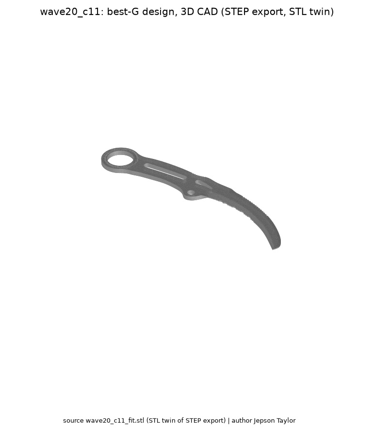
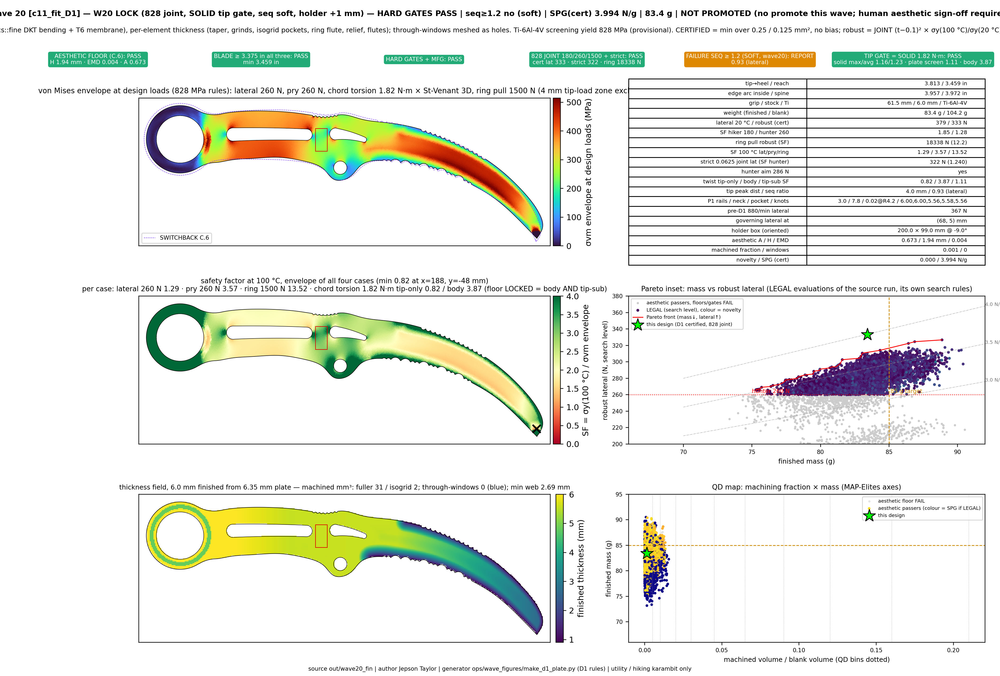
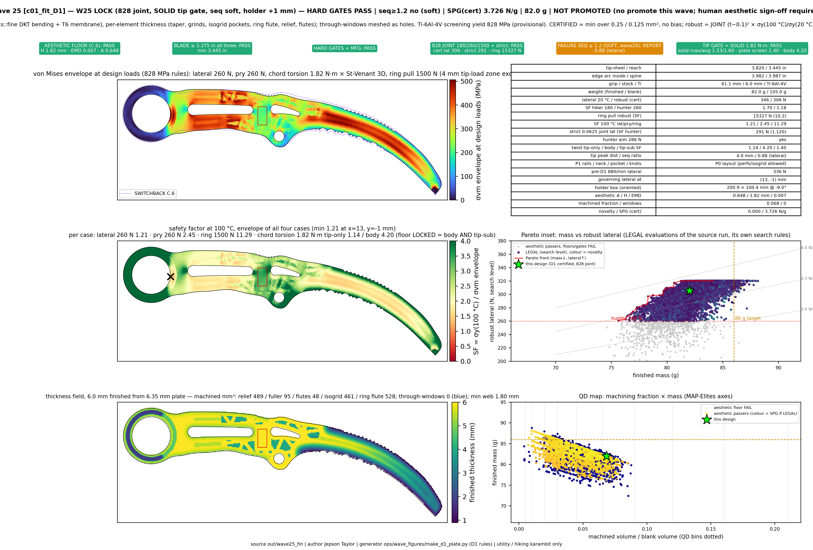
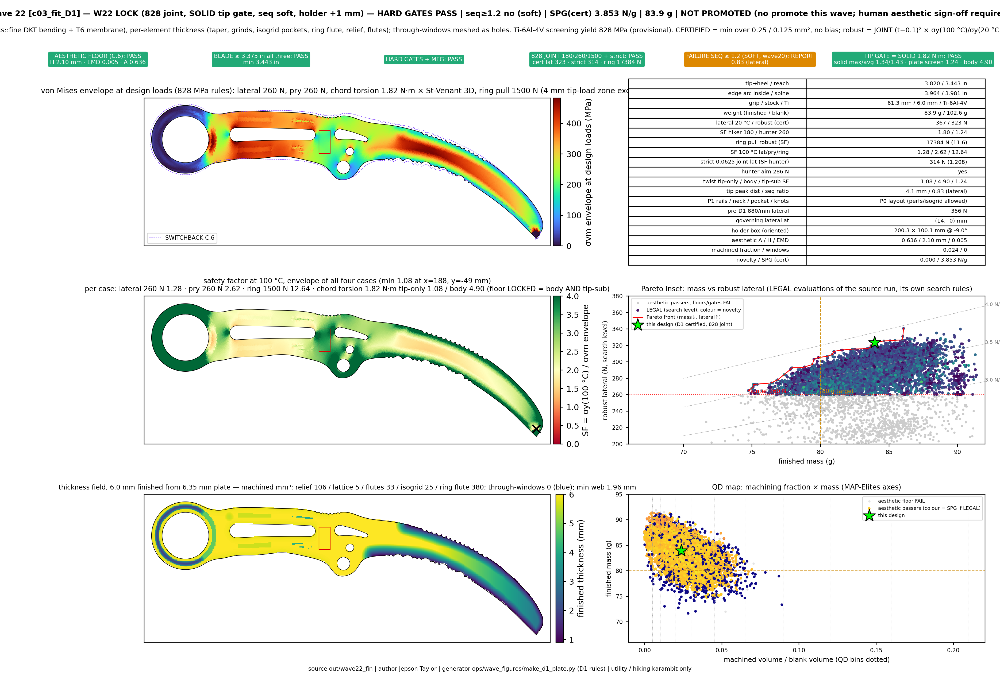
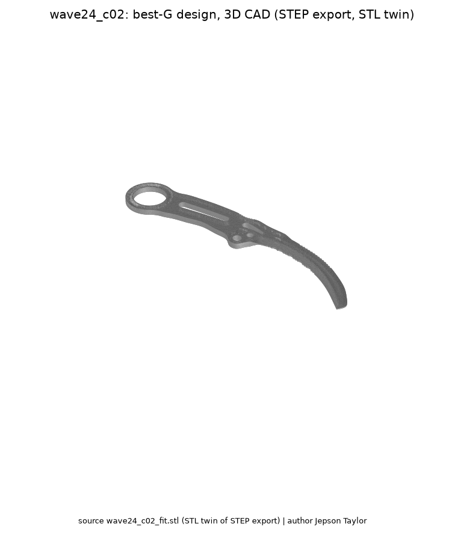
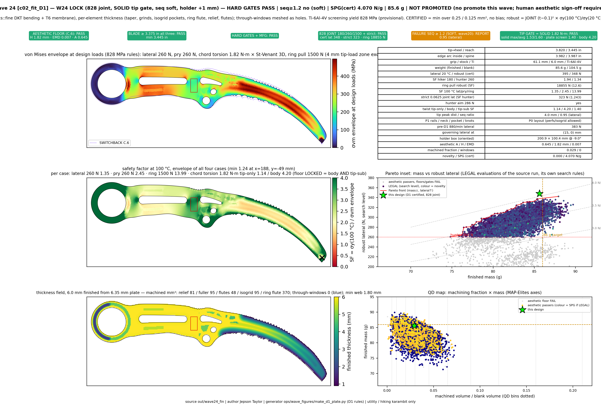
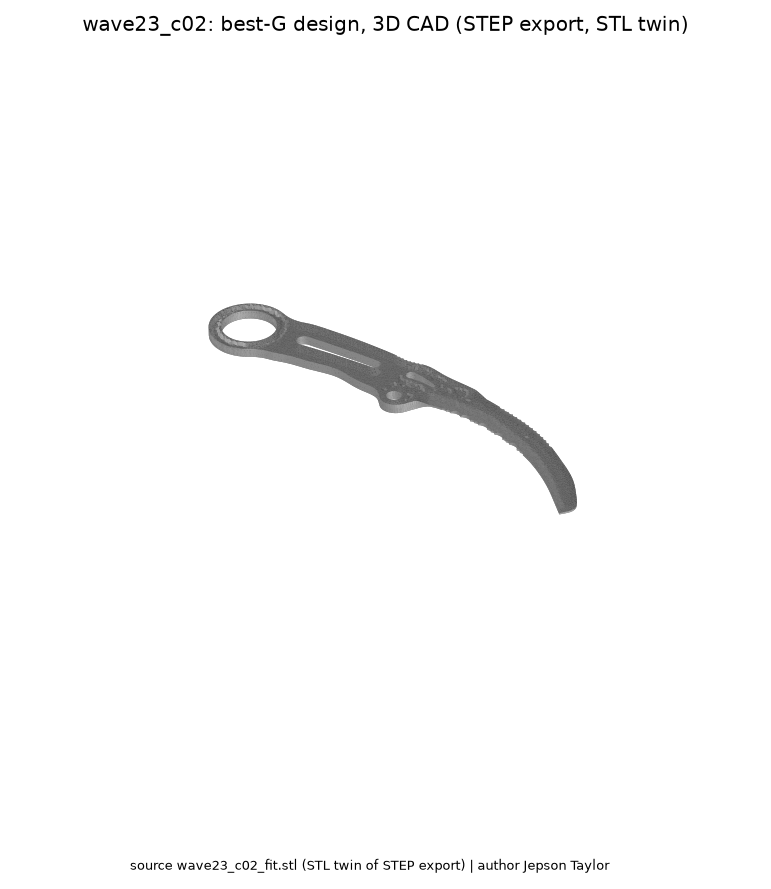
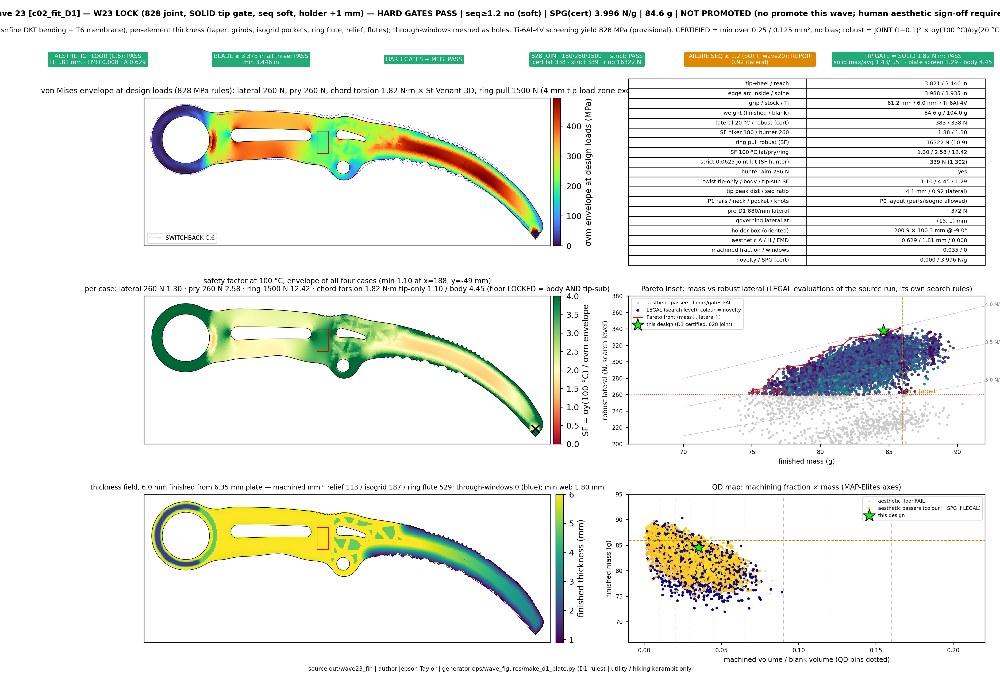
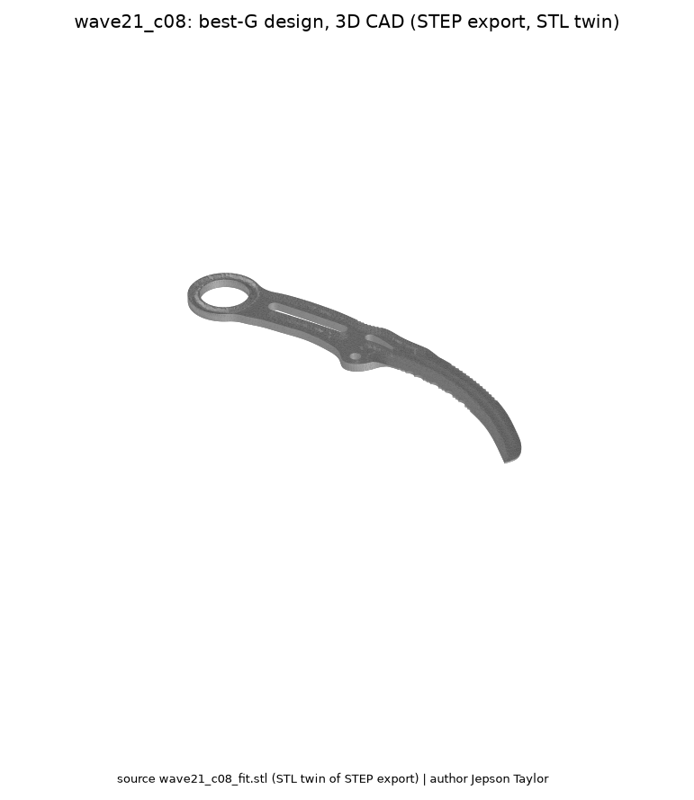
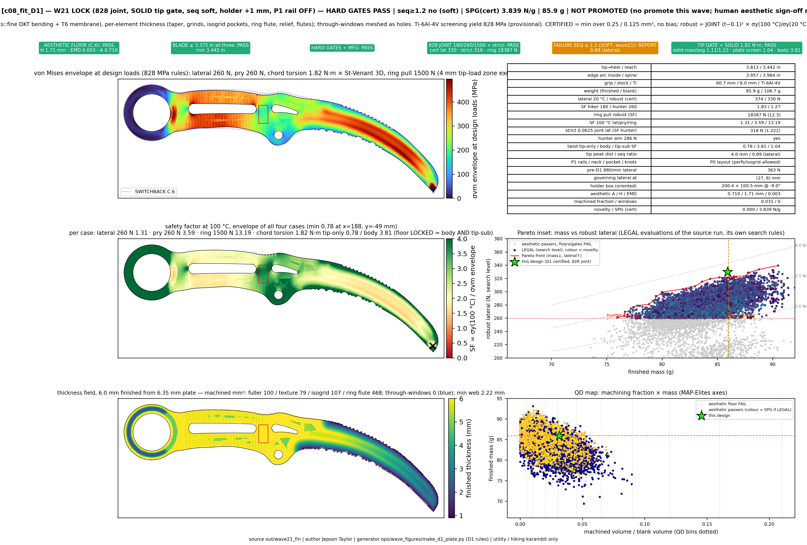

# Intelligence-Designed Titanium Utility Karambits via Monte-Carlo-Robust Evolutionary Search

**Jepson Taylor**

**Version 0.28.0 — 2026-10-12** (living document; version from `docs/VERSION`, checked by CI `ops/ci/version_check.py`). Frozen companion: `docs/WHITEPAPER_g3_neckrail.md` (v0.1.0-g3neckrail, branch `release/v0.1.0`). Target: IEEE-style, 6–10 pp; completeness over page count. Wave27 pack landed (tag `v0.27.0`); engineering provisional is **g3_tip+00_t60_tt3** (G1 0.9804, tip×SPG 6.362 @ 84.80 g). Wave26 plates remain a placeholder. **No design is promoted** (g3_neckrail not promoted; 828 MPa screening yield provisional; human aesthetic sign-off pending).

**Abstract** — *jarambit* is a Rust-native pipeline that evolves fixed-blade titanium hiking/utility karambits (SWITCHBACK class) under hard manufacturability and safety constraints, verified by a plate FEM screen plus a solid tip submodel, made robust by Monte Carlo over tolerances, temperature (−10…100 °C) and cut media, and ranked across waves by a single GLOBAL metric **G** that combines solid-tip safety factor, strength-per-gram, aesthetics, mass and failure sequence. Hard limits are rejections, never penalties; G never overrides a gate.

*Index Terms* — evolutionary design, finite element analysis, Monte Carlo robustness, titanium, karambit, NSGA-II, design-for-manufacture.

**Hero figures.** 3D CAD (watertight STEP):  — FEM plate: see §III-G.

## I. Introduction
Utility cutting (cord, webbing, packaging) with a ring-retained hooked blade. Contributions: (1) constrained genotype with validators; (2) watertight CAD phenotype; (3) two-level FEM (plate screen + solid tip submodel); (4) MC robustness; (5) island/novelty evolution; (6) a locked global metric and versioned, figure-backed wave reporting. Code map: `TECHNOLOGY_MAP.md`.

## I-A. Related work
Multi-objective evolutionary design (NSGA-II [1]), DKT plate elements [2], topology/shape optimisation, robust design under tolerance, and knife-edge mechanics in Ti alloys. jarambit differs by treating legal/manufacturing limits as hard rejections and by ranking across waves with one locked metric.

## II. Methods
### II-A. Pipeline
genotype (validate/reject) → phenotype (outline, STEP, mass) → Monte Carlo × FEM (capacities, SF, SPG, seq) → evolve → plates → G → this paper + `docs/WAVE_LOG.md`.

### II-B. GLOBAL metric G (definition, locked G1 — `docs/GLOBAL_METRIC.md`)
$$G = 0.35\,\min(SF_{tip},2) + 0.35\,\frac{SPG}{4.0} + 0.20\,aes - 0.05\,\frac{\max(0,m-77)}{10} - 0.05\,\frac{\max(0,1.2-seq)}{1.2}$$
SF_tip = solid tip submodel SF at the max-stress node (828 MPa); SPG = certified strength-per-gram (N/g); aes = C.6 automated aesthetic score (0…1); m = finished mass (g); seq = hand/blade failure-sequence ratio, soft until ≥ 1.2. `G*` marks a provisional value where the solid submodel is missing and the plate tip-submodel screen SF is substituted. Every wave FEM plate title shows G, mass (g) and the software version.

### II-C. Requirement sets (RS-karambit-v1, `requirements/RS-karambit-v1.toml`)
Every PASS/FAIL names a requirement set (here RS-karambit-v1) and group. **Screen** (plate field `w20_hard_pass`): ring ID 25.4 ± 0.5 mm; blade ≥ 3.375 in on tip-to-heel, horizontal reach and sharpened arc; sharpened edge ≤ 4.0 in; grip 60–80 mm; connected solid; Ti only; 0.1 mm stock; C.6 aesthetic floor; 828 MPa joint thin+hot (provisional); hiker 180 N / hunter 260 N; ring pull 1500 N; chord torsion 1.82 N·m (body and tip submodel); solid tip SF ≥ 1.0. **Promotion** (`promote_eligible`, owner lock) adds: strict hunter lateral ≥ 260 N and seq ≥ 1.2, plus human aesthetic sign-off. **Mass is soft** (owner decision 2026-10-12, RS-karambit-v1 version 2): it is a strong penalty in G and a ranking target (< 80 g first, then < 70 g), never a screen or promotion gate; the 74–77 g band is reported only. **Search legality** (crescent, P1 on) makes seq ≥ 1.2 hard and treats mass as a ranking target. A screen PASS at 84.8 g is therefore consistent; that design currently fails promotion on seq, not on mass.

### II-D. Versioning
Major wave N ⇒ version 0.N.0 + tag `v0.N.0` + `docs/RELEASES.md` entry + this header. Sub-experiments (Wave N.1, …) ⇒ `docs/WAVE_LOG.md` only. Earlier versions in the callouts are retro-assigned by wave (wave N ↔ 0.N.0); only `v0.1.0-g3neckrail` exists as a tag before v0.27.0.

## III. Core technologies (callouts)
Each callout: (a) 3D CAD/STEP figure, (b) FEM colormap/mesh figure, (c) metrics table including G, (d) version that introduced it. Figures are the best-G design of the cited wave that passes the RS-karambit-v1 screen (`docs/figures/whitepaper/`).

### III-A. Constrained genotype + validators (genotype/)
20-gene + Ti grade genotype; red-team rejects (never penalises) ring ID 25.4 ± 0.5 mm, blade ≥ 3.375 in on all three measures, edge ≤ 4.0 in, grip 60–80 mm, connected solid, double serrated.

**(a) 3D CAD/STEP** — 

**(b) FEM colormap/mesh** — 

**(c) Metrics**
| design | G | SF_tip | SPG N/g | aes | mass g | seq | RS-karambit-v1 screen |
|---|---|---|---|---|---|---|---|
| wave20 c11_fit_D1 | **0.848** | 1.164 | 3.994 | 0.673 | 83.4 | 0.926 | PASS |

**(d) Introduced in:** v0.1.0 (wave1); crescent C.4/C.6 anchor v0.6.0→v0.13.0 (no stick-figure priors)

### III-B. Phenotype → watertight STEP/CAD, grinds, tip outline/stock (phenotype/)
Outline → watertight extrusion → faceted MANIFOLD_SOLID_BREP STEP + STL; 0.1 mm stock; grind law per edge; holder envelope +1 mm.

**(a) 3D CAD/STEP** — 

**(b) FEM colormap/mesh** — 

**(c) Metrics**
| design | G | SF_tip | SPG N/g | aes | mass g | seq | RS-karambit-v1 screen |
|---|---|---|---|---|---|---|---|
| wave25 c01_fit_D1 | **0.952** | 1.527 | 3.726 | 0.648 | 82.0 | 0.879 | PASS |

**(d) Introduced in:** v0.1.0 (STEP/STL); grind law + tip outline v0.26.0 (wave26 grind_law)

### III-C. Plate FEM screen, D1 rules: 828 MPa joint thin+hot, lateral/pry/ring, chord torsion 1.82 N·m (fem/)
DKT + membrane plate on the outline; certification min(0.25,0.125 mm²) + strict 0.0625 mm²; twist both modes; 4 mm tip-load zone excluded on the plate and handed to the solid submodel.

**(a) 3D CAD/STEP** — 

**(b) FEM colormap/mesh** — 

**(c) Metrics**
| design | G | SF_tip | SPG N/g | aes | mass g | seq | RS-karambit-v1 screen |
|---|---|---|---|---|---|---|---|
| wave22 c03_fit_D1 | **0.885** | 1.345 | 3.853 | 0.636 | 83.9 | 0.831 | PASS |

**(d) Introduced in:** v0.13.0 (D1 rules; CI d1-gates)

### III-D. Solid tip submodel (fem/)
C3D solid submodel of the tip region at 828 MPa; nodal max/avg SF; hard gate SF ≥ 1.0. Supplies the tip term of G.

**(a) 3D CAD/STEP** — 

**(b) FEM colormap/mesh** — 

**(c) Metrics**
| design | G | SF_tip | SPG N/g | aes | mass g | seq | RS-karambit-v1 screen |
|---|---|---|---|---|---|---|---|
| wave24 c02_fit_D1 | **0.966** | 1.527 | 4.070 | 0.645 | 85.6 | 0.952 | PASS |

**(d) Introduced in:** v0.20.0 (W20 lock: SOLID tip gate, seq soft, holder +1 mm)

### III-E. Monte Carlo over tolerances, −10…100 °C, heterogeneous media (monte_carlo/)
Exact-n tolerance cloud, thread-stable seeds, cut-media mix; SF maps at 100 °C yield; SPG = p05 (search) / certified (plate).

**(a) 3D CAD/STEP** — 

**(b) FEM colormap/mesh** — 

**(c) Metrics**
| design | G | SF_tip | SPG N/g | aes | mass g | seq | RS-karambit-v1 screen |
|---|---|---|---|---|---|---|---|
| wave23 c02_fit_D1 | **0.925** | 1.425 | 3.996 | 0.629 | 84.6 | 0.916 | PASS |

**(d) Introduced in:** v0.1.0

### III-F. Evolution: islands, fitness, novelty, diversity (evolve/)
NSGA-II islands with migration; MAP-Elites/QD (machining fraction × mass); novelty arms (wave25 c*_novel).

**(a) 3D CAD/STEP** — 

**(b) FEM colormap/mesh** — 

**(c) Metrics**
| design | G | SF_tip | SPG N/g | aes | mass g | seq | RS-karambit-v1 screen |
|---|---|---|---|---|---|---|---|
| wave21 c08_fit_D1 | **0.808** | 1.107 | 3.839 | 0.710 | 85.9 | 0.891 | PASS |

**(d) Introduced in:** v0.1.0 NSGA-II islands; novelty/QD v0.6.0; novelty lane v0.25.0

### III-G. GLOBAL metric G + versioned wave plates (metrics/)
G (Methods §II-B) printed in every new plate title with mass and version; ranks plated designs per wave.

**(a) 3D CAD/STEP** —  *(extruded phenotype solid from `out/wave27/g3_tip+00_t60_tt3_D1.json`, t = 6.0 mm; render script `ops/wave_figures/render_step3d_w27.py`)*

**(b) FEM colormap/mesh** — 

**(c) Metrics**
| design | G | SF_tip | SPG N/g | aes | mass g | seq | RS-karambit-v1 screen |
|---|---|---|---|---|---|---|---|
| wave27 g3_tip+00_t60_tt3_D1 | **0.980** | 1.534 | 4.147 | 0.649 | 84.8 | 0.959 | PASS |
| wave27e g3t58_S05_rw-05_D1 (prior w27 provisional) | 0.977 | 1.594 | 3.859 | 0.593 | 81.8 | 0.888 | PASS |

tip×SPG = 1.534 × 4.147 = **6.362**; ring ID 25.46 mm; seq soft. Engineering provisional (not promoted); `g3_tip+00_t60_tt0` (= g3_neckrail, 6.340 @ 84.59 g, G 0.979) is history.

**(d) Introduced in:** v0.27.0

## IV. Results — waves 20–27 (best G per wave, RS-karambit-v1 screen PASS designs)
| design | G | SF_tip | SPG N/g | aes | mass g | seq | RS-karambit-v1 screen |
|---|---|---|---|---|---|---|---|
| wave20 c11_fit_D1 | **0.848** | 1.164 | 3.994 | 0.673 | 83.4 | 0.926 | PASS |
| wave21 c08_fit_D1 | **0.808** | 1.107 | 3.839 | 0.710 | 85.9 | 0.891 | PASS |
| wave22 c03_fit_D1 | **0.885** | 1.345 | 3.853 | 0.636 | 83.9 | 0.831 | PASS |
| wave23 c02_fit_D1 | **0.925** | 1.425 | 3.996 | 0.629 | 84.6 | 0.916 | PASS |
| wave24 c02_fit_D1 | **0.966** | 1.527 | 4.070 | 0.645 | 85.6 | 0.952 | PASS |
| wave25 c01_fit_D1 | **0.952** | 1.527 | 3.726 | 0.648 | 82.0 | 0.879 | PASS |
| wave26 ctl_g3_ref (solid table; plates PENDING — `jarambit_w26_resume` live) | pending | 1.525 | 4.158 | — | 84.6 | 0.959 | PASS (table) |
| wave27 g3_tip+00_t60_tt3_D1 | **0.980** | 1.534 | 4.147 | 0.649 | 84.8 | 0.959 | PASS |
| wave27e g3t58_S05_rw-05_D1 | 0.977 | 1.594 | 3.859 | 0.593 | 81.8 | 0.888 | PASS |
| wave27b a0_S08_dr+05_D1 | **0.979*** | screen 1.636 | 3.747 | 0.591 | 81.9 | 0.842 | FAIL |

**Trend.** Solid tip SF rose from 1.16 (wave20) to 1.53–1.59 (waves24–27) while SPG held near 3.7–4.1 N/g; G rose 0.85 → 0.97. No design reaches seq ≥ 1.2 or the 74–77 g band yet. Those two gaps stop promotion.

*Wave26 figure: PLACEHOLDER (plates pending). Wave27 figures: final pack in `docs/wave27_diversity/plates/` + `plates_e/`; the engineering provisional g3_tip+00_t60_tt3 is shown in III-G.*

**Pareto note (v0.27.0).** No wave27 tip arm reaches an RS-karambit-v1 screen PASS at ≤ 82 g with tip×SPG ≥ 6 (the ≤ 82 g, ≥ 6 points a0_tip+10_t58_tt3/tt0 fail the screen). The mass king remains the a0_c02fit_ref class (~81.4 g, tip×SPG ~5.58). seq < 1.2 everywhere (a promotion requirement). The next major wave (v0.28.0) starts only after a hard-PASS design beats G1 0.9804, or reaches ≤ 82 g at tip×SPG ≥ 6 with an RS-karambit-v1 screen PASS. (Superseded for versioning by the v1 roadmap; see docs/RELEASES.md.)

## V. Limitations and ethics
828 MPa is a provisional screening yield; seq is soft; the aesthetic score does not replace human sign-off; no design is promoted. The tool covers utility/hiking use only.

## VI. Conclusion
Wave27 (v0.27.0) set the engineering provisional to **g3_tip+00_t60_tt3** (G1 0.9804, tip×SPG 6.362 @ 84.80 g, ring 25.46 mm; RS-karambit-v1 screen PASS, promotion FAIL on seq 0.959 < 1.2; mass 84.80 g is over the soft 80 g target and penalised in G). A +0.3 mm tip-stock law beat the g3_neckrail baseline at +0.21 g; tip-outline shifts of ±1 mm failed hard gates. Open gaps: seq ≥ 1.2, mass (soft: < 80 g, then < 70 g), and human aesthetic sign-off. Artefacts: watertight STEP (release asset `g3_tip+00_t60_tt3.step`, generator `crates/crescent/examples/export_step.rs`), FEM plate, pack. Patent draft (not filed): `docs/PATENT_DRAFT.md`.

---
## Appendix A — prior draft v0.3 body (retained verbatim for traceability)

**Jepson Taylor**

*Draft v0.3 — target IEEE conference format, 6–8 pages. Search snapshot is mh1 in progress, not a finished optimum.*

**Abstract** — We present *jarambit*, a Rust-native pipeline that evolves fixed-blade titanium hiking/utility karambit geometries (SWITCHBACK class) under hard manufacturability and safety constraints. A 20-gene continuous genotype (+ titanium grade) is decoded into a connected genus-1 planar profile with a 25.4 mm finger ring, a ≥60 mm grip, a curved double-edged blade with serrations on both edges, a sheath/holder interface (shoulders, thickness lands, retention detent), 0.1 mm-precision stock thickness and a flat brand pad. The primary fitness is **strength-per-gram** (governing lateral capacity / mass, N/g) at the 5th percentile of a Monte Carlo over CNC/waterjet tolerances and −10…100 °C, subject to hiker and hunter strength floors — not strength alone. Hard limits (blade **≥ 3.375 in on all three measures**, sharpened edge ≤ 4.0 in) are enforced as rejections, never penalties. A red-team gate rejects any candidate that is not a recognisable, connected, double-serrated curved karambit.

## I. Introduction
Motivation: outdoor/utility cutting (cord, webbing, rope, packaging) where a hooked, ring-retained blade gives controlled pull cuts and retention with gloves. Contribution list: (1) constrained genotype, (2) MC-robust fitness, (3) red-team gate, (4) open Rust implementation.

## II. Related Work
Evolutionary structural design; topology optimisation; robust design under tolerance; knife-edge mechanics (edge angle vs. retention in Ti alloys).

## III. Design Space and Genotype
20 continuous genes + `TiGrade` (see `crates/genotype::bounds`): blade arc, mid radius, thickness (0.1 mm quantum), edge angle, inner/outer serration pitch+depth, ring ID, ring wall, grip length, brand pad w/l, and seven holder-interface genes (ricasso land length, shoulder step, detent depth/position, friction length, holder drain Ø, holder shell wall). Sweep is derived (outer arc / outer radius) and repaired to ≥ 56°.

### III-A. Hard constraints (red-team rejects; `crates/redteam::check`, constants in `genotype::limits`) — ASSUMPTIONS, NEVER WEAKEN
1. **Blade length, all-three FLOOR (owner requirement, Jepson Taylor, 2026-10-11).** Each of (a) tip-to-heel straight distance (tip to the farther start-of-sharpening heel), (b) horizontal reach (blade extent perpendicular to the grip axis, heel to farthest blade point), (c) sharpened-edge arc (longer of concave/convex edge centrelines, heel→tip) must be **≥ 3.375 in = 85.725 mm**; a design is rejected if **any one** is below it. A 0.5 mm guard band sits *above* the floor (design floor `BLADE_FLOOR_MM` = 86.225 mm) so CNC/waterjet tolerance cannot drop a part under 3.375 in, and the sharpened edge is capped at **4.0 in = 101.6 mm** (`BLADE_EDGE_MAX_MM`). MC tolerance samples are re-gated, so p05 fitness collapses for designs that can fall under the floor in production. *Errata:* revisions before 2026-10-11 implemented this rule inverted (reject if any measure ≥ 85.225 mm) and capped the outer-arc gene at 72 mm, so every evolved design had a ~44 mm blade (tip 43.6–44.3 / reach 32.3–33.7 / arc 54.2–55.2 mm). All mh1 results produced before the fix are **PRE-BLADE-FIX** and quarantined; none is a winner. The outer-arc gene is now 77.1–92.3 mm (sharpened arc ≈ 86.3–101.5 mm). *Known gap:* the current phenotype starts the blade with its tangent parallel to the grip axis, which bounds horizontal reach at ≈68 mm while the edge stays ≤ 101.6 mm; meeting the reach floor needs a blade rake/cant gene (open work; a red-team canary test tracks it). Until then every candidate is rejected on horizontal reach (and on tip-to-heel for most radii).
2. **Grip floor:** ring-neck to guard (shoulder) ≥ **60 mm**; usable band 60–80 mm (reject outside).
3. **Finger ring:** ID **25.4 mm ± 0.5 mm**; wall ≥ 4 mm; ring at end of grip.
4. **Curved, never straight:** sweep ≥ 55°, mid radius ≤ 45 mm; blade must rise above the grip line (recognisable karambit).
5. **Double-edged, both edges serrated** (≥ 3 teeth each, depth > 0).
6. **Single connected solid:** one outer boundary, exactly one hole (ring), no self-intersection, ≥ 3 mm material around the ring hole.
7. **Flat brand pad** ≥ 6 × 12 mm, inside grip, clear of the holder detent.
8. **Thickness precision:** stock thickness is a multiple of 0.1 mm (mm-precision callout).
9. **Titanium only** (Ti-6Al-4V or Ti-3Al-2.5V); edge ≥ 14°/side (Ti edge roll).
10. **Holder pop-in interface** — see `docs/HOLDER_ENVELOPE.md` (shoulder stop ≥ 0.8 mm, ricasso thickness lands ≥ 5 mm, detent 0.4–1.2 mm inside friction zone, ≥ 30 mm grip exposed, drain Ø ≥ 3 mm, envelope ≤ 100 × 200 × 9 mm).
11. **Use framing:** hiking/utility/game-processing only; no combat framing; no manufacturer contact by the pipeline; any fabrication requires human approval.

### III-B. Fitness — strength-per-gram subject to floors (`crates/physics::primary_fitness`)
Strength S = min(blade-heel lateral capacity, grip-at-shoulder lateral capacity) at yield, with serration-depth section loss and a detent notch factor K_t = 1 + 0.6·(d/1.2). Lever = tip-to-heel (blade) and tip-to-heel + ricasso (grip). Floors (capacity at yield, lateral tip load): **hiker ≥ 180 N** (90 N × SF 2), **hunter ≥ 260 N** (130 N × SF 2, joint separation/field dressing), **ring pull ≥ 1500 N**. **These three floors are CONFIRMED by Jepson 2026-10-11 (firm design requirements, no longer placeholders; values unchanged).** Feasible: f = S / m (N/g); infeasible: f = −1 − 10·(floor deficit). Red-team reject on any MC sample: f = −1000. Objective = MC p05 of f. Strength alone is never optimised; the Pareto front (S vs m) and population diversity are logged each run (`pareto.csv/svg`, `diversity.svg`, `fitness.svg`, `history.csv`, `quarantine.csv`).
Material yield is derated linearly with temperature (Ti-6Al-4V −0.11 %/°C ref. 20 °C).

## IV. Phenotype Decoding
The blade is an annular sector about the origin: heel at angle π, sweep = arc length / outer radius, repaired to at least 56°. Both edges are scalloped. Below the guard the outline steps in at the shoulders, runs the grip, cuts a V detent, and closes around one finger-ring hole. The brand pad is an axis-aligned rectangle on the grip.

Export is one extrusion of that profile. An ear clip triangulates the outer ring (counter-clockwise) with the hole (clockwise) by bridging the hole's rightmost vertex to the nearest visible outer vertex. Caps sit at z = 0 and z = t with opposite winding; side walls follow the outer boundary and the hole so each wall normal points outward. The same triangles are written as ASCII STL and as a faceted AP214 `MANIFOLD_SOLID_BREP` (`CLOSED_SHELL` of planar `ADVANCED_FACE`s, no polyline). A release test on 30 random repaired genotypes found no boundary edge, no non-manifold edge, and one STEP face per triangle.

## V. Physics: Beam Surrogate and a Plate Check
Monte Carlo uses a beam section, because that evaluation is microseconds and a plate factor is not.

Let h_eff be the 14 mm blade height minus both serration depths, t the stock, L the tip-to-heel distance, and σ_y the yield at temperature. Lateral capacities (N) are

S_blade = σ_y · h_eff · t² / (6 L),

S_grip = σ_y · h_w · t² / (6 (L + L_ricasso)) / K_t,

with grip width h_w reduced by the detent depth and K_t = 1 + 0.6 · (d / 1.2). Ring pull on one wall is σ_y · wall · t. In-plane capacity swaps the section axes. Governing strength is min(S_blade, S_grip). Primary fitness is that strength over mass when the hiker (180 N), hunter (260 N) and ring-pull (1500 N) floors all hold.

A coarse 3D check with linear tetrahedra was tried and rejected. On a 50 × 14 × 3 mm cantilever, one, two and four elements through the thickness all returned about 7 % of the beam bending stress and about 1.4 % of the beam tip deflection. The same solver on a straight bar in tension was within 40 % of F/A, so the element locks in bending rather than mis-scaling the constitutive law. The blade model is therefore a flat Kirchhoff plate on the ear-cut outline: a discrete Kirchhoff triangle for lateral bending [2] and a constant-strain membrane triangle for in-plane load and ring pull. Serration scallops are not meshed; blade bending stress is scaled by h / h_eff and in-plane stress by (h / h_eff)². Poisson's ratio is 0.34. For a tip load the finger-ring nodes are fixed (the hand). For ring pull the ricasso band is fixed and the hole is loaded. Those are different supports, so each case has its own factorisation. Degrees of freedom are (u, v, w, θx, θy). A mesh over 160 nodes, 320 triangles, or 800 free dofs is not solved.

Release checks, all passing:

- Cantilever, ν = 0, 8 × 2 quads, L = 50 mm, width 14 mm, t = 3 mm, E = 113.8 GPa. Tip deflection must lie in 0.70–1.35 of F L³ / (3 E I) and the peak surface von Mises in 0.50–1.80 of 6 F L / (b t²).
- Uniform tension patch: membrane von Mises in 0.70–1.40 of F / (width · t).
- Twenty random in-spec karambits, Ti-6Al-4V at 20 °C, none failing to mesh. Median plate/surrogate governing lateral strength **0.526** (range about 0.20–0.84). The plate grip usually governs: the ring support puts a longer moment arm through the grip than the surrogate's ricasso lever. Blade-only ratios cluster nearer 1.
- Ring pull on eight designs versus the two-wall net section σ_y · 2 · wall · t: median inside 0.15–4. The surrogate is the stricter one-wall formula.

The plate solve is reported once, at 20 °C, on the logged winner. It is not inside the 10k-sample loop. Temperature scales yield only, so a single unit-load stress would convert to any temperature; the tolerance cloud still changes the mesh every draw. `JARAMBIT_FEM=1` (mh2) still does not factor the plate per draw. It scores each candidate from one nominal 20 °C plate solve, then applies the beam-surrogate Monte Carlo knockdown: robust strength = plate strength × (p05 surrogate strength / nominal surrogate strength), and the same ratio on ring pull. The firm floors, 180 / 260 / 1500 N, apply to that robust estimate. A missed plate mesh is infeasible. This ratio is not a scale that forces the plate to match the beam.

## VI. Monte Carlo Robustness
Each candidate is scored on an exact sample count (default 10 000 in the live search). Sample i is seeded from a mix of the run seed and i, so the multiset does not depend on the thread count. Threads default to at most 48 (`JARAMBIT_MAX_THREADS` raises that per host, still clamped to the machine). Thickness noise (σ = 0.03 mm) is applied after the red-team thickness gate, which sees the nominal 0.1 mm stock. Profile, ring, edge, detent, shoulder and shell-wall genes are perturbed and not clamped; the red team re-gates every draw. A draw that fails the gate contributes −1000 to fitness, so a design that fails on 5 % or more of draws cannot win on p05. Temperature: 12.5 % of draws at −10 °C, 12.5 % at 100 °C, the rest uniform on that interval.

Cut media are a second objective, not part of the primary scalar. Each draw picks wood, cord/webbing, hide, muscle, bone or gel (weights 20/20/15/20/10/15). The medium supplies a work level, an edge-lead fraction (in-plane versus lateral) and an edge-quality need. Margin is the worse of structural reserve and (sharpness + serration − need). Bone is more lateral than hide; a dull edge fails cord. p05 of that margin is maximised beside strength-per-gram. It cannot zero the robust strength score.

The holder pop-in proxy is inside the same gate. A Kydex-like shell (E = 2.2 GPa, 12 mm tab, 10 mm snap) gives insertion 6.6 · wall³ · detent newtons and draw at 0.55 of that. The allowed window is 3–80 N insertion and 1.5–45 N draw, on the nominal design and on every perturbed draw.

## VII. Evolutionary Search
Search is NSGA-II with constraint domination [1]. A design that clears the floors with positive fitness dominates one that does not; among infeasible designs, the less-negative penalty wins. Feasible objectives, in order: maximise p05 strength-per-gram (primary), minimise nominal mass, maximise p05 cut margin. Crowding uses those three axes, with infinite crowding at the extremes so the unique primary-best is kept. Ten percent of each generation are random immigrants. Mutation scale shrinks from 0.10 to 0.02 across the run. Islands are optional; the logged best is still the feasible individual with the highest primary fitness. Every fifth generation the primary-best migrates around the ring of islands if it beats the neighbour's worst. A checkpoint file resumes a run; history and quarantine logs append.

The live search **mh1** (started 2026-10-11 ~10:23Z) is 20 independent island pairs, not one shared population: six on xbabe2 (seeds 1001–1006, 10k samples), seven on xbabe3 (three of them at 50k samples) and seven on xbabe1. Each process is 2 islands, population 48, 60 generations, 16 threads, `nice` 19. Cross-host migration is not wired. A yield guard pauses only these processes if the host CPU average reaches 82 %.

## VIII. Red-Team Safety Gate
Rejection taxonomy: BladeTooShort{tip_to_heel|horizontal_reach|sharpened_arc}, BladeEdgeTooLong, GripOutOfBand, RingIdOutOfSpec, NotCurved, NotKarambit, NoFingerRing, NotDoubleSerrated, Disconnected, BrandPad, Holder, NonTitanium, ThicknessPrecision, UnsafeGeometry. Geometric checks, beyond the gene values, require a serration ripple on both edges, a hooked planform, a single connected outline (a legitimate grip edge is long; a spike is not), an axis-aligned brand pad, and holder insertion/draw inside the window above. Applied to every candidate in every generation and to every MC sample; rejected phenotypes are quarantined to `quarantine.csv`.

## IX. Results
Plate and export checks are in §V and §IV. They are release tests, not a fitted scale factor: the plate is not multiplied to match the beam.

**mh1 snapshot, 2026-10-11 10:29Z** (not a finished study; **PRE-BLADE-FIX** — run under the inverted blade rule, every design is under 3.375 in and quarantined). On the six xbabe2 island pairs the log lines then in `out/mh1/xbabe2_s1001`–`s1006` were generations 14–20 of 60. Best p05 strength-per-gram was 12.8–13.9 N/g, governing surrogate strength 466–542 N at 32–37 g, thickness 4.3–4.5 mm, grip 61–65 mm, rejected count 0. A positive primary fitness means that candidate's Monte Carlo p05 cleared the 180 / 260 / 1500 N floors on the beam model. The same minute, the read-only monitor in `COORD.md` reported best p05 13.921 N/g on xbabe2, 13.709 N/g on xbabe1 (generations 12–19) and 13.729 N/g on xbabe3 (10k groups near generations 12–19; the three 50k groups still on generations 1–2). Plate numbers for each winner are written when that process exits (`best_report.md`). Do not read 13.9 N/g as the optimum.

**Not a result: `smoke_legal_blade` (wave 5), 2026-10-11.** A 15-generation plate-fitness smoke (seed 4242, population 64, 2 islands, 512 samples) cleared the blade-length floor on the search model at 7.045 N/g, 48.9 g, Ti-6Al-4V, 4.5 mm, with blade measures about 89.6 / 88.8 / 100.7 mm. The coarse plate in that search reported about 385 N. A refined offline plate of about 6.6k triangles gives lateral 166 N at 20 °C and 151 N at 100 °C. The minimum safety factor is 0.58 at 100 °C, at the grip-ring neck. Both sit under the 180 N and 260 N floors. The design is not promoted. The coarse plate overstates that refined lateral capacity by about 2.3×. Do not quote 7.04 N/g as an optimum.

## IX-B. Crescent Lane: C.4-Anchored Aesthetic Genotype with Novelty Search (wave 6)
The stick-figure genotype above cannot express the SWITCHBACK C.4 silhouette, and its winners (wave 5, the blocky mh1 Pareto) are not promoted. The crescent lane (`crates/crescent`) encodes the planform as 40 normal offsets of the C.4 interpolating spline (tip is the only corner) inside per-zone bounds, plus 50 genes for ring, stock (5.3–6.0 mm finished from 6.35 mm plate), taper, edge angles and edge thickness, C.4-zone lightening (comet slot, eye, cairn), serrations, sheath nub and a 3-D layer: medial-axis relief, hex-lattice dimples, fuller, comet-ligament flutes, machined texture or cord wrap, and a protected brand pad. Thickness is a 0.25 mm raster with web floor max(1.5 mm, 0.3 t).

**Aesthetic floor (hard).** Hausdorff to the C.4 exterior ≤ 6 mm; EMD of the 32-bin log-signed curvature histogram ≤ 0.06; longest R > 250 mm run ≤ C.4 + 8 mm; concave blends ≥ min(2 mm, 0.8× C.4) and neck fillet ≥ 8 mm; spine-convex and edge-concave fractions ≥ C.4 − 0.03; thumb seat ≥ 0.4 mm; guard lobe ≥ 5 mm; hook drop ≥ 25 mm; texture present; pad on a flat. A stick-figure planform fails it by an order of magnitude (H 61–96 mm, straight run 50–61 mm vs 16.5 mm, EMD 0.11–0.14), while 5-step mutation walks from C.4 keep 32/60 passers with H ≤ 4.9 mm and descriptor spread 0.56, so the floor is neither a stick-figure attractor nor a single point.

**Fitness.** SPG × A × (1 + novelty) on designs that pass the floor, every manufacturability gate and the 180 / 260 / 1500 N floors; novelty is the k = 5 nearest-neighbour distance in a 12-D 3-D-feature/silhouette descriptor among aesthetic passers only, with a MAP-Elites archive over (relief fraction, Hausdorff).

**FEM.** The detailed plate (§V) carries a per-element thickness field (grinds `edge_t + 2 d tan θ`, taper, relief, lattice, flutes). A crescent convergence study (25 designs, 2 → 0.125 mm²) measured the search-level bias at 1.105 (lateral) and 1.073 (ring), above the jarambit 1.070; the search now divides by 1.11 / 1.08 and every reported design is certified as the minimum over the 0.25 and 0.125 mm² solutions.

**First smoke (seed 7, pop 64, 40 gens, 2624 evaluations, 249 s on 48 threads).** 2317 aesthetic passers, 1832 also pass every gate, 505 LEGAL on the search level; the three plated designs were all re-confirmed at the certified level.

| design | SPG (N/g) | mass (g) | blade tip-heel / reach / arc (in) | A | novelty | SF hiker / hunter / ring (robust, certified) |
|---|---|---|---|---|---|---|
| top (id 2421, 5.9 mm) | 3.796 | 87.5 | 3.803 / 3.446 / 3.986 | 0.714 | 0.057 | 1.84 / 1.28 / 10.8 |
| qd2 (id 2345, 5.8 mm) | 3.458 | 84.9 | 3.811 / 3.450 / 3.989 | 0.691 | 0.070 | 1.63 / 1.13 / 11.0 |
| qd3 (id 2409, 5.8 mm) | 3.180 | 84.8 | 3.803 / 3.451 / 3.987 | 0.649 | 0.061 | 1.50 / 1.04 / 9.7 |
| C.4 seed at 5.7 mm (reference, not legal) | — | 82.6 | 3.806 / 3.426 / 3.983 | 0.882 | — | 0.78 / 0.54 / 13.7 (search level) |

**Engineering callouts, top design (id 2421).** Ti-6Al-4V, 5.9 mm finished from 6.35 mm plate (0.225 mm skim per face), linear taper from x = 119.9 mm to 2.95 mm at the tip; inside edge 18.3°/side, spine edge 21.8°/side, edge flat 0.72 mm; spine sharpening begins 24 mm aft of the crest (spine arc 3.947 in ≤ 4.0 in). Ring ID 25.4 mm, wall 4.85 mm, tangent neck fillet R15.1. Comet lightening slot x 25.1–66.0 mm, width 7.9 → 4.7 mm; eye and Ø5.70 mm cairn hole (sheath nub seat, 0.6 mm engagement, 1.28 mm shell wall). Medial-axis relief 0.26 mm deep × 4.2 mm wide and comet-ligament flutes 0.45 mm deep, both above the 3.08 mm minimum web. Cord-wrap grip zone x 20–72 mm; brand pad 6.2 × 12.1 mm flat at x = 75 mm. Serration scallops 1.35 / 0.70 / 0.75 mm (large / small / fine); C.4 jimping scale 1.01 (C.5 adoption separate). Grip 61.3 mm. Holder box 198.8 × 99.2 mm at −9°. Mass 87.5 g (STEP solid 87.42 g, watertight: 0 boundary, 0 non-manifold edges, 16 632 faces). Certified capacities: lateral 364 N at 20 °C, robust 332 N (governing at the mid-hawkbill belly, x 177, y −33 mm); ring pull 17.7 kN at 20 °C, robust 16.2 kN; tip pry 712 N; twist 1.25 N·m at 20 °C (advisory SF 0.93 at 100 °C — no floor, open gap).

**Candidate distinguishing features (for counsel review, not a legal opinion).** (i) A continuous crescent planform whose ring, handle, guard lobe, thumb seat, belly and hawkbill are one G1-continuous spline with a single corner at the point; (ii) lightening confined to a tapering comet slot along the handle neutral axis with fluted ligaments, an eye hole, and a cairn hole that doubles as the sheath retention seat; (iii) a medial-axis relief and graded thickness field that removes mass along the handle centreline while keeping a protected friction land and brand flat; (iv) spine sharpening that starts aft of the crest so both edges stay ≤ 4.0 in while all three blade measures stay ≥ 3.375 in. Prior-art search has not been run.

Plates: `docs/figures/wave_heatmaps/wave6_crescent_*_FEM_metrics.{png,pdf}` (aesthetic passers only; σvm envelope, per-case 100 °C SF, thickness field, QD map). Gaps and owner decisions: `docs/AESTHETIC_GAPS.md`.

## IX-C. SWITCHBACK Rev C.6 anchor: dual-face ring contrast-anodize channels (waves 11–13)
The aesthetic anchor moved C.4 → C.5 (R0.8 / 0.45 mm thumb-seat jimping, wave 11) → **C.6** (wave 13): C.5 plus a two-sided
annular "racetrack" groove on the finger-ring faces, r = r_bore + 1.6 to r_OD − 1.6 mm (14.3–17.4 mm nominal), 0.6 mm per face,
R0.5 floor fillet. The groove is part of the phenotype's thickness field, so the plate FEM, mass, and exported solid all
include it; a design whose ring wall cannot host a ≥ 2 mm groove fails the C.6 aesthetic floor. Prior certified crescents
were re-scored against C.6 (certification = min over 0.25 / 0.125 mm² meshes, no bias; strict 0.0625 mm² level reported):
11 of 42 pass everything under 80 g, led by wave8_c01 at 75.55 g, SPG 4.03 N/g, certified robust lateral 304.5 N
(hunter SF 1.17), ring SF 9.8, strict lateral 280 N. Wave 13 (8 islands × 48, 120 generations, mass target 76 g, strict
0.0625 mm² check enforced) is seeded from those 11 C.6 passers and the C.6 seed.

**Candidate distinguishing feature (for counsel review, not a legal opinion; no prior-art search performed).** Dual-face
ring contrast-anodize channels on a crescent karambit: a recessed annular channel machined into BOTH faces of the finger
ring, concentric with the bore, bounded by full-thickness rims at the bore and ring OD, intended to carry a contrast
anodize / masked finish below the worn faces, in combination with a single-spline crescent planform whose ring is joined
by tangent neck fillets. The channel sits in the ring's low-stress zone (certified ring-pull SF ≈ 9), so it is also a
mass-relief feature that does not touch the governing lateral path at the grip-ring neck.

**Waves 13–14 under C.6 (results).** Wave 13 (xbabe2, 43 k evaluations) certified 24 finalists: 15 pass every hard item
(floors 180/260/1500 N robust = min of 20 °C at −0.1 mm stock and 100 °C yield; certification min over 0.25 / 0.125 mm²),
all under 80 g; the lightest is **wave13_c01, 74.37 g (watertight STEP 74.10 g), t 5.6 mm, SPG 3.93 N/g, certified robust
lateral 292 N (hunter SF 1.13), ring 13.7 kN (SF 9.1), strict 0.0625 mm² lateral 284 N**, with three through-perforations
in the handle web, C.6 groove present, Hausdorff 1.28 mm to the C.6 exterior. Wave 14 (xbabe3, through-lattice lane, ≥ 3
through-features required) certified 24/24 finalists passing all floors and the strict check at 74.8–77.0 g, best SPG
4.05 N/g at 76.54 g. Waves 15 (mass target 72 g, 240 generations) and 16 (≥ 4 through-features, 240 generations) continue
the search. Tip twist (100 °C proxy SF 0.86–1.22) is reported as an advisory warning only, per owner direction.

## X. Limitations and Ethics
The beam surrogate and the coarse plate both miss the grip-ring neck. On the wave-5 candidate the refined plate is weakest there at 100 °C (safety factor 0.58). The released outline meets the ring in a sharp re-entrant corner. A neck flare and a tangent fillet are not in this revision; the red-team ligament check (at least 3 mm from the upper ring hole to the outline) is what a later reinforcement has to keep. Until an h-refinement study of at least four levels, with peak stress and tip deflection inside 5 %, and a measured Monte Carlo-to-plate factor are in the code, neither the beam nor the coarse plate is a strength to publish. The 0.526 median in §V is the earlier short-arc population, not the legal-blade population.

`JARAMBIT_FEM=1` scores one nominal 20 °C plate times the surrogate knockdown. The default search still optimises the surrogate. That knockdown is the surrogate's shape sensitivity, not the plate's. Temperature changes yield only; the modulus is constant. Serrations, the edge bevel, scallop roots, and jimping are scales or omitted, not local submodels. Detent K_t is the ad hoc 1 + 0.6 · (d / 1.2). Supports are a fixed ring for a tip load and a fixed ricasso for ring pull. A gripped contact face is not modeled. The constitutive model is linear elastic to first yield. Not modeled: fatigue crack growth, fracture toughness, strain rate, sheet anisotropy, grind or waterjet residual stress, and holder shock. The holder envelope, 100 mm by 200 mm, is a frozen assumption and already limits horizontal reach to roughly 86–90 mm. mh1 outputs are PRE-BLADE-FIX and are not winners. Islands do not migrate across hosts. Utility and hiking framing only. Designs require human approval before any fabrication. The pipeline does not contact manufacturers.

## References
[1] K. Deb, A. Pratap, S. Agarwal, and T. Meyarivan, "A fast and elitist multiobjective genetic algorithm: NSGA-II," IEEE Trans. Evol. Comput., vol. 6, no. 2, pp. 182–197, 2002.

[2] J.-L. Batoz, K.-J. Bathe, and L.-W. Ho, "A study of three-node triangular plate bending elements," Int. J. Numer. Methods Eng., vol. 15, no. 12, pp. 1771–1812, 1980. doi:10.1002/nme.1620151205.

