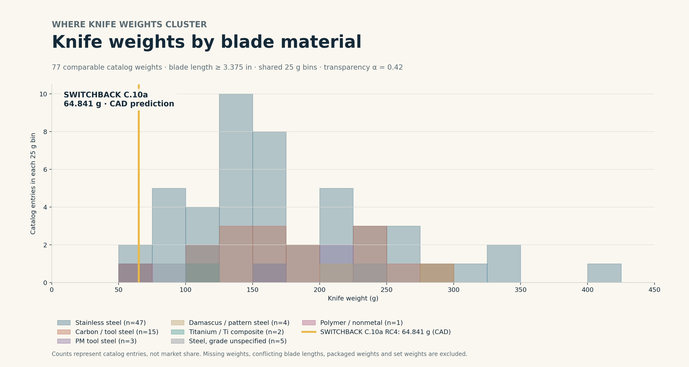
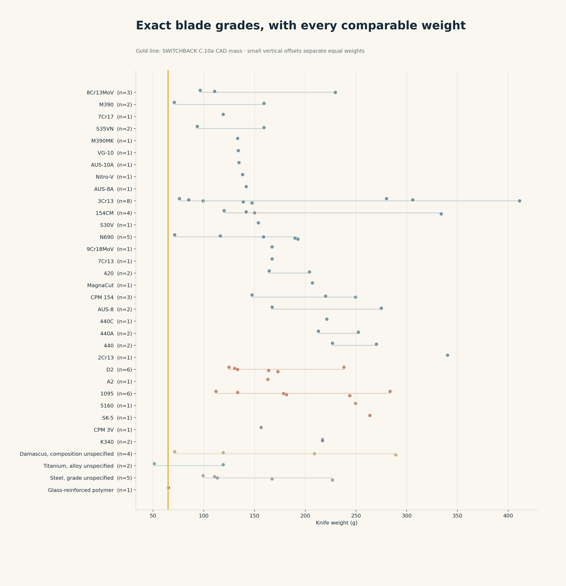

# Karambit market census and SWITCHBACK weight comparison

Research date: **October 13, 2026 (America/Denver)**. Minimum published blade length: **3.375 in = 85.725 mm**, inclusive.

**SWITCHBACK C.10a RC4 is 64.841 g by CAD calculation.** That is nominally lighter than **76/77 (98.7%)** comparable catalog entries and **59.3% below** their **159.32 g median**. These are catalog comparisons, not measured product tests. The TALIM titanium listing is lighter at **51.03 g**. The FGX polymer listing is approximately **65.2 g**, close enough that published rounding prevents a demonstrated physical weight advantage.


The gold star identifies C.10a. Moving left reduces weight; moving up increases listed blade length. Colors identify blade material families. Diamonds identify broader styles, including straight ring designs and ringless hawkbills. The histogram above uses the same weight axis and common bins. Product names preserve source identity; the project comparison concerns utility knives and catalog specifications.



Histogram bins are **25 g**, shared across groups, with **alpha 0.42**. Heights are counts of catalog entries in each bin. Overlapping colors do not form a stacked total. Each color includes only entries with a verified current published knife-weight field or explicit knife-only mass. This is not sales share.

## Coverage and what “credible” means

The eight original CSVs contain **435 rows**. All are preserved byte-for-byte, hashed, and assigned exactly one canonical disposition. One additional qualifying nonmetal model was discovered during the current category review. The resulting **166 canonical entries** contain **119 current-source-confirmed qualifying listings**, **77 comparable weights**, and **42 qualifying entries without comparable verified weights. The remaining entries require source/identity/length resolution; they are not silently counted as verified.

Credibility here means an identifiable manufacturer, established retailer, or named custom dealer with a product page whose current published blade-length field was read. It does not certify alloy chemistry, heat treatment, utility performance, product authenticity, stock availability or seller measurements. Independent marketplace claims remain candidates. Archived and custom-dealer pages are retained as historical examples, with availability kept separate from qualification. A page existing does not establish that the knife can currently be purchased.

**This is a broad source-audited census, not a proof that every global model has been found.** The candidate queue, merchant fetch failures, short-blade exclusions, and missing weights remain in the checked-in evidence. The supplied files overlap heavily; multiple CSV mentions are not independent confirmations. The current Blade HQ category was reviewed for additional leads, including the FGX and separate rubber trainer; a full 250-item category/stock audit has not been completed.

| Disposition | Entries |
|---|---:|
| source confirmed as listed | 119 |
| candidate unverified | 43 |
| conditional length conflict | 3 |
| conditional model identity | 1 |

## Blade materials

Blade substrate controls grouping. Titanium coatings, titanium clips and titanium handles do not turn a steel blade into a titanium blade. PM stainless steels such as M390 and CPM 154 remain in stainless steel; CPM 3V, K340 and Z-Wear are grouped as PM tool steels. Damascus is a declared pattern/composite category with unspecified chemistry, not a single standardized grade.

| Material family | Qualifying entries | Comparable weights |
|---|---:|---:|
| Stainless steel | 63 | 47 |
| Carbon / tool steel | 18 | 15 |
| PM tool steel | 5 | 3 |
| Damascus / pattern steel | 9 | 4 |
| Titanium / Ti composite | 5 | 2 |
| Steel, grade unspecified | 18 | 5 |
| Polymer / nonmetal | 1 | 1 |

The exact-grade distribution below preserves individual grades; it avoids a long, unreadable multicolor histogram legend.



## Important reconciliations

- **TALIM titanium:** Northern Knives explicitly lists a 3.5 in titanium blade, 1.8 oz live knife, and 3.4 oz with sheath. The product heading/HTML title disagree TALIM/TUSK; SKU and URL remain attached. It belongs to the broader ringless-style group and prevents a “lightest overall” claim.
- **HIGHTRON Cyroclaw:** manufacturer and Blade HQ list 3.94 in, with a 2.44 in edge. Arizona Custom Knives repeats that description but its own product-details table lists 2.75 in. Both color variants are merged; the unresolved length remains outside the qualifying comparison.
- **Schwartz Spartan:** KnifeCenter’s 4.4 oz expressly includes the sheath. A distinct custom-dealer example lists 3.7 oz with unclear scope. Neither a sheath mass nor an estimated 103 g is treated as verified bare-knife mass.
- **TOPS TAC-TOPS:** current manufacturer table lists a 7.13 in blade, 5.75 in cutting edge, 10 oz knife and 14.5 oz with sheath. Older 6.125 in catalog claims remain visible.
- **Boker Wildcat XL:** manufacturer 3.43 in / 5.78 oz takes precedence over Blade HQ 3.375 in / 5 oz. Both lengths qualify. Weight disagreement is retained.
- **Boker Straight:** sources disagree on 7Cr17MoV versus 440A; the consolidated grade remains unspecified. It is a broader straight-ring comparator.
- **Black Legion set:** three color variants and an alternate MTech label are collapsed. The 3.5 in karambit component qualifies, but a three-knife/set weight is never used for a single knife.
- **M48 Liberator/Falcon:** UC3334 appears under conflicting model names and 4.63/5.25 in lengths. It remains conditional rather than counting the same product twice as verified.
- **Emerson Super:** Blade HQ/Oso Grande list 3.375/3.4 in; Knivesandtools lists 8 cm (3.15 in). The unresolved measurement/SKU boundary stays conditional. A 3–3.49 in storefront filter range is not treated as an exact blade measurement.
- **Maxace Hela:** published 6.17/7.30 oz specifications conflict across M20A/B/C/E listings. Length qualifies; weight stays unresolved.
- **Rogue marketplace prototype:** structured length is 100 mm, correcting the input 4.75 in claim. Titanium/Kevlar-carbon-fiber and 3.75 oz remain single-seller claims in the candidate queue.
- **Knife Country USA:** the catalog weight block sits with shipping/package dimensions. These values are retained in observations and excluded from knife-weight comparisons.

## Sensitivity and claim limits

| Comparable subset | Entries | Median g | Nominally heavier than C.10a |
|---|---:|---:|---:|
| explicit knife only | 32 | 140.33 | 31 |
| curved karambit only | 55 | 167.26 | 55 |
| metal blades only | 76 | 161.16 | 75 |

Including all **119 qualifying entries**, the missing-weight extremes put the nominal share heavier than C.10a between **63.9% and 99.2%**. These are bookkeeping bounds, not statistical confidence intervals. The headline percentage uses only the **77** comparable weights.

C.10a is pinned to repository base `7042f199ad1a9c9e924b7aa68d514e8ea5123567`, the accepted C.10a RC4 mass/outline records and the STEP SHA in `benchmark.json`. Its 96.653 mm tip-to-heel distance is used on the chart; 87.003 mm projection and 101.180 mm edge arc remain recorded separately. Commercial blade-length fields do not establish these same three dimensions. Listed blade length is not assumed to equal cutting-edge length.

The historical design of record, `g3_tip+00_t60_tt3`, is 84.80 g. C.10a is a release candidate, not a manufactured product or a promoted design of record. A later C.10c RC5 PR appeared during research; it is not substituted for accepted main evidence. No market mass comparison establishes strength, sharpness, safety, fitness, edge life or manufacturing readiness.

## Files and reproduction

- [Qualifying entries organized by material](qualified_by_material.csv)
- [Complete normalized census](census.csv) and [JSON](census.json)
- [Exact-grade summary](material_summary.csv)
- [Every lighter or nearby listing up to 80 g, with full URLs](nearby_weight_links.csv)
- [Candidate and conflict queue](review_queue.csv)
- [Screened short blades/trainers](screened_exclusions.csv)
- [Original input manifest](input_manifest.json), [all observations](observations.json), [frozen source facts](source_facts.json), [web-reader factual evidence](web_evidence.json), [retrieval outcomes](retrieval_ledger.json), and [curated reconciliations](curation.json)
- [Full-size SVG](figures/market_landscape.svg), [PDF](figures/market_landscape.pdf), and [histogram PDF](figures/weight_histogram.pdf)

From the repository root:

```sh
python3 ops/market/build.py --no-plots
python3 ops/market/validate.py
python3 ops/market/report.py
# Optional: regenerate PNG/SVG/PDF with matplotlib and numpy available.
python3 ops/market/build.py
```

The ordinary build is offline and reads frozen committed facts. It does not require scratch, web access, a CAD engine, FEM runs or a shared environment upgrade. `normalize.py` can regenerate original observations from the preserved inputs. `harvest.py` is an optional future public-source refresh into private scratch; do not use its output to replace curation automatically. The original page bodies stay outside Git. Rechecking requires inspecting identities, dimensions, weight scopes and candidate status before freezing new facts.

## Qualifying catalog, organized by material

A dash means no comparable verified knife weight. Every model links to its selected product source. Material grade is a published claim, not an independent assay.

| Blade family / grade | Model | Listed blade in | Comparable knife g | Weight basis |
|---|---|---:|---:|---|
| Carbon / tool steel / 1095 | [Stroup Arctic Fox](https://www.knifecenter.com/item/STROAFBLK/stroup-knives-arctic-fox-pkal-karambit-fixed-blade-knife-1095-black-cerakote-double-edge-hawkbill-blade-and-handle-with-finger-ring-kydex-sheath-with-discreet-carry-concepts-clip) | 3.500 | 111.98 | explicit knife only |
| Carbon / tool steel / 1095 | [TOPS 10/27](https://www.knifecenter.com/item/TOELPNX1/tops-knives-10-27-fixed-carbon-steel-sawback-blade-black-g10-handles-kydex-sheath) | 3.500 | 243.81 | published knife spec |
| Carbon / tool steel / 1095 | [TOPS C.U.T. 4.0](https://www.topsknives.com/c-u-t-4-0) | 4.250 | 178.60 | explicit knife only |
| Carbon / tool steel / 1095 | [TOPS TAC-TOPS](https://www.topsknives.com/promo/tac-tops-karambit) | 7.130 | 283.50 | explicit knife only |
| Carbon / tool steel / 1095 | [TOPS Trailhead Kukri](https://www.knifecenter.com/item/TOTDKR01/tops-knives-trailhead-kukri-karambit-fixed-blade-sniper-gray-kukri-blade-black-canvas-micarta-handles-kydex-sheath) | 4.750 | 181.44 | explicit knife only |
| Carbon / tool steel / 1095 | [Valhalla Combat Tactical Bodyguard](https://www.knifecenter.com/item/VCTBGGR/valhalla-combat-tactical-bodyguard-karambit-fixed-blade-knife-1095-acid-washed-hawkbill-green-linen-micarta-handles-kydex-sheath) | 3.750 | 133.24 | explicit knife only |
| Carbon / tool steel / 5160 | [Gingrich Custom](https://www.knifecenter.com/item/GTIKRBTTBK/gingrich-tactical-innovations-gti-custom-karambit-fixed-blade-knife-5160-black-traction-hawkbill-tanblack-g10-handles-kydex-sheath) | 3.750 | 249.48 | explicit knife only |
| Carbon / tool steel / 5160 | [Ontario Ranger EOD](https://www.knifecenter.com/item/ON9466/ontario-ranger-eod-kerambit-karambit-knife-fixed-carbon-steel-blade-black-micarta-handles-kydex-sheath) | 3.500 | — | published knife spec |
| Carbon / tool steel / A2 | [Bark River Ghost II](https://www.knifecenter.com/item/BAR12113GMSC/bark-river-knives-ghost-ii-karambit-fixed-a2-tool-steel-blade-mil-spec-camo-g10-handles-leather-sheath) | 3.500 | 163.01 | published knife spec |
| Carbon / tool steel / D2 | [Armis Knife and Tool Co. Rugged Tactical Karambit](https://www.kombativ.com/rugged-tactical-karambit) | 3.500 | 124.74 | explicit knife only |
| Carbon / tool steel / D2 | [BLACKHAWK Garra](https://www.knifecenter.com/item/BH15GF401BK/blackhawk-garra-karambit-fixed-blade-knife-d2-black-hawkbill-blade-black-zytel-handles-conceal-carry-kydex-sheath) | 3.380 | 133.24 | published knife spec |
| Carbon / tool steel / D2 | [Black Mamba Knives Verdant Reaper D2 Karambit](https://blackmambaknives.com/product/verdant-reaper-handmade-d2-steel-satin-karambit-knife-with-olive-green-micarta-handle-leather-sheath-everyday-carry-gift-for-him-bmk-1187) | 3.600 | — | published knife spec |
| Carbon / tool steel / D2 | [Boker Wildcat XL](https://www.bokerusa.com/wildcat-xl-01bo755) | 3.430 | 163.86 | published knife spec |
| Carbon / tool steel / D2 | [CRKT Du Hoc Folding](https://store.crkt.com/du-hoc-black-folding-knife-with-deadbolt-lock-2635) | 3.620 | 238.14 | published knife spec |
| Carbon / tool steel / D2 | [Elite Tactical Silverfang](https://www.kygunco.com/product/elite-tactical-knives-silverfang-karambit-knife) | 3.500 | 172.93 | explicit knife only |
| Carbon / tool steel / D2 | [United Cutlery M48 Steel Titan](https://www.knifecenter.com/item/UC3602/united-cutlery-m48-steel-titan-karambit-folding-knife-d2-two-tone-hawkbill-blade-black-g10-handles) | 3.375 | 130.41 | published knife spec |
| Carbon / tool steel / OU-31 | [Kiku Matsuda Custom Karambit](https://www.arizonacustomknives.com/products/1025029) | 4.000 | — | seller weight scope unspecified |
| Carbon / tool steel / SK-5 | [CRKT Du Hoc Fixed](https://www.knifecenter.com/item/CR2630/columbia-river-2630-mcglaun-du-hoc-fixed-blade-karambit-powder-coated-plain-blade-black-g10-handles-grn-sheath) | 5.095 | 263.65 | published knife spec |
| Damascus / pattern steel / Damascus, composition unspecified | [Black Mamba Knives Octopus Damascus Karambit](https://blackmambaknives.com/product/bmk-159-octopus-damascus-karambit-knife) | 3.600 | 119.07 | published knife spec |
| Damascus / pattern steel / Damascus, composition unspecified | [CIVIVI Midwatch](https://www.knifecenter.com/item/CIVC20059BDS1/civivi-knives-midwatch-fixed-blade-knife-damascus-clip-point-twill-carbon-fiber-handles-with-pinky-ring-kydex-sheath) | 3.390 | 71.20 | published knife spec |
| Damascus / pattern steel / Damascus, composition unspecified | [Corrie Schoeman Custom Karambit Front Flipper](https://www.arizonacustomknives.com/products/1144409) | 3.500 | — | seller weight scope unspecified |
| Damascus / pattern steel / Damascus, composition unspecified | [Damascus (import line at Knife Country USA) 1324 Tree Ridge Karambit](https://www.knifecountryusa.com/store/product/320637.320642/damascus-1324-tree-ridge-karambit-damascus-fixed-blade-knife-black-green-micarta-handles.html) | 5.000 | — | package or shipping not knife |
| Damascus / pattern steel / Damascus, composition unspecified | [Damascus (import line at Knife Country USA) 1344 Talon Karambit](https://www.knifecountryusa.com/store/product/325668.325673/damascus-1344bl-talon-karambit-damascus-fixed-blade-knife-blue-handles.html) | 3.750 | — | package or shipping not knife |
| Damascus / pattern steel / Damascus, composition unspecified | [Damascus 1177](https://www.knifecountryusa.com/store/product/221127.221131/damascus-1177-karambit-damascus-fixed-blade-knife.html) | 4.250 | — | package or shipping not knife |
| Damascus / pattern steel / Damascus, composition unspecified | [Olamic Karambit](https://www.bladehq.com/item--Olamic-Cutlery-Karambit-Fixed-Blade--19500) | 3.500 | 208.94 | published knife spec |
| Damascus / pattern steel / Damascus, composition unspecified | [Rite Edge Damascus Karambit](https://www.tigeredge.com/Karambit-Knife-37in-Damascus-Steel-Blade-Black-Wood-Handle-Leather-Sheath_p_12175.html) | 7.500 | — | published knife spec |
| Damascus / pattern steel / Damascus, composition unspecified | [Unspecified (Kombativ) Damascus Blade Karambit](https://www.kombativ.com/damascus-blade-karambit) | 4.500 | 289.17 | explicit knife only |
| PM tool steel / CPM 3V | [LOTAR KHARMA Gen.2](https://www.arizonacustomknives.com/products/1133706) | 3.750 | — | seller weight scope unspecified |
| PM tool steel / CPM 3V | [Magnumworks Black Savage Recurve](https://karambit.com/products/magnumworks-black-savage-recurve) | 3.500 | 156.49 | published knife spec |
| PM tool steel / K340 | [Halfbreed CQB-02](https://www.knifecenter.com/item/HBKCQB02BLK/halfbreed-blades-jared-wihongi-cqb-02-talon-fixed-blade-knife-k340-black-pvd-talon-point-blade-milled-black-g10-handles-with-pinky-ring-iwb-molded-kydex-sheath) | 3.540 | 217.00 | explicit knife only |
| PM tool steel / K340 | [Halfbreed CQB-02S](https://www.knifecenter.com/item/HBKCQB02SBLK/halfbreed-blades-jared-wihongi-cqb-02s-talon-fixed-blade-knife-k340-black-pvd-talon-point-serrated-blade-milled-black-g10-handles-with-pinky-ring-iwb-molded-kydex-sheath) | 3.540 | 217.00 | explicit knife only |
| PM tool steel / Z-Wear | [Miller Bros. Blades M-5 Karambit](https://www.arizonacustomknives.com/products/1132577) | 3.500 | — | seller weight scope unspecified |
| Polymer / nonmetal / Glass-reinforced polymer | [Cold Steel FGX Karambit](https://www.bladehq.com/item--Cold-Steel-FGX-Karambit-Nightshade--16139) | 4.000 | 65.20 | published knife spec |
| Stainless steel / 154CM | [David Mosier Double-Edged Karambit](https://www.arizonacustomknives.com/products/1034034) | 3.500 | — | seller weight scope unspecified |
| Stainless steel / 154CM | [Rich Derespina Model 11](https://www.knifecenter.com/item/DSPM11KHGB/rich-derespina-custom-model-11-karambit-fixed-blade-knife-double-edge-154cm-hawkbill-blade-greenblack-g10-handles-kydex-sheath) | 4.170 | 141.75 | explicit knife only |
| Stainless steel / 154CM | [Rich Derespina Model 2](https://www.knifecenter.com/item/DSPM2KBK/rich-derespina-custom-model-2-karambit-fixed-blade-knife-154cm-double-edge-hawkbill-blade-milled-black-g10-handles-kydex-sheath) | 3.750 | 149.97 | explicit knife only |
| Stainless steel / 154CM | [Rich Derespina Model 6](https://www.knifecenter.com/item/DSPM6BKMBTBG/rich-derespina-custom-model-6-battle-karambit-fixed-double-edge-154cm-hawkbill-blade-blackgray-g10-handles-kydex-sheath) | 6.500 | 333.96 | explicit knife only |
| Stainless steel / 154CM | [Rich Derespina Pikarambit](https://www.knifecenter.com/item/DSPPKRBTAW/rich-derespina-custom-pikarambit-fixed-blade-knife-triple-edge-154cm-acid-washed-blade-black-rubberized-cord-wrapped-handle-kydex-sheath) | 3.750 | 119.92 | explicit knife only |
| Stainless steel / 154CM | [Terry Renner Playmates Tactical Hawkbill Karambit](https://www.arizonacustomknives.com/products/157016) | 4.000 | — | set or single knife unresolved |
| Stainless steel / 2Cr13 | [United Cutlery M48 Falcon](https://www.knifecenter.com/item/UC3334/united-cutlery-m48-falcon-karambit-two-tone-hawkbill-blade-tpu-and-nylon-sheath) | 5.250 | — | published knife spec |
| Stainless steel / 2Cr13 | [United Cutlery M48 Magnum](https://atlanticknife.com/products/united-cutlery-tactical-black-m48-magnum-fixed-karambit-knife-sheath-3102) | 3.750 | 340.19 | published knife spec |
| Stainless steel / 3Cr13 | [Death Before Dishonor](https://karambit.com/products/shop-karambits-production-karambits-death-before-dishonor-micarta-karambit) | 3.750 | 305.89 | published knife spec |
| Stainless steel / 3Cr13 | [Jungle Ranger](https://www.karatemart.com/jungle-ranger-karambit) | 4.375 | 99.22 | explicit knife only |
| Stainless steel / 3Cr13 | [MTech MT2084MR](https://knyfe.de/en/mtech/mtech-fixed-blade-knife-mt-20-84mr/mtech2084mr) | 3.543 | 280.00 | published knife spec |
| Stainless steel / 3Cr13 | [Rainbow Titanium Coated Fixed Karambit (various)](https://www.sharpimport.com/rainbow-titanium-straight-edge-fixed-blade-cleaver-axe-hunting-knife-karambit.html) | 9.500 | — | published knife spec |
| Stainless steel / 3Cr13 | [Unbranded / KarateMart listing Desert Tracker Karambit](https://www.karatemart.com/desert-tracker-karambit) | 4.000 | 147.42 | explicit knife only |
| Stainless steel / 3Cr13 | [Unbranded / KarateMart listing Karambit Boot Knife](https://www.karatemart.com/karambit-boot-knife) | 4.000 | 85.05 | explicit knife only |
| Stainless steel / 3Cr13 | [United Cutlery CIA Stinger III](https://www.knifecenter.com/item/UC3631/united-cutlery-undercover-cia-stinger-iii-karambit-fixed-blade-knife-black-hawkbill-blade-one-piece-steel-handle-with-finger-ring-molded-nylon-sheath) | 3.750 | 75.98 | explicit knife only |
| Stainless steel / 3Cr13 | [United Cutlery M48 Tanker](https://www.knifecenter.com/item/UC3443/united-cutlery-m48-tanker-combat-karambit-black-stonewashed-recurve-tanto-blade-one-piece-construction-with-pinky-ring-kydex-belt-sheath) | 4.500 | 411.07 | published knife spec |
| Stainless steel / 3Cr13 | [Unspecified (KarateMart) Stealth Assassin Karambit](https://www.karatemart.com/stealth-assassin-karambit) | 3.875 | 138.91 | explicit knife only |
| Stainless steel / 420 | [REAPR Versa](https://smkw.com/reapr-versa-karambit-fixed-blade-knife-3-5in-plain-powder-coated-talon) | 3.500 | — | published knife spec |
| Stainless steel / 420 | [Renegade Tactical Steel Hayato Karambit](https://www.knifecenter.com/item/RTS167/renegade-tactical-steel-hayato-karambit-fixed-blade-black-pakkawood-handles-leather-sheath) | 4.000 | 164.43 | published knife spec |
| Stainless steel / 420 | [Unbranded / KarateMart listing Desert Raider Karambit](https://www.karatemart.com/desert-raider-karambit) | 3.750 | 204.12 | explicit knife only |
| Stainless steel / 440 | [Browning Black Label Fear Factor](https://www.knifecenter.com/item/BR320141BL/browning-black-label-fear-factor-karambit-fixed-35-hawkbill-blade-black-g10-handles-injection-molded-sheath) | 3.500 | — | published knife spec |
| Stainless steel / 440 | [MTech MT-665](https://knyfe.de/en/mtech/mtech-tactical-karambit-neck-knife-mt-665bg/mtech665bg) | 3.740 | 270.00 | published knife spec |
| Stainless steel / 440 | [MTech Panther](https://www.bladehq.com/item--M-Tech-Karambit-Panther-Fixed-Blade--57625) | 3.750 | 226.80 | published knife spec |
| Stainless steel / 440 | [Various/MegaKnife CSGO Style Hawkbill Karambit](https://www.megaknife.com/csgo-karambit-hawkbill-claw-limited-titanium-rainbow) | 4.000 | — | published knife spec |
| Stainless steel / 440A | [Boker Raptor's Claw](https://www.knifecenter.com/item/BO02SC032/boker-magnum-raptors-claw-karambit-fixed-bronze-blade-bronze-black-g10-handles-kydex-sheath) | 4.500 | 252.31 | published knife spec |
| Stainless steel / 440A | [Boker Spike Karambit](https://www.bokerusa.com/spike-karambit-02sc028) | 4.020 | 212.90 | published knife spec |
| Stainless steel / 440C | [Mickey Yurco Large Karambit](https://www.arizonacustomknives.com/products/174025) | 4.000 | — | seller weight scope unspecified |
| Stainless steel / 440C | [Rich Derespina Model 4](https://www.arizonacustomknives.com/products/1010864) | 3.500 | — | seller weight scope unspecified |
| Stainless steel / 440C | [Skallywag Deep 6](https://www.knifecenter.com/item/SYWD6KRBT/skallywag-tactical-deep-6-karambit-fixed-blade-knife-black-pvd-two-tone-hawkbill-blade-milled-black-g10-handles-kydex-sheath) | 4.000 | 221.13 | published knife spec |
| Stainless steel / 5Cr15MoV | [Gil Hibben High Polish](https://www.knifecenter.com/item/UCGH5054/united-cutlery-hibben-karambit-fixed-mirror-polished-blade-black-micarta-handles-leather-sheath) | 5.375 | — | published knife spec |
| Stainless steel / 7Cr13 | [Gil Hibben (United Cutlery) Folding Recurve Karambit](https://www.darkknightarmoury.com/product/gil-hibben-folding-recurve-karambit) | 3.400 | — | published knife spec |
| Stainless steel / 7Cr13 | [United Cutlery Honshu](https://www.knifecenter.com/item/UC2786/united-cutlery-honshu-karambit-satin-blade-leather-boot-sheath) | 4.000 | 167.26 | published knife spec |
| Stainless steel / 7Cr13 | [United Cutlery M48 Anti-Zombie](https://www.karatemart.com/m48-anti-zombie-karambit) | 3.750 | — | published knife spec |
| Stainless steel / 7Cr17 | [United Cutlery Warbird](https://www.knifecenter.com/item/UCGH5139/united-cutlery-gil-hibben-warbird-folding-karambit-knife-polished-black-hawkbill-blade-bloodwood-handles-with-finger-ring) | 3.600 | 119.07 | published knife spec |
| Stainless steel / 8Cr13MoV | [Kershaw Dawnstar](https://www.bladehq.com/item--Kershaw-Dawnstar-Karambit-Assisted--221871) | 3.500 | 96.39 | published knife spec |
| Stainless steel / 8Cr13MoV | [Schrade Shasta McNasty](https://www.osograndeknives.com/catalog/knives/schrade-sch112-shasta-mcnasty-karambit-fixed-5.21-inch-double-edge-hawkbill-plain-blade-black-textured-tpr-handle-and-sheath-26911.html) | 5.210 | 229.63 | published knife spec |
| Stainless steel / 8Cr13MoV | [Smith & Wesson SW995 Karambit](https://bladeops.com/smith-wesson-m-p-sw995-shield-karambit-fixed-blade-knife-black-stonewash-blade) | 3.750 | 110.56 | published knife spec |
| Stainless steel / 9Cr18MoV | [Smith & Wesson Chokehold](https://www.knifecenter.com/item/SW1122586/smith-wesson-extreme-ops-karambit-fixed-blade-knife-tanto-plain-blade-black-g10-handles-polymer-sheath) | 4.000 | 167.26 | published knife spec |
| Stainless steel / AEB-L | [Armis Knife and Tool Karam-Bite](https://armisknifeandtool.com/products/karam-bite) | 3.500 | — | published knife spec |
| Stainless steel / AUS-10A | [SOG Gambit XL](https://www.knifecenter.com/item/SOGGB2001/sog-gambit-xl-karambit-fixed-aus-10a-black-stonewashed-hawkbill-blade-green-paracord-wrapped-handles-kydex-sheath) | 4.000 | 134.66 | published knife spec |
| Stainless steel / AUS-8 | [5.11 Tactical Double Duty Karambit](https://www.knifecenter.com/item/TG51072/511-tactical-double-duty-folding-karambit-black-combo-blade-black-frn-handles-51072) | 3.750 | 167.26 | published knife spec |
| Stainless steel / AUS-8 | [Schrade Boneyard](https://www.knifecenter.com/item/SCH1182504/schrade-delta-class-boneyard-fixed-karambit-aus-8-gray-hawkbill-blade-black-rubber-overmold-handles-injection-molded-sheath) | 5.200 | 274.99 | published knife spec |
| Stainless steel / AUS-8A | [Cold Steel Steel Tiger](https://www.coldsteel.com/steel-tiger) | 4.750 | 141.75 | published knife spec |
| Stainless steel / CPM 154 | [Attn2Detail Mercantile Custom Karambit](https://www.knifecenter.com/item/A2DKARAM2TONE/attn2detail-mercantile-custom-karambit-fixed-blade-knife-3375-two-tone-cpm-154-compound-double-edge-micartabrass-handles-black-kydex-sheath) | 3.375 | 147.42 | explicit knife only |
| Stainless steel / CPM 154 | [McDaniel Fenris](https://karambit.com/products/mcdaniel-knives-fenris-karambit) | 3.500 | 249.48 | published knife spec |
| Stainless steel / CPM 154 | [McDaniel Lycan](https://karambit.com/products/mcdaniel-knives-lycan-karambit) | 4.000 | 219.99 | published knife spec |
| Stainless steel / M390 | [Artisan Cobra](https://www.bladehq.com/item--Artisan-Cutlery-Cobra-Liner-Lock--86531) | 3.500 | 159.32 | published knife spec |
| Stainless steel / M390 | [Bastinelli Creations Chopper](https://www.knifecenter.com/item/BGCHOPPER/bastinelli-creations-chopper-fixed-blade-knife-35-m390-black-pvd-trailing-point-3d-machined-black-micarta-handles-kydex-sheath) | 3.500 | 70.87 | explicit knife only |
| Stainless steel / M390 | [Maxace Hela](https://whitemountainknives.com/no-box-maxace-hela-folding-knife-black-titanium-handle-m390-plain-red-blade-m20e) | 3.930 | — | published weight conflict unresolved |
| Stainless steel / M390 | [Microtech Hawk](https://www.bladehq.com/item--Microtech-Hawk-Auto-Karambit-Black-Al-Two-Tone--198839) | 4.000 | — | published knife spec |
| Stainless steel / M390MK | [Microtech Hawk Auto](https://www.knifecenter.com/item/MT16610/microtech-166-10-hawk-auto-folding-knife-m390mk-stonewashed-karambit-blade-black-aluminum-handles-with-textured-inserts) | 3.950 | 133.24 | published knife spec |
| Stainless steel / MagnaCut | [LOTAR KHARMA Gen.3X](https://www.knifecenter.com/item/LTRKH103BW/lotar-combat-kharma-gen3x-maccabee-fixed-blade-knife-magnacut-battleworn-black-ti-karambit-double-edge-sawback-blade-milled-carbon-fiber-handles-carbon-fiber-kydex-sheath) | 4.000 | 207.00 | explicit knife only |
| Stainless steel / N690 | [CIVIVI Midwatch](https://www.civivi.com/products/civivi-midwatch-c20059b-1) | 3.390 | 71.20 | explicit knife only |
| Stainless steel / N690 | [Fox Monky Tumber](https://www.bladehq.com/item--Fox-Knives-Monky-Tumber-Black-G-10-Black--125089) | 3.600 | 158.76 | published knife spec |
| Stainless steel / N690 | [Fox Parong Hunting](https://www.bladehq.com/item--Fox-Knives-Parong-Hunting-Karambit--8465) | 3.750 | 192.78 | published knife spec |
| Stainless steel / N690 | [Fox Parong Standard](https://www.bladehq.com/item--Fox-Knives-Parong-Fighting-Karambit--18496) | 3.750 | 189.94 | published knife spec |
| Stainless steel / N690 | [Sam Eddleman Custom Karambit](https://www.knifecenter.com/item/SEKKMBTBK/sam-eddleman-custom-karambit-fixed-blade-knife-n690-acid-wash-hawkbill-black-rayskinflat-cord-wrapped-handles-kydex-sheath) | 4.250 | 116.23 | explicit knife only |
| Stainless steel / Nitro-V | [Civivi Orthrus fixed karambit, straight edge (Bob Terzuola design)](https://www.civivi.com/products/civivi-orthrus-c20037b-1) | 3.760 | 138.20 | explicit knife only |
| Stainless steel / S30V | [Strider MSC PS](https://www.arizonacustomknives.com/products/1129274) | 3.750 | — | seller weight scope unspecified |
| Stainless steel / S30V | [Strider PS Small](https://www.bladehq.com/item--Strider-PS-Small-Karambit-Knife-w--18235) | 3.500 | 153.65 | published knife spec |
| Stainless steel / S35VN | [Artisan Cobra](https://www.bladehq.com/item--Artisan-Cutlery-Cobra-Liner-Lock--86530) | 3.500 | 159.32 | published knife spec |
| Stainless steel / S35VN | [Hoback TALIM](https://www.knifecenter.com/item/JHKTALIM/jake-hoback-talim-combatives-fixed-blade-system-s35vn-acid-washed-blade-black-g10-handles-kydex-sheath-includes-red-aluminum-trainer) | 3.625 | 93.55 | explicit knife only |
| Stainless steel / VG-10 | [Spyderco Civilian](https://www.knifecenter.com/item/SP12GS/spyderco-c12gs-civilian-folding-knife-vg10-serrated-blade-g10-handles) | 4.125 | 134.00 | published knife spec |
| Steel, grade unspecified / Steel, grade unspecified | [Airborne Reaper](https://www.arizonacustomknives.com/products/151472) | 4.000 | — | seller weight scope unspecified |
| Steel, grade unspecified / Steel, grade unspecified | [Black Legion Triple Knife Set - karambit component](https://karambit.com/products/black-fixed-blade-knife-set) | 3.500 | — | three knife set not single knife |
| Steel, grade unspecified / Steel, grade unspecified | [Boker Straight Karambit](https://www.bladehq.com/item--Boker-Magnum-Straight-Karambit-Black-Micarta--193759) | 3.800 | — | published knife spec |
| Steel, grade unspecified / Steel, grade unspecified | [China Made (unbranded import) 300149WD Karambit-style assisted linerlock, wood onlay](https://www.knifecountryusa.com/store/product/310818.310823/china-made-300149wd-karambit-style-black-stainless-linerlock-knife-black-aluminum-handles-assisted-opening-brown-checkered-wood-onlay.html) | 4.500 | — | package or shipping not knife |
| Steel, grade unspecified / Steel, grade unspecified | [ElitEdge 20-098 Karambit](https://www.knifecountryusa.com/store/product/333615.333618/elitedge-20098bk-black-karambit-stainless-fixed-blade-knife-black-abs-handles-7-5-inch-overall.html) | 3.500 | — | package or shipping not knife |
| Steel, grade unspecified / Steel, grade unspecified | [Fade Karambit (Mini Katana style)](https://minikatana.com/products/karambit-knife-titanium) | 3.540 | — | published knife spec |
| Steel, grade unspecified / Steel, grade unspecified | [Kombat Instruments Limited Ifugao Karambit](https://www.bloodsport.com/products/karambit-ifugao-philippines) | 4.500 | 113.40 | published knife spec |
| Steel, grade unspecified / Steel, grade unspecified | [MTech MT-20-76](https://www.discountcutlery.net/MT2076BY-Mtech-Karambit-Fixed-Blade-Knife-Blue_p_119545.html) | 4.000 | — | published knife spec |
| Steel, grade unspecified / Steel, grade unspecified | [MTech MT-20-78](https://www.southsummit.com/prism-talon-karambit-knife-rainbow-titanium) | 3.500 | — | published knife spec |
| Steel, grade unspecified / Steel, grade unspecified | [MTech MX-8140](https://www.discountcutlery.net/MTX8140BT-MTech-Xtreme-Karambit-Knife_p_69555.html) | 4.000 | — | published knife spec |
| Steel, grade unspecified / Steel, grade unspecified | [Master USA 3.5-inch](https://bladeops.com/master-usa-mu-1142-karambit-fixed-blade-neck-knife-black-blade) | 3.500 | 110.56 | published knife spec |
| Steel, grade unspecified / Steel, grade unspecified | [Pakistan (HS import) 4409 Forged Twist Karambit](https://www.knifecountryusa.com/store/product/217576.217583/pakistan-4409-forged-twist-karambit-fixed-blade-knife.html) | 3.500 | — | package or shipping not knife |
| Steel, grade unspecified / Steel, grade unspecified | [Rite Edge (SZCO Supplies) 211431 Karambit](https://www.knifecountryusa.com/store/product/221057.221061/china-made-211431bk-black-karambit-stainless-fixed-blade-knife-black-abs-handles-7-13-inch-overall.html) | 3.500 | — | package or shipping not knife |
| Steel, grade unspecified / Steel, grade unspecified | [SZCO Supplies Tiger Karambit (tiger-print blade)](https://smkw.com/tiger-claw-karambit) | 3.870 | — | published knife spec |
| Steel, grade unspecified / Steel, grade unspecified | [Steve Ryan Kong](https://www.arizonacustomknives.com/products/1134357) | 3.500 | — | seller weight scope unspecified |
| Steel, grade unspecified / Steel, grade unspecified | [Tac-Force TF-957](https://frontierblades.com/products/8-tac-force-karambit-black-tactical-combat-pocket-knife-tf-957bk) | 3.500 | 226.80 | published knife spec |
| Steel, grade unspecified / Steel, grade unspecified | [Unbranded / KarateMart listing Midnight Assassin Karambit](https://www.karatemart.com/midnight-assassin-karambit) | 3.500 | 167.26 | explicit knife only |
| Steel, grade unspecified / Steel, grade unspecified | [Unbranded / KarateMart listing Tactical Trailing Point Karambit](https://www.karatemart.com/tactical-trailing-point-karambit) | 4.000 | 99.22 | explicit knife only |
| Titanium / Ti composite / Ti-6Al-4V | [Schwartz Spartan](https://www.knifecenter.com/item/SWZ13/schwartz-tactical-st-spartan-karambit-fixed-hawkbill-titanium-blade-paracord-handle-holstex-sheath) | 3.375 | — | seller weight scope unspecified |
| Titanium / Ti composite / Titanium, alloy unspecified | [Hoback TALIM](https://www.northernknives.com/online-store/Jake-Hoback-TALIM-Combative-Systems-3-5-Karambit-&-Trainer-Carbon-Fiber-Differentially-Heat-Treated-Titanium-Pre-Owned-p616740169) | 3.500 | 51.03 | explicit knife only |
| Titanium / Ti composite / Titanium, alloy unspecified | [Mick Strider Custom](https://www.knifecenter.com/item/MSCKARAMBITSP2/mick-strider-custom-karambit-fixed-blade-knife-35-level-iv-strike-plate-titanium-hand-ground-hawkbill-carbon-fiber-handles-kydex-sheath) | 3.500 | 119.07 | explicit knife only |
| Titanium / Ti composite / Titanium, alloy unspecified | [Warren Thomas Prototype 1099471](https://www.arizonacustomknives.com/products/1099471) | 3.500 | — | seller weight scope unspecified |
| Titanium / Ti composite / Titanium, alloy unspecified | [Warren Thomas Prototype 415135](https://www.arizonacustomknives.com/products/415135) | 3.500 | — | seller weight scope unspecified |
