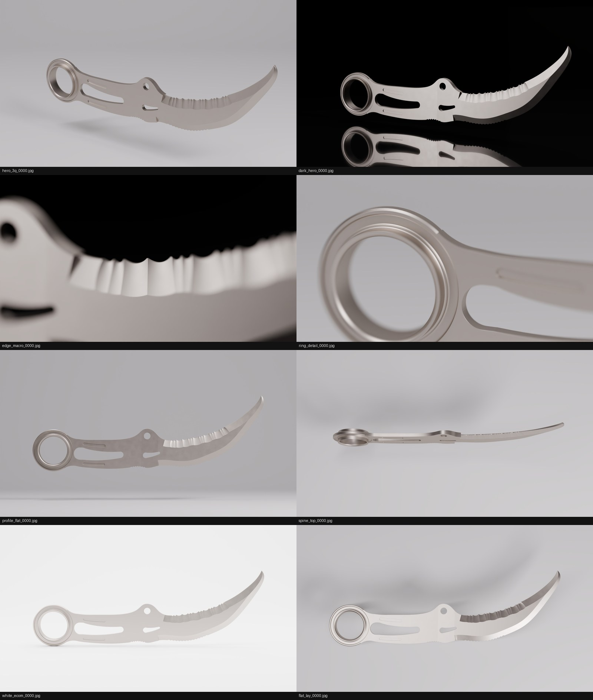

# Look-dev v1: scene, materials, rigs, finishing (lane: Claude, `render/claude-scene`)

Product: SWITCHBACK Rev **C.9.2** titanium hiking/utility karambit. Images are a physically based visualization under stated material assumptions. Ti-6Al-4V appearance is `appearance_assumed` (literature F0/F82). It is not a measured coating.

Contact sheet (1920×1080 each, xbabe1 RTX 4090, OptiX, 512 spp max / 64 min, adaptive 0.02, OIDN denoised copy, AgX + Medium High Contrast). Row by row: `hero_3q`, `dark_hero` / `edge_macro`, `ring_detail` / `profile_flat`, `spine_top` / `white_ecom`, `flat_lay`.

Source: Codex's C.9.2 bundle `~/jarambit_render_scratch/hero_C9.2/mesh` (STEP sha256 `2ad2a8ec…b1c307`, `normal_policy=brep_analytic`, npz `99691975…331a45`), copied to xbabe1/xbabe3 scratch. Regions came from Codex's first pass (`method=brep`, `review: pending`; see open items).

## Measured (QA targets from plan §8)
| ID | What | Result | Target |
|---|---|---|---|
| Q1 | 4K frame, RTX **3090** (xbabe3) OptiX, `turntable` el 15, 6 frames, 512/64 spp, adaptive 0.02, no auto-tile, incl. compositor (OIDN + EXR writes) | **median 54.0 s, p95 59.2 s** (60.7, 50.6, 54.5, 53.3, 53.4, 54.8) | median ≤ 90, p95 ≤ 150 |
| Q1 | same frame with the plan's `final_4k` (adaptive 0.005, 1024/64, auto-tile 2048) | 160 s, mean 1019 spp (adaptive never stops: sub-pixel bead-blast bump) | — |
| Q2 | projection: 240 × 54 s ÷ 2 GPUs | ≈ 1.8 h (projected, not run) | ≤ 4.5 h |
| Q4 | product-mask clip (8-bit display = 255), 8 stills @1080p + 6 4K frames | 0.000 % everywhere | ≤ 0.05 % |
| Q5 | product-mask crush (= 0) | ≤ 0.001 % (dark_hero), else 0 | ≤ 0.5 % |
| Q6 | ColorChecker emission patches → Cycles → EXR → `finish.py` (Standard view) | ΔE2000 mean 0.000, max 0.000 | mean ≤ 2, max ≤ 4 |
| Q6b | `finish.py` AgX path vs Blender's own colour-managed save (HDR ramp 1e-4…64) | max 0.004/255 | ≤ 1/255 |
| Q7 | high-pass residual, flattest 96² body patch, 4K frame 0: denoised / raw | 0.06 % / 3.0 % of mean | ≤ 0.6 % (denoised) |
| Q7 | SSIM raw(512, 0.02) vs raw(1024, 0.005), product bbox, display | 0.992 (denoised: 0.9987) | ≥ 0.97 vs 4096-spp ref (**4096-spp ref not rendered yet**) |
| Q8 | fireflies (> 8× 3×3 median) after denoise, 6 4K frames | 0 | 0 |
| Q8 | static-background luminance flicker over 6 frames | 0.001 % | ≤ 0.8 % |
| Q12 | smoke rerun with `--force`, same plan key | mean abs diff ≤ 1/255 (test asserts) | ≤ 1/255 |

Raw data: `~/jarambit_render_scratch/q1/qa_frames.json` on xbabe3.

**Recommendation for `profiles.json` `final_4k` (Grok):** `adaptive_threshold 0.02, spp_min 64, spp_max 512, auto_tile false`. This keeps 4K resolution and passes Q1 with margin. Do not rely on 0.005: adaptive sampling cannot converge on the 40 µm bead-blast bump, which is smaller than a pixel at 4K (≈ 60 µm/px).

## Conventions (worker)
- World = bundle canonical frame (m, +Z up). This matches Codex's pose decision (COORD 04:38Z): X longest, −Y blade normal, ring left.
- Frame `(az, el)` is the camera direction relative to the part. `az=0` puts the camera on −Y, `az=90` on +X (same as `framing.py`). The worker realises this as a turntable: the part rotates by −az about +Z through the bbox centre, and the camera stays at az 0. Lights, cards, floor and HDRI are world-fixed, so reflections travel. `rigmath.test_turntable_equivalence` proves this is the same projection as orbiting the camera.
- `distance_m: null` triggers a fallback fit (one distance for the whole trajectory, fill ≤ 0.78, margin ≥ 6 %). The farm normally supplies `distance_m` from `framing.py`. `field_mm` (macro) sets distance = field·f/sensor.
- `dof_policy: whole_object` raises the f-stop until CoC ≤ 1.5 px at the near and far extremes of the part (cap f/22). Path tracing has no diffraction, so f/22 is free of it. `fixed` keeps the request f-stop (macros).
- Seeds: `sha256(plan_key:index:seed)` per frame. Raw EXR stays raw (Cycles denoise off). The OIDN copy is made in the compositor with albedo + normal guides.
- Lights are written camera-relative (`az/el/dist_D`, sizes in object diagonals D, power ∝ D²). `aim: mirror` solves the mirror direction of a region's mean normal (optional `normal_filter` up/down/toward_camera, `offset_deg`) and moves the light, never the normals. `CARD` adds black flags / bounces that are invisible to the camera.

## Material notes (plan §3)
Blender 4.2's Principled metal is the F82-tint conductor: base = F0 (0.542, 0.497, 0.449) and specular tint = F82 (0.62, 0.59, 0.56). The plan's "Physical Conductor (F82)" Metallic BSDF node arrived in Blender 4.3, so it is not available on the pinned 4.2 LTS. Finishes follow the plan table: bead-blast with 40 µm Voronoi bump plus mm-scale roughness mottling, satin bevel with anisotropy 0.75 along `finish_tangent` plus 200:1 grind lines, edge apex with Bevel node r = 0.03 mm (8 samples), stonewash, mirror bevel, and thin-film anodize 210/260/290 nm @ IOR 2.4. A 0.12 mm shading-only edge break (Bevel node, 4 samples) on every finish gives the hairline catch-light on machined edges. Nothing moves vertices.

## Rig deviations from plan §4 (why)
- **R1 studio_softbox**: the overhead strip is dropped. HDRI goes 0.35 → 0.10, fill −2.3 → −3.5 EV, exposure −1 EV, and a black flag sits on the flat-face mirror direction. A bevel kicker is mirror-aimed at the up-facing bevel normals. Without the flag the flat Ti faces reflect the bright sweep, and the part reads as matte white plastic (first lookdev: flat 190/255 luma, no bevel contrast).
- **R2 dark_strip**: exposure −4 EV. At 0 EV the strips flooded the bead-blast faces (29 % of product pixels clipped).
- **R3 product_white**: the front dome light is replaced by a black flag on the face mirror direction, exposure −0.3 EV. Otherwise the blade disappears white-on-white.
HDRI: Poly Haven `studio_small_09` 4k (CC0), sha256 `71a876b4…5e39`. The worker searches `$JARAMBIT_HDRI_DIR`, `~/jarambit_render_scratch/hdri`, `ops/render/marketing/hdri`, and fails if the HDRI is missing unless `profile.hdri` is `optional`/`off` (smoke uses `off`).

## Open items
- **Regions (Codex)**: the C.9.2 first pass labels the ring's concentric ridges as `bevel`, finds no `ring`/`edge_apex`, and leaves the blade grind as `body` and the handle as `pad` (gloss 0.12). The look holds because the grind geometry itself catches light. Once regions are reviewed, the satin bevel and edge-apex materials will apply where intended, and the R1 `bevel_kicker` will aim at the real grind. The edge macro uses the label-free `auto:thin_edge` target (vertices within 0.3 mm of the mid-plane).
- 4096-spp reference crop for Q7 SSIM.
- Art review (Q14) is `pending` and needs owner sign-off on this sheet and the full-res frames.
- Old-model lookdev (g3 wave27 STL, `hero_tmp`) is superseded by C.9.2 and kept only in scratch.
